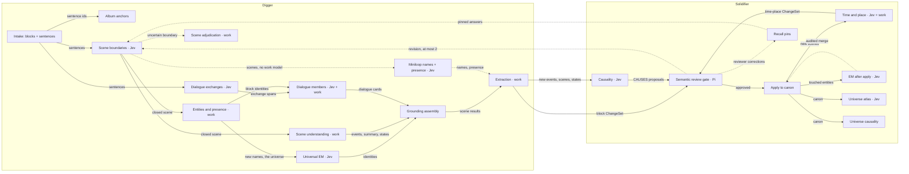

# Faculty flow: the Digger + Solidifier graph

The directed graph of every faculty as the code runs it today, and what the
event log can show of it live. The viewer's Pi console draws this graph
(`apps/playground/src/data/facultyFlow.ts`, which must follow this page) and
lights nodes from `faculty.activity` events. [faculty-graph.md](faculty-graph.md)
keeps the scheduling details of the per-block Digger graph and its history.

## The graph

Solid edges carry context forward; dashed edges are fallbacks and feedback.
The label on an edge is the context the next faculty reads.

Default `novel ingest` (work model configured) runs intake through apply per
block, then entity matching after each applied block; causality is on unless
`--no-causality` and also sweeps old × old pairs when a chapter closes;
time and place runs after apply only with `--time-place`. Without a work model
the miniloop replaces the scene faculties. The other faculties are their own
commands: `novel review` (gate), `novel em`, `novel causality [universe]`,
`novel timeplace run|tree`, `novel atlas`, `novel album`, `novel recall`.

## What each faculty reports

`faculty.activity` names a faculty, a system (`system1` = Jev, `system2` =
work-model fallback, `work`) and a status. System 1 calls are named by their
first question's key prefix, work-model calls by their pool faculty.

| Node | Names in `faculty.activity` |
| --- | --- |
| Scene boundaries | `scene_start`, `scene_end`, `scene_seam`, `scene-boundaries` |
| Scene adjudication | `scene-adjudication` |
| Dialogue exchanges | `dlg_kind`, `dlg_turn` (older runs: `dlg_start`, `dlg_end`), `dialogue-boundaries`, `dialogue-structure` |
| Entities and presence | `entities-participants` |
| Universal EM | `who` (older logs: `birth`, `fragment`) |
| Scene understanding | `scene-understanding` |
| Dialogue members | `dialogue-member`, `dialogue-participants`; legacy scopes: `speaker`, `dialogue-attribution`, `dialogue-adjudication` |
| Miniloop | `newname`, `nick`, `present` |
| Extraction | `extraction` |
| Causality | `causality`, `causal`, `succession` |
| Time and place | `timeplace`, `in`, `entity`, `time_role`, `place_tree`, `strand_presence` |
| EM after apply | `matching`, `same`, `distinct`, `variant` |
| Universe atlas | `atlas` |
| Universe causality | `universe-causality` |

Intake, grounding assembly, the gate, apply, album and recall are not model
calls. They show through `block.started`/`sectioned`, `draft.updated`,
`changeset.*`, `album.anchored` and the Pi command line, not through
`faculty.activity`.

## Gaps found, and what this change closes

Before this change only the per-block scene faculties and `novel causality`
reported calls. Everything else ran dark:

- Inside `novel ingest`, the causality pass, the chapter-close causality sweep,
  time and place after apply, the entity-matching pass and the miniloop (the
  path without a work model) were handed the unobserved Jev client, and
  extraction and the miniloop's name refiner called the work model directly.
- `novel changeset approve` ran entity matching after an approval unobserved.
- `novel timeplace run|tree` and `novel match` wrote no activity at all.
- `novel atlas` and `novel causality universe` work on a library, which had no
  log the viewer reads.

`observeDecisions` and `observeWork` (`src/ground/events/observe.ts`) now wrap
those clients, so every model call made for a novel is one started/finished
pair in its event log. Commands that work across the whole novel report no
`blockId`: the console still shows them, and the orbit plays no block effect
for them.

Library faculties report to `<library>/telemetry/events.jsonl`
(`libraryCallSink`). It holds call telemetry only: the library's own activity
stays derived from committed state ([library-live.md](library-live.md)), and a
lost telemetry line can never hide a decision. `tools/pi-review/library-live.mjs`
reads the newest 1 MiB of it and adds `Library · atlas` and
`Library · universe-causality` to the live faculties, where they light the graph
like a book's faculties.

Two limits stay. Events say which faculty fired, not which upstream output it
read, so the console draws context edges from this graph and animates an edge
when its target fires after its source in the same block; it never claims a
record moved along it. And the reviewer's own reasoning is not a faculty: the
gate shows as busy only through the review status.
