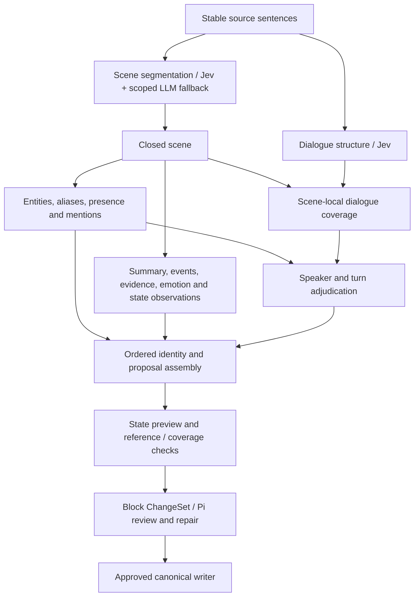

# Streaming faculties and bounded adjudication

## Current dialogue contract

The default work-model path is `dialogueScope: "card"` (CLI:
`NOVEL_DIALOGUE_SCOPE=card`). It detects multi-person exchange spans independently
of scene cuts, discovers source-grounded identities, then asks one independent
membership question per candidate in a shared S1 batch for each exchange.
Uncertain membership gets bounded S1 context widening and one shared S2
adjudication per card. No single winner, per-sentence speaker map, speaker-only
S2 or voice-change split is used on this path. Scene identity/understanding work
still streams; participant resolution waits for its source/candidate dependencies.

Scene `dialogues` store stable card IDs, source spans, `participantIds` and
initially unresolved candidates. Scene-cut fragments share the card ID, and
semantic review deduplicates membership facts across those fragments. Each
member is reviewed independently; holding one does not erase supported members
or source text. Card membership does not infer physical presence, directed
speech, relationships or emotions. The viewer shows all known members and
retrieves the full original exchange across scene fragments on demand.

The portable bundle retains these cards. Rebuild existing disposable graphs
to query `Scene.dialogue_cards_json`; no directed Character edge is generated
from card co-membership. Legacy turns remain readable. The explicit `scene`
and `block-turn` modes below are historical compatibility/benchmark paths, not
the default contract. The no-work-model miniloop remains the legacy path.
Historical text below describes those older modes unless noted otherwise.

PR36 (`feat/em-faculty`, inspected at `4e355eb`) is open and not merged here.
It adds descriptive/fragment alias-at-birth and structural matching; its reported
birth-order and extraction-mint gaps still matter for candidate identity quality.
This change consumes grounded identity declarations and remaps/deduplicates card
members through the existing audited entity merge/removal path. Integrating
PR36 must cover block-level birth resolution as well as scene declarations,
include card memberships in matching evidence without treating co-participants
as the same person, and reconcile post-apply confidence-triggered merges with
this branch's independent semantic gate. It is not safe to silently import that
auto-merge behavior or assume its scores measure dialogue-card accuracy.

Current benchmark: [dialogue-card contract](dialogue-card-benchmark.md).

## Historical single-speaker implementation

Live ingestion with a work model uses `FacultyGraph` by default. The no-work-model
path remains System 1 only. `BlockProcessor` also accepts `facultyGraph: false`
for reference tests. No model call approves or writes canonical records.



## Scheduling and dependencies

Scene segmentation emits its immutable closed prefix as soon as the next
boundary is known. Independent dialogue selection publishes stable spans and a
monotone complete-through watermark, holding back exchanges that future overlap
stitching can still change. Identity and scene understanding start for each
closed scene, without waiting for either pipeline to finish the block. Speaker
work waits only for that scene's identity candidates and dialogue coverage.
Large scenes remain scenes: bounded source chunks are execution units, not new
ontology scene boundaries. Adjacent chunk fragments can reunite when the model
explicitly reports continuation by the same known speaker. Exchange membership
across scene cuts remains available through `dialogueUnitScenes`.

Faculties are functional groupings, not autonomous Pi agents. Understanding
shares one reading call for summaries, events, evidence and observed state
changes. Identity discovery and participant classification share another call.
Parallel model outputs use source names; deterministic, source-ordered assembly
assigns IDs and resolves aliases afterward, preventing completion-order races.
Pi retains long-range identity, temporal and semantic consistency review;
this graph does not invent cross-scene causation from adjacent events.

## System 1 / System 2 routing

- A shared `DecisionRouter` provides local S1 -> bounded wider-context S1 ->
  unresolved-only S2 routing. The router owns retry budgets, concurrency and
  metrics; faculty adapters supply questions and structural validators.
- Unpinned scene choices below 0.85 request scoped LLM adjudication by default.
  If their faculty's context buffer is explicitly enabled, they first retry the
  same question and options with neighboring source context. Only a still-unresolved choice requests
  scoped LLM adjudication. Its result must be an exact offered option and explicitly resolved. Its routing
  confidence is a policy threshold, not a calibrated LLM probability; original
  confidence and the adjudicated choice remain in review notes.
- Dialogue boundary choices can opt into the same shared S1 retry policy at 0.85;
  remaining uncertainty is deferred to scene-local dialogue adjudication and
  Pi review, rather than adding a separate LLM call for every boundary.
- Speaker choices use local name candidates and a 0.8 threshold. Unknowns,
  low-confidence attribution, multiple quote starts, and source quotation
  candidates absent from S1 coverage remain unresolved. For structurally valid
  units, insufficiently confident attribution retries the **same questions,
  candidates and sentence units**, with wider context only. A validated retry
  bypasses S2. Structural defects cannot be repaired by repeating speaker
  questions: their repair belongs to the upstream dialogue-boundary retry or
  S2 adjudication. Such attribution retries are skipped rather than inflating
  the S1 workload with per-sentence reclassification. Quote patterns nominate
  checks, not proof of speech. Neither scene nor dialogue questions change
  granularity during a context retry.
- Entities/participants and scene understanding remain always-on LLM faculties,
  not confidence-triggered fallbacks. Emotion/state observations share the
  understanding call. No S1 approximation of generative summaries is introduced.
- Adjudication can split mixed-speaker spans and recover missed speech. It uses
  sentence endpoints, not character-level speech-fragment offsets. No speaker
  outside the supplied candidate set is accepted. Unknown names remain null
  without dropping an otherwise valid source turn.
- Context-only response rows are excluded from owned output. Invalid identity
  and dialogue rows are noted individually without discarding independent valid
  rows. Invalid understanding chunks are explicitly deferred for review.
  Missing event citations are never replaced with the scene's first sentence
  on the faculty path. Exact reference existence is not semantic entailment.
- Failures, oversized sentences, missing identities and unresolved decisions
  remain explicit review notes. Failed chunks preserve full scene provenance.
  There is no semantic retry-until-pass or automatic approval loop. Independently
  valid S2 rows are retained even when other rows remain unresolved; an unknown
  speaker is not counted as a fully resolved attribution.

`facultyGraph.decisionRouting` configures this policy. Default ingestion enables
the wider-context S1 retry **only for speaker attribution**. Scene and dialogue
boundary widening remain off; their existing S2/review routes are unchanged.
The shared router is retained, rather than creating a separate speaker-specific
execution loop. Override a faculty through `faculties`, for example:

```ts
decisionRouting: {
  faculties: {
    "dialogue-attribution": { enabled: true, contextMargin: 32 },
    "scene-boundaries": { enabled: false },
    "dialogue-boundaries": { enabled: false },
  },
}
```

An explicit top-level `enabled: false` disables every retry, including enabled
faculty overrides; `enabled: true` without overrides enables the historical
all-faculty experiment. Faculty policies can override context margin, state-byte
ceiling, retry count and timeout. Call budget and concurrency remain shared.
Only enabled faculties contribute to the cross-block read-only buffer size.
Default limits are one expanded
attempt, 32 additional neighboring sentences per side, 16,000 UTF-8 bytes of
state, at most 128 retry calls per block, four concurrent S1 retries and a
15-second cancellable retry deadline. Set `enabled: false` for a no-buffer
control, or `maxRetries: 2` for a second, wider bounded attempt. Existing target
text, reviewer constraints and allowed options are never removed to fit a
budget. If no additional context fits, skip the retry rather than repeat the
same request. `BlockProcessor` supplies bounded previous/next-block source
when those blocks are available in its input; neighboring source is read-only
and does not establish canonical identities or events. An online caller without
following source cannot assume this retrospective lookahead is available.

Per-faculty routing metrics are stored under `accepted.decisionRouting` and
the execution review note: processed tasks, initial acceptance/uncertainty,
retry attempts/recoveries, S2 escalations/validated resolutions, unresolved
tasks, failures, skipped retries, stage latency, state bytes and question counts.
Scene/dialogue-boundary denominators are individual choices; attribution
denominators are scene-local execution chunks. Pinned choices are excluded.
Recovery rate is `retryRecovered / retries`; escalation rate is
`escalated / processed`. Do not combine incompatible task denominators or
mistake 35 fallback calls out of 63 LLM calls for an escalation rate. State-byte
counters exclude serialized question schemas and are not token billing figures.
Actual token cost and accuracy require provider usage and independent labels;
higher S1 confidence alone is not evidence of correctness.

The prior 36/38 speaker-attribution score came from an **all-faculty** buffer run,
not this speaker-only default. In that run, boundary retries recovered three
choices, while speaker retries recovered zero of two. The 94.7% result must not
be advertised as measured accuracy of speaker-only widening. This customization
selects a policy; it is not a new isolated accuracy claim.

Scene/dialogue recall pins take precedence. Dialogue boundary pins disable
automatic restructuring of those selected units. Legacy name, presence or
window-numbered speaker pins select the legacy path with an explicit note:
their meaning is not silently changed by moving to scene-scoped execution.

## Context and resource limits

### Opt-in scene-independent turn attribution

`FacultyGraphOptions.dialogueScope: "block-turn"` enables the experimental
decoupled path. Omit it, or use `"scene"`, to retain the current default.
Hosts can pass this through the existing `BlockProcessor` observation option
`facultyGraph`; there is no new CLI flag or automatic rollout.

```text
Original source
  ├─ scene segmentation ──> scene participants / understanding
  ├─ block identity discovery ──────────────────────────┐
  └─ dialogue detection ──> turn-structure repair ───────┤
                                                      v
                  fixed turns + bounded source context + candidates
                                                      |
                  S1 attribution -> context retry -> speaker-only S2
                                                      |
                              join attributed turns to scene spans
                                                      |
                         grounding / pending proposal assembly
```

Turn evidence comes from original source rather than being clipped by scene
boundaries. Available neighboring blocks remain read-only context: they cannot
become turn output or block identity evidence. Structure repair has no identity
output; speaker assignment cannot add or extend dialogue spans. Retry metrics
count turns in this mode, not the default mode's scene-local chunks.

Block identity declarations are registered as pending, source-grounded entity
proposals before scene assembly so attributed speakers are not lost when a
scene's identity response is absent. Every accepted name/alias must occur in
the current block; provenance cites its actual source sentences. Conflicting
existing identity owners/kinds are not fused. Registry membership never implies
physical scene presence. Names remain in the original language/script.

Reviewer constraints accompany decisions. Any reviewer pins retain the original
scene-scoped execution path for that revision, with an explicit review note,
rather than silently changing pinned targets. Invalid/oversized states and
failed structure or speaker work remain unresolved. No target or candidate list
is silently truncated to fit a budget; candidate lists over 250 fail explicitly.
The existing independent Pi review/application gate is unchanged.

This mode deliberately remains opt-in: the bounded real-data experiment needed
an offline assembly correction, spent more tokens, and exhausted its combined
test budget before all non-speaker work completed. It still duplicates some
block/scene identity work and makes per-turn attribution calls. Batching,
budget isolation and a complete live validation are prerequisites to promoting
it to the default. See [the decoupling benchmark](decoupled-faculty-benchmark.md).

All work-model calls share one per-block pool: four concurrent requests by
default, with one slot reserved for adjudication (at concurrency one, all work
uses that slot). Queued adjudication has priority over bulk understanding.
At most four scene jobs remain in flight; the pool accepts at most 256 distinct
calls. Duplicate in-flight requests share one result within a run, keyed by
model, faculty, prompts and output settings. Cache entries never cross runs,
revisions or changed inputs. No persistent cache of private source is added.

Identity and understanding cores contain at most 48 sentences; dialogue cores
at most 24. A bounded neighboring margin supplies continuity. Source listings
are capped at 7,000 UTF-8 bytes for scene work and 5,000 for dialogue work; the
margin shrinks before the core is reduced. A single oversized sentence is
reported unresolved rather than truncated or split at invented offsets.
The combined system/prompt pool ceiling is 24,000 bytes; scene adjudication has
an additional 12,000-byte prompt check. These are conservative byte budgets,
**not exact tokenizer guarantees**. Actual provider token usage is measured in
the live benchmark. Reviewer constraints are included and never silently cut.

Output ceilings are 100 tokens for a scene choice, 1,200 for identities, 1,300
for dialogue and 2,000 for understanding. A 45-second overall call signal is
propagated through the HTTP client, including retries. Request failures are
redacted at the pool boundary. Queue/call timing, input bytes, cache hits and
peak concurrency are available without logging source or credentials.

## Emotion, state and the merge boundary

Understanding proposes source-grounded state observations: emotions, knowledge,
goals, relationships, location and possessions. It must not turn reader-visible
exposition into character knowledge or temporary handling into lasting ownership.
Assembly binds names and originating event IDs before these become state
proposals. The continuity stage derives an explicitly unapproved private state
preview from the latest approved state plus proposed deltas in event order.
The existing additive fold is unchanged: no implicit emotion decay, goal
completion model or permanent-trait inference is introduced.

Grounding checks source partition coverage, turn/source containment, event
references and ordering, and state owner/event/relationship targets. These are
structural checks, not a claim that emotional interpretation is correct.
Only Pi's approved block ChangeSet persists deltas; canonical state remains a
deterministic fold. Parallel workers never invoke store writes.

See [the bounded live comparison](faculty-benchmark.md) for measured quality,
latency, token tradeoffs and remaining errors.
See [the S1 buffer comparison](system1-buffer-benchmark.md) for the opt-in retry
policy's system-wide cost, latency, escalation rates and negative first result.
