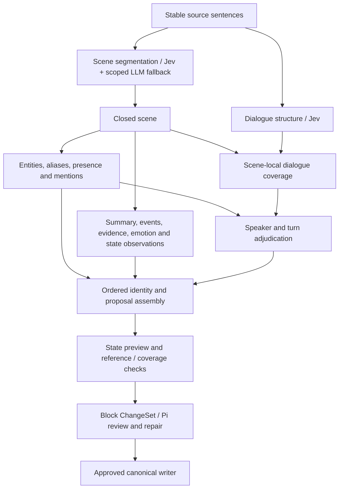

# Streaming faculties and bounded adjudication

Live ingestion with a work model uses `FacultyGraph` by default. The no-work-model
path remains System 1 only. `BlockProcessor` also accepts `facultyGraph: false`
for reference tests. No model call approves or writes canonical records.

## Scheduling and dependencies

Scene segmentation emits its immutable closed prefix as soon as the next
boundary is known. Independent dialogue selection publishes stable spans and a
monotone complete-through watermark, holding back exchanges that future overlap
stitching can still change. Identity and scene understanding start for each
closed scene, without waiting for either pipeline to finish the block. Speaker
work waits only for that scene's identity candidates and dialogue coverage.
Large scenes remain scenes: bounded source chunks are execution units, not new
ontology scene boundaries. Adjacent chunk fragments can reunite when the model
explicitly reports continuation by the same known speaker. Exchange membership
across scene cuts remains available through `dialogueUnitScenes`.

Faculties are functional groupings, not autonomous Pi agents. Understanding
shares one reading call for summaries, events, evidence and observed state
changes. Identity discovery and participant classification share another call.
Parallel model outputs use source names; deterministic, source-ordered assembly
assigns IDs and resolves aliases afterward, preventing completion-order races.
Pi retains long-range identity, temporal and semantic consistency review;
this graph does not invent cross-scene causation from adjacent events.

## System 1 / System 2 routing

- Unpinned scene choices below 0.85 request one scoped LLM adjudication. The
  result must be an exact offered option and explicitly resolved. Its routing
  confidence is a policy threshold, not a calibrated LLM probability; original
  confidence and the adjudicated choice remain in review notes.
- Speaker choices use local name candidates and a 0.8 threshold. Unknowns,
  low-confidence attribution, multiple quote starts, and source quotation
  candidates absent from System 1 coverage route to turn adjudication. Source
  quote patterns nominate checks; they do not decide that text is speech.
- Adjudication can split mixed-speaker spans and recover missed speech. It uses
  sentence endpoints, not character-level speech-fragment offsets. No speaker
  outside the supplied candidate set is accepted. Unknown names remain null
  without dropping an otherwise valid source turn.
- Context-only response rows are excluded from owned output. Invalid identity
  and dialogue rows are noted individually without discarding independent valid
  rows. Invalid understanding chunks are explicitly deferred for review.
  Missing event citations are never replaced with the scene's first sentence
  on the faculty path. Exact reference existence is not semantic entailment.
- Failures, oversized sentences, missing identities and unresolved decisions
  remain explicit review notes. Failed chunks preserve full scene provenance.
  There is no semantic retry-until-pass or automatic approval loop.

Scene/dialogue recall pins take precedence. Dialogue boundary pins disable
automatic restructuring of those selected units. Legacy name, presence or
window-numbered speaker pins select the legacy path with an explicit note:
their meaning is not silently changed by moving to scene-scoped execution.

## Context and resource limits

All work-model calls share one per-block pool: four concurrent requests by
default, with one slot reserved for adjudication (at concurrency one, all work
uses that slot). Queued adjudication has priority over bulk understanding.
At most four scene jobs remain in flight; the pool accepts at most 256 distinct
calls. Duplicate in-flight requests share one result within a run, keyed by
model, faculty, prompts and output settings. Cache entries never cross runs,
revisions or changed inputs. No persistent cache of private source is added.

Identity and understanding cores contain at most 48 sentences; dialogue cores
at most 24. A bounded neighboring margin supplies continuity. Source listings
are capped at 7,000 UTF-8 bytes for scene work and 5,000 for dialogue work; the
margin shrinks before the core is reduced. A single oversized sentence is
reported unresolved rather than truncated or split at invented offsets.
The combined system/prompt pool ceiling is 24,000 bytes; scene adjudication has
an additional 12,000-byte prompt check. These are conservative byte budgets,
**not exact tokenizer guarantees**. Actual provider token usage is measured in
the live benchmark. Reviewer constraints are included and never silently cut.

Output ceilings are 100 tokens for a scene choice, 1,200 for identities, 1,300
for dialogue and 2,000 for understanding. A 45-second overall call signal is
propagated through the HTTP client, including retries. Request failures are
redacted at the pool boundary. Queue/call timing, input bytes, cache hits and
peak concurrency are available without logging source or credentials.

## Emotion, state and the merge boundary

Understanding proposes source-grounded state observations: emotions, knowledge,
goals, relationships, location and possessions. It must not turn reader-visible
exposition into character knowledge or temporary handling into lasting ownership.
Assembly binds names and originating event IDs before these become state
proposals. The continuity stage derives an explicitly unapproved private state
preview from the latest approved state plus proposed deltas in event order.
The existing additive fold is unchanged: no implicit emotion decay, goal
completion model or permanent-trait inference is introduced.

Grounding checks source partition coverage, turn/source containment, event
references and ordering, and state owner/event/relationship targets. These are
structural checks, not a claim that emotional interpretation is correct.
Only Pi's approved block ChangeSet persists deltas; canonical state remains a
deterministic fold. Parallel workers never invoke store writes.

See [the bounded live comparison](faculty-benchmark.md) for measured quality,
latency, token tradeoffs and remaining errors.
