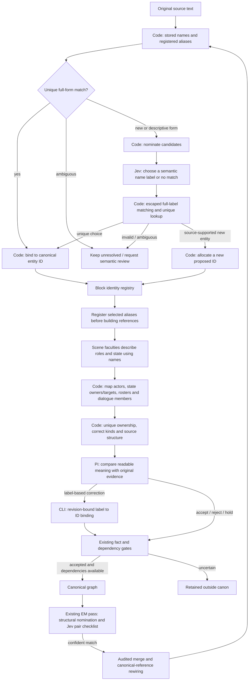

# Semantic identity choices, backend-owned references

Models judge what a name or description means. Code owns entity IDs, exact label
binding, reference typing and propagation. A name resemblance is a candidate,
not evidence that two people are the same. Regex never decides semantic sameness.

## Current flow, including this fix

The diagram's Jev choice branch describes nickname/description/fragment matching.
The separate existing EM pair checklist asks sameness/distinctness questions; it
does not ask Jev to invent a storage ID. Work-model scene understanding and Pi's
independent review remain separate from Jev. Uncertain/new identities still require
source-grounded decisions; deterministic matching does not approve facts.

## Mechanical defects repaired

- The miniloop nickname choice previously offered `char_...` IDs. It now offers
  semantic name labels; the backend maps the chosen label to its existing entity.
- Selected `add_alias` proposals were folded only after actors, state and scene
  references were assembled. They are now registered first, with source evidence,
  so every reference path sees the same identity without minting a nickname clone.
- The old form map used last-write-wins ownership. Multiple owners now remain
  ambiguous; declarations bridging existing people or incompatible kinds cannot
  steal a name. Unknown or ambiguous references are not invented.
- Review pages expose `meaning` alongside the unchanged complete raw value and
  original evidence. Pi can submit `semanticReplacement` using names; a
  revision-bound CLI adapter performs storage binding before existing validation.

## Binding contract

- Full labels are matched literally with escaped, anchored regular expressions;
  superficial width normalization/outer whitespace is allowed. Registered forms
  use the existing language map. Substring/near-name similarity only nominates
  semantic candidates; it never silently merges or binds an identity.
- Known aliases resolve only when uniquely owned. Same-name choices get explicit
  disambiguating labels, not raw IDs. A label suffix is not source evidence.
- Storage IDs remain in bundles, revisions, fact keys and the compatible raw API.
  They are not required as the nickname model's choice or Pi's identity correction.
- Semantic replacements preserve the original field shape. Identity-object edits
  cannot supply IDs; state identity edits cannot move an event anchor or silently
  sum two aliases' relationship deltas. Relation endpoint changes cannot bypass
  their existing evidence workflow through this adapter.
- Correct identity binding does not prove participation, physical presence,
  emotion, ownership or causation. Those judgments retain independent review.

## Boundaries and validation

No existing book or immutable approved proposal packet is migrated by these code
changes. Existing canonical EM merges already rewire events, scenes, dialogue
members, relations and state owner/relationship references. Pending packets whose
canonical context changes must still be freshly reviewed; this change does not
silently rewrite their decisions or infer new merge authority from old Pi edits.

Regression tests cover semantic choices, raw-ID/regex-injection rejection,
same-name ambiguity, early alias propagation across reference types, conflicting
declarations, source preservation, semantic review correction, state-anchor and
causal-workflow boundaries, and stale revisions. They establish implementation
behavior, not a new real-novel accuracy rate.

A read-only compatibility check paged 6,367 facts from 28 applied packets across
three existing workspaces, in 332 bounded pages with no errors. Sixty source,
proposal and ontology file hashes remained unchanged. No paid calls or real-book
mutations were made by that check; the ongoing owner's run was not restarted.
