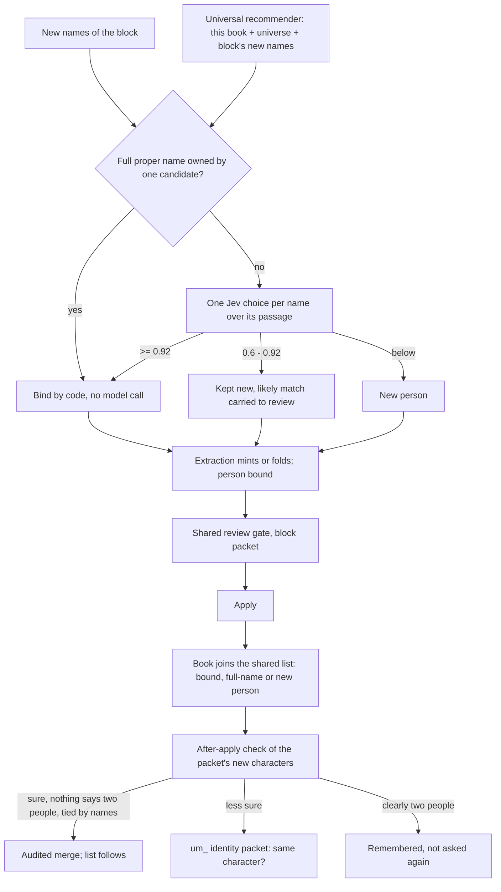

# Universal EM: one character list per universe

Who a character is used to be decided in five places that never saw the same
candidates: extraction's exact name index, a per-scene birth check (only
earlier blocks and the same scene), the review gate (no "same as" answer), a
structural pass after apply (shared scenes only, name pairs skipped) and
`novel match` (name pairs, never run by the checklist). A person introduced in
one block under a full name, a short form and a description in different
scenes became three records; a person met again in a later book became a new
record there.

Universal EM replaces all five with one mechanism built from two inputs:

- **the universal recommender** (`src/solidifier/identity/recommender.ts`):
  for a scene, who it could be, from one pool — this book's characters, the
  people of the universe's other books, and the names extraction just found in
  this block — scored like the cast recommender (named in the scene 1.0,
  nearby scenes, the chapter, the book) plus a small prior for the universe's
  central people;
- **the newly extracted names**: every Character name or description the
  block's faculties declared, with its passage.

## Named buildings and things

The same two systems cover the buildings and large things a book names (`novel stage objects`). At birth, each new name is checked against this book's records of its kind (any Item; any Location for a building, since a named building may already be a place) and the universe's list of things, plus the run's other new names: a full proper name owned by one candidate binds by code; any other name gets one Jev choice (`NEW_THING` for a new one), with the same thresholds. Bare kind words ("大楼", "卡车") never bind by themselves. A likely match below the bind threshold is kept new and shown to the reviewer (`possiblySame`).

The universe's list of things lives beside the character list (`<library>/cast/<universe>.things.json`; `<book>/cast/book.things.json` standalone, `src/solidifier/identity/things.ts`). When a stage-objects packet applies, each reviewed record joins it: one bound at birth to a universe thing (`universalId`) as its member, any other as a new thing. The after-apply pair check (um_ packets) is for characters only so far.

## The shared character list

`src/solidifier/identity/cast.ts`. One list per universe, in the library
(`<library>/cast/<universe>.json`; a standalone book keeps `<book>/cast/book.json`).
A person holds every name form any book reviewed for them and the book records
that are them. Books keep their own records (their graphs need them); identity
lives in the list. A book finds its universe through the host's library
bindings (`NOVEL_CAUSAL_BINDINGS`).

## What binds by itself, and what is asked

- **Full proper names bind automatically**, within a book and across books: a
  record's own name (not a description, title or generic word) or a longer
  form extending it ("林晓" → "林晓月"), when exactly one candidate has it.
  Epithets ("新任会长") and honorific forms ("X小姐", "X长官") are not
  names: they can pass to someone else.
- **Short forms, titles and descriptions are asked**: one Jev choice per name
  over its passage, options = the scene's top candidates + the block's other
  new names + `NEW_PERSON`. Bound at 0.92 or above; between 0.6 and 0.92 kept
  new with its likely match; a name bound to another new name follows it, so a
  block's full name, short form and description become one identity.
- **After apply**, the packet's new characters (every character, for `novel em
  sweep`) are checked against the recommender over the whole book. Candidates
  are ranked by what the names say — the same form, one name inside the other,
  a shared word, or apposition in the text ("名为X的Y", "Y——X", including a
  description's core word) — and the top three per character go to one Jev
  batch (same / two people, with the lines that name both). A pair merges
  automatically only when Jev says same at 0.92 or above, nothing says two
  people (below 0.3), **and** the names tie them (a shared real name, one inside
  the other, or apposition). A match resting on a shared description ("女老师")
  is always reviewed. Clearly two people (0.8 and same below 0.2) is
  remembered and never asked again.

Identity packets (`um_*`) are reviewed through the shared gate:
`--scope universe --universe <id>` at the library, `--scope book` for a
standalone book. Accept makes the two one (audited merge inside a book, one
person in the list across books; later decisions follow earlier merges);
reject remembers them as two people.

## Commands and checklist

- `novel em show <book>`: the book's people, those shared with other books, and
  open identity packets with the exact review command.
- `novel em sweep <book> [--limit N]`: check every character again (also how a
  book processed before universal EM joins the list).
- The checklist's `identities` item (after `blocks`): `todo` while a character
  is outside the list (`novel em sweep`), `review` while a `um_` packet waits.

`novel match`, the structural pass, the chapter-close EM sweep and the
per-scene birth checks are gone.

## Measured (2026-10-28, offline on reviewed data)

Three reviewed volumes of one universe, swept in reading order with Jev (no
extraction re-run): the third volume had seven known duplicate records
(full name / short form / descriptions of four people) found by a hand-read
audit.

| | Before (old EM) | Universal EM |
|---|---|---|
| Duplicates merged automatically | 0 of 7 | 3 of 7 |
| Duplicates raised for review with the right partner | 0 of 7 | 4 of 7 |
| Duplicates missed | 7 of 7 | 0 of 7 |
| People joined across the three books by full name | — | 16 |
| Wrong automatic merges (all three books) | — | 0 of 7 |
| Review items that are not the same person | — | 1 of 7 |

The one wrong review item rests on a shared description, which is exactly why
such matches are reviewed rather than merged. A short form the text never puts
next to its full name, and a person known only by descriptions in different
scenes, still depend on Jev reading the passages; extraction-time EM (the
block's new names together) was not replayed, since that needs a paid
re-extraction.
