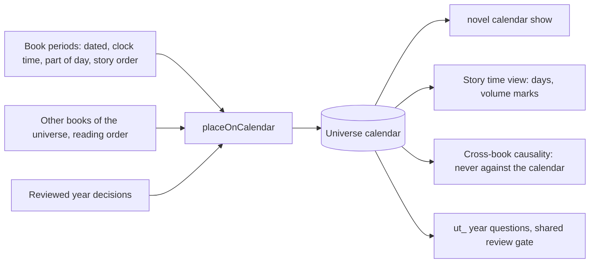

# The universe calendar: one clock per universe

Story time used to be per book: each book's periods had a book-local order,
a date when the text stated one, and nothing joined books. The story view
picked a volume first and listed its periods, so time was subordinate to
volume order — which is not story time (two volumes can tell the same night
from two sides).

The universe calendar makes time a universe-level system, on the same
principle as [universal EM](universal-em.md)'s shared character list: one
calendar per universe, every book's time nodes placed on it, and every
faculty, command and view that involves time reads positions from it.

## Placement

`src/solidifier/calendar/calendar.ts` (`placeOnCalendar`, pure; the CLI, the
after-apply rebuild and the view feed all call it):

- **A dated period** (stated, or derived from stated words such as "the next
  day") sits on its day, at its clock time ("下午三点" → 15:00) or part of the
  day (morning, evening, …), else across the whole day. A late night told
  after an evening of the same date is that night past midnight; so are a
  derived date's small hours ("凌晨0点" after "平安夜" is the next day). A clock
  time is when a period starts: it runs until the book's next period starts,
  at most to the end of its part of the day (15:00 → 17:00 when the next
  period is at 17:00; 18:30 → 21:00 when nothing follows that evening).
- **An undated period** is a range between its dated neighbours in the book's
  story order — never a made-up time.
- **Story time is the reference.** A flashback sits at its own date. The
  calendar never reorders a book's periods against its story order; where a
  stated date contradicts it, the conflict is reported for a look at the text.
- **Books are marks**: each book's span is the range its periods cover.
- **Years nobody states are relative.** Year 1 is the first dated book of a
  continuity; a later book continues the same year while its dates do not go
  back. When they do, a `ut_` packet asks "same year, or a later one?" —
  accept: the same year (another side of the same days); reject: a later
  year; until answered it stays in the same year. A year a book states is kept
  as a label; positions stay relative.

Calendar minutes are ordering keys (31-day months, 12-month years), not real
date arithmetic; `compareOnCalendar` returns before / after / null when two
spans overlap (the calendar cannot order them).

## Storage, commands, checklist

- `<library>/calendar/<universe>.json` (`<book>/calendar/book.json` for a
  standalone book): books with year and span, entries, conflicts, open year
  questions and reviewed decisions.
- Rebuilt after every applied packet that adds story time (no model calls).
- `novel calendar show|build <book>` or `<library> --universe <id>`: days with
  their periods and books, book spans, conflicts, and the year questions'
  review command.
- Checklist `calendar` item (after `time-place`): `todo` when the stored
  calendar is behind the books it reads, `review` while a `ut_` packet waits.

## Who reads the clock

- **Story time view**: the calendar is the axis — a day axis with each book as
  a coloured mark across the days it covers, then day headings with every
  period in clock order (stated time or part of the day, the book's colour, its
  scenes). Choosing a mark or a day glides there; the reading-order ribbon
  stays. Periods still awaiting review are placed too, so the calendar fills in
  live as story time is extracted. A book with no dates falls back to its story
  order.
- **3D story line and strands**: giant pins stand behind the story, one where
  each calendar day's first scene sits in each book's stretch, with the date at
  the pole's foot (a calendar ruler along the floor). Rough marks: strands are
  ordered by who is in each scene, so a pin says "this day starts about here".
- **Cross-book causality**: a pair the calendar orders is nominated only cause
  first (`calendar-order`); each candidate shows both calendar positions for
  the reviewer's temporal reason. Pairs it cannot order stay open both ways.
- Faculties added later read `calendarEntry` / `compareOnCalendar` rather than
  volume or reading order.

## Measured (2026-10-28, three reviewed volumes, no model calls)

All 18 periods of three volumes landed on two calendar days (Year 1, 12-24 →
12-26 past midnight); the first and second volume overlap on the same night,
the third sits inside the second's span. One year question was raised (the
second volume's dates go back from the first's: the same Christmas told from
another side) and one real conflict surfaced (a period dated midnight told
after the evening it precedes).

Live, Pi built the universe calendar and reviewed the year question: same
year, from the second volume opening on the first one's Christmas Eve and
picking up its aftermath. Review of that run fixed the one conflict (the
midnight period was a derived date's small hours, now the next day) and gave
clock-time periods their length.
