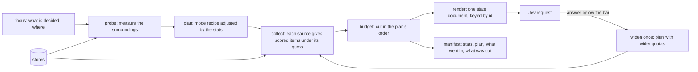

# The context composing engine (design, 2026-10-30)

One engine composes the state of every Jev request in v2, at extraction and in the world loop. It has a mode per kind of
decision, and before composing it measures the surroundings of what is being decided, so that what goes in, and how much,
follows the place in the book and in the world rather than a fixed recipe. Status: **design, for the user's approval.**
Nothing here is built yet.

## 1. Why one engine

Today every step builds its own request:

| Step | Where | What it composes |
|---|---|---|
| Typing | `src/v2/typing.ts` | the batch's sentences, the strings, the types |
| EM | `src/v2/em.ts` | the batch, the strings, three candidates each, the latest facts about them |
| Concept owners | `src/v2/em.ts` (`askOwners`) | the batch, the concepts, the people it names, facts holding them |
| EM² | `src/v2/roles.ts` | a window of the scene, a scored cast, slots, things, concepts, facts, the lines before, descriptions and habits |
| Sentence kinds | `src/digger/autostep/segmentation.ts` | a window of sentences, the kinds |
| World loop | `experiments/world-first/compose.mjs` | prose: who is where, facts, the story so far, the scene before, the scene, the question |
| Movement, buildings, scale | `src/digger/stage/*.ts` | spots, units, pictures |

Each one picks its own window, its own idea of "recent" (reading order), its own budget and cut order. The world loop
still sends prose, against the §1 rule that the state is a document. Nothing records what Jev was shown, so a wrong answer
cannot be traced to a missing fact or a window that was too short. Everything added this week (facts, roles, slots,
habits, crowds, things, concepts and owners, soon the calendar) should reach every decision that it bears on, not only
the step that made it.

## 2. What it is



```ts
compose(mode: ModeName, focus: Focus, stores: Stores, options?: { budget?: number; widen?: boolean })
  => { state: Record<string, unknown>; questions: DecisionQuestion[]; manifest: Manifest }
```

- **Focus:** what is decided and where: sentence ids, a scene id, a world tick, entity ids, strings with their sentences.
- **Stores** (read-only views; the engine never writes): the book's sentences, cards and kinds; the chart (entities,
  names, owners); the fact ledger; EM² roles, references, slots, habits; the scene contexts; the calendar (periods, story
  order); the world state (who is where, since when, the trips); the event log; the stage records (buildings, things,
  motion).
- **Sources** turn a store into items for a focus: each item has an id, a kind, its fields, a score and a cost (its
  characters). A source never decides anything; it ranks.
- **Modes** are recipes: which sources, their default quotas, the order to cut in, how the focus and the questions are
  written, and the answer bar for widening.
- **The probe** measures the surroundings (§3), and the plan is the mode's recipe adjusted by those measurements.
- **Render** follows the §1 rules: definitions once, items keyed by id, labels from one labeller (a person's first proper
  name, a concept with its owner, a slot as "unnamed …"), the decision's part last.
- **Manifest:** the stats, the plan, every item that went in (source, id, score, why) and every item cut. It is kept with
  the request, so the data page can show what Jev saw for any answer.
- **Deterministic:** the same stores and focus give the same document byte for byte, so the cache keeps working and a rerun
  pays only for what changed.

## 3. The probe: the stats of the surroundings

Before composing, the engine looks around the focus (the window, the scene, the scene before, the world at that tick) and
measures. This is code over the stores, with no model calls. Each stat moves the plan:

| Stat | How it is measured | What it changes |
|---|---|---|
| Density | people named in the window; distinct speakers in the last lines; open slots | the cast quota (16 → up to 24); a longer list of answered lines before |
| Kind mix | dialogue / action / narration share of the cards around the focus | more dialogue: more lines before, who spoke to whom; more action: more things, places, world positions |
| Novelty | first appearances in the window; descriptions not yet resolved; names learned in the last batch | more facts holding the new strings; habits of the descriptions; the scene before's cast |
| Ambiguity | the recommender's gap between its top two; the share of unsure answers (below 0.5) so far in this scene | more candidates and their last appearances; four facts per candidate, not two; widen sooner |
| Continuity | same place and time as the scene before (world state, or the cards); a cut to a new place or time | carrying on: the scene before's cards and who stayed; a cut: a one-line summary of it |
| Story time | an open flashback; sentences since the last time anchor; how sure the calendar is (stated, derived, between) | the present period and the flashback's; facts ordered by story time near the focus |
| Evidence | facts about the focus's people (count, how old in story time); habits; owner links | the facts' quota; owners' facts brought in through their concepts |
| Load | characters of the window and of each source | the budget split; the cut order starts earlier |

The stats are kept in the manifest. Over a run they tell which surroundings make Jev unsure (by bucket: dense dialogue,
cuts, flashbacks), so the quotas are tuned from measurements rather than guessed.

## 4. Modes

| Mode | Used by | Focus | Sources (default quota) | Questions |
|---|---|---|---|---|
| `identity` | EM | a batch's strings | passage (the batch), candidates (3 each), facts (2 about each candidate, 2 holding each string), peers | `em:<key>` |
| `ownership` | concept owners | a batch's concepts with no owner | passage, concepts, the people it names (12), facts holding each concept | `own:<concept>` |
| `roles` | EM² | 12 asked sentences of a scene | window (3 before), cast (16 + 6 slots), things (8), concepts with owners, facts (8 people × 2), lines before (4), descriptions with habits | `role:who`, `role:to`, `role:matters`, `ref:` |
| `time` | story time (§2.0.5 of the v2 design) | the time words of a scene | passage, the time words, the current period and its date, an open flashback, the last periods | `time:<key>` |
| `presence` | world loop | a scene | the world (who is where), the story so far, the scene before's cards, the scene, candidates, facts | who is here, where |
| `when` | world loop | a scene | the allowed relations (the laws), periods, the scene before | when, against the scene before |
| `movement` | sim pick loop | an event | units, spots, destinations, positions, things and vehicles there | where each unit goes, which way |
| `dialogue` | later: talking to a character | a person at a tick | what they know (facts about them, their concepts), who they have talked to, where they are | (free answers) |

Today's documents become the first recipes. The `roles` mode starts as exactly what `roles.ts` sends now, so moving it
onto the engine is checked by identical documents (and cache hits) before the probe is allowed to change anything.

## 5. Budget and cutting

A request carries one budget (characters, set under Jev's 32k-token state limit). The plan divides it among the sources by
their quotas. Over budget, the plan's cut order applies. The default order: the oldest story first, then the scene
before's cards, the oldest facts, the least recently placed people, then the middle of a very long scene. The focus and
the questions are never cut. Every cut is written in the manifest.

## 6. Widening

When an answer comes back below the mode's bar (0.5 for roles, 0.6 for EM), the engine may compose once more, only for
those questions, with the plan widened: twice the facts, the scene before in full, more candidates. A second answer is
kept only if it is sure. This is the "re-ask with more context" that the tiling already does with its gates, made general.
It is capped per scene, so cost stays bounded.

## 7. Story time

Once the calendar is wired (§2.0.5 of the v2 design), "recent" means recent in story time: the latest facts before the
focus on the calendar. A fact told in a flashback sorts into the past, and a fact that updates an earlier one comes after
it. Until then, reading order, as now.

## 8. Order of work

1. The engine with the `roles` mode, reproducing today's EM² documents exactly (test: same bytes on vol 1's cache).
2. `identity` and `ownership` on it; the manifest written beside each answer; the data page shows "what Jev saw".
3. The probe and its stats, measured over vol 1 with no plan changes; then plan changes one stat at a time, each checked
   on the page (sure answers by stat bucket).
4. `time`, with the calendar.
5. The world loop's `presence` and `when` as documents instead of prose (compose.mjs retired), then `movement`.

## 9. Open questions

- Which stats should change the plan first: density and kind mix (cheap, likely to help EM²), or ambiguity (directly tied
  to unsure answers)?
- The widening cap: one more request per scene, or per batch?
- The world loop runs scene by scene while extraction runs first: should the engine also give extraction's modes the world
  state once the world loop has run (a second pass of EM² with presence), or keep extraction before the world?
