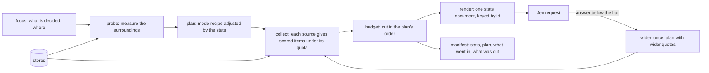

# The context composing engine (design, 2026-10-30)

One engine composes the state of every Jev request in v2, at extraction and in the world loop. It has a mode per kind of
decision, and before composing it measures the surroundings of what is being decided, so that what goes in, and how much,
follows the place in the book and in the world rather than a fixed recipe. Status: **design; the user agreed to most of
it on 2026-10-30 and settled the open questions** (a mixed complexity score, widening per batch, facts by graph query
with retrieval for widening, the world run per strand: §3.1, §6, §7, §9). The core is built first with the place modes
(2026-10-31: [world-model.md](world-model.md) §6, where this engine is layer 3 of the world model's layers); the other
modes move onto it after.

## 1. Why one engine

Today every step builds its own request:

| Step | Where | What it composes |
|---|---|---|
| Typing | `src/v2/typing.ts` | the batch's sentences, the strings, the types |
| EM | `src/v2/em.ts` | the batch, the strings, three candidates each, the latest facts about them |
| Concept owners | `src/v2/em.ts` (`askOwners`) | the batch, the concepts, the people it names, facts holding them |
| EM² | `src/v2/roles.ts` | a window of the scene, a scored cast, slots, things, concepts, facts, the lines before, descriptions and habits |
| Sentence kinds | `src/digger/autostep/segmentation.ts` | a window of sentences, the kinds |
| World loop | `experiments/world-first/compose.mjs` | prose: who is where, facts, the story so far, the scene before, the scene, the question |
| Movement, buildings, scale | `src/digger/stage/*.ts` | spots, units, pictures |

Each one picks its own window, its own idea of "recent" (reading order), its own budget and cut order. The world loop
still sends prose, against the §1 rule that the state is a document. Nothing records what Jev was shown, so a wrong answer
cannot be traced to a missing fact or a window that was too short. Everything added this week (facts, roles, slots,
habits, crowds, things, concepts and owners, soon the calendar) should reach every decision that it bears on, not only
the step that made it.

## 2. What it is



```ts
compose(mode: ModeName, focus: Focus, stores: Stores, options?: { budget?: number; widen?: boolean })
  => { state: Record<string, unknown>; questions: DecisionQuestion[]; manifest: Manifest }
```

- **Focus:** what is decided and where: sentence ids, a scene id, a world tick, entity ids, strings with their sentences.
- **Stores** (read-only views; the engine never writes): the book's sentences, cards and kinds; the chart (entities,
  names, owners); the fact ledger; EM² roles, references, slots, habits; the scene contexts; the calendar (periods, story
  order); the world state (who is where, since when, the trips); the event log; the stage records (buildings, things,
  motion).
- **Sources** turn a store into items for a focus: each item has an id, a kind, its fields, a score and a cost (its
  characters). A source never decides anything; it ranks.
- **Modes** are recipes: which sources, their default quotas, the order to cut in, how the focus and the questions are
  written, and the answer bar for widening.
- **The probe** measures the surroundings (§3), and the plan is the mode's recipe adjusted by those measurements.
- **Render** follows the §1 rules: definitions once, items keyed by id, labels from one labeller (a person's first proper
  name, a concept with its owner, a slot as "unnamed …"), the decision's part last.
- **Manifest:** the stats, the plan, every item that went in (source, id, score, why) and every item cut. It is kept with
  the request, so the data page can show what Jev saw for any answer.
- **Deterministic:** the same stores and focus give the same document byte for byte, so the cache keeps working and a rerun
  pays only for what changed.

## 3. The probe: the stats of the surroundings

Before composing, the engine looks around the focus (the window, the scene, the scene before, the world at that tick) and
measures. This is code over the stores, with no model calls. Each stat moves the plan:

| Stat | How it is measured | What it changes |
|---|---|---|
| Density | people named in the window; distinct speakers in the last lines; open slots | the cast quota (16 → up to 24); a longer list of answered lines before |
| Kind mix | dialogue / action / narration share of the cards around the focus | more dialogue: more lines before, who spoke to whom; more action: more things, places, world positions |
| Novelty | first appearances in the window; descriptions not yet resolved; names learned in the last batch | more facts holding the new strings; habits of the descriptions; the scene before's cast |
| Ambiguity | the recommender's gap between its top two; the share of unsure answers (below 0.5) so far in this scene | more candidates and their last appearances; four facts per candidate, not two; widen sooner |
| Continuity | same place and time as the scene before (world state, or the cards); a cut to a new place or time | carrying on: the scene before's cards and who stayed; a cut: a one-line summary of it |
| Story time | an open flashback; sentences since the last time anchor; how sure the calendar is (stated, derived, between) | the present period and the flashback's; facts ordered by story time near the focus |
| Evidence | facts about the focus's people (count, how old in story time); habits; owner links | the facts' quota; owners' facts brought in through their concepts |
| Load | characters of the window and of each source | the budget split; the cut order starts earlier |

The stats are kept in the manifest. Over a run they tell which surroundings make Jev unsure (by bucket: dense dialogue,
cuts, flashbacks), so the quotas are tuned from measurements rather than guessed.

### 3.1 One score: the complexity of the context (the user's call)

The stats are mixed into one number, the context's complexity, and the plan follows it, rather than one stat at a time.
Each stat is scaled to 0..1:

| Stat | Scaled as |
|---|---|
| density | people in the window / 12, at most 1 |
| dialogue | the share of spoken lines in the window |
| novelty | (first appearances + unresolved descriptions) / 6, at most 1 |
| ambiguity | the share of unsure answers so far in the scene; for EM, 1 minus the gap between the top two candidates |
| cut | 1 when the scene changes place or time from the one before, else 0 |
| story time | 1 in an open flashback, else sentences since the last time anchor / 200, at most 1 |
| evidence gap | 1 minus (facts about the focus's people / 4), at least 0 |
| load | the window's characters / the budget, at most 1 |

complexity = Σ wᵢ·sᵢ / Σ wᵢ. The weights start equal and differ by mode (EM leans on ambiguity and novelty, EM² on
density and dialogue, story time on the time stat). Once there are manifests, the weights are fitted: how well each stat
predicts an unsure answer over vol 1, checked on vol 2. The plan scales every source's quota by 0.75 + 0.75 × complexity (a
simple window gets three quarters of the default, the hardest one and a half times), inside the same budget, and a request
above 0.66 widens on answers below 0.6 instead of 0.5.

## 4. Modes

| Mode | Used by | Focus | Sources (default quota) | Questions |
|---|---|---|---|---|
| `identity` | EM | a batch's strings | passage (the batch), candidates (3 each), facts (2 about each candidate, 2 holding each string), peers | `em:<key>` |
| `ownership` | concept owners | a batch's concepts with no owner | passage, concepts, the people it names (12), facts holding each concept | `own:<concept>` |
| `roles` | EM² | 12 asked sentences of a scene | window (3 before), cast (16 + 6 slots), things (8), concepts with owners, facts (8 people × 2), lines before (4), descriptions with habits | `role:who`, `role:to`, `role:matters`, `ref:` |
| `time` | story time (§2.0.5 of the v2 design) | the time words of a scene | passage, the time words, the current period and its date, an open flashback, the last periods | `time:<key>` |
| `presence` | world loop | a scene | the world (who is where), the story so far, the scene before's cards, the scene, candidates, facts | who is here, where |
| `when` | world loop | a scene | the allowed relations (the laws), periods, the scene before | when, against the scene before |
| `movement` | sim pick loop | an event | units, spots, destinations, positions, things and vehicles there | where each unit goes, which way |
| `dialogue` | later: talking to a character | a person at a tick | what they know (facts about them, their concepts), who they have talked to, where they are | (free answers) |
| `place-parent` | place EM ([world-model.md](world-model.md) §5) | named places the place recommender is unsure of | the place's sentences, facts about it and each candidate, co-mentions, stated pairs, the candidates' addresses, narrative adjacency | `tree:<key>` |
| `setting` | place EM | a scene whose setting is unsure | its environment cards, its opening, the setting before, the candidates' addresses | `setting:<scene>` |
| `place-ref` | place EM | a scene's descriptions that may be a named place | the passage, the scene's address, the candidates with scales, earlier answers for the same words | `place:<key>` |

Today's documents become the first recipes. The `roles` mode starts as exactly what `roles.ts` sends now, so moving it
onto the engine is checked by identical documents (and cache hits) before the probe is allowed to change anything.

## 5. Budget and cutting

A request carries one budget (characters, set under Jev's 32k-token state limit). The plan divides it among the sources by
their quotas. Over budget, the plan's cut order applies. The default order: the oldest story first, then the scene
before's cards, the oldest facts, the least recently placed people, then the middle of a very long scene. The focus and
the questions are never cut. Every cut is written in the manifest.

## 6. Widening

When answers come back below the mode's bar (0.5 for roles, 0.6 for EM), the engine composes once more for the batch
(the user's call: per batch), with only those questions and the plan widened: twice the facts, retrieval (§7), the scene
before in full, more candidates. One widened request per batch at most; a second answer is kept only if it is sure. This
is the "re-ask with more context" that the tiling already does with its gates, made general.

## 7. Facts: graph query first, retrieval for widening (the user's idea)

On the first request, facts come from the graph: the ledger and the chart go into the Ladybug store, a fact linked to
what it is about (by name, by a description, through a concept's owner), and the sources ask it in Cypher (the latest
facts about these people before this point, the facts that name this string, the facts about a concept and its owner), as
`src/ground/ontology/retrieval.ts` does for presence. When a batch widens, retrieval is added: the facts and cards most
similar in meaning to the unsure question's passage, by embedding, which finds what no edge links yet (a fact that
describes someone without naming them). This changes the standing decision of 2026-10-21 (no embeddings until graph
queries fall short) for widening only; the manifest records which facts came by query and which by retrieval, so it shows
whether retrieval made the second answer sure.

## 8. Story time

Once the calendar is wired (§2.0.5 of the v2 design), "recent" means recent in story time: the latest facts before the
focus on the calendar. A fact told in a flashback sorts into the past, and a fact that updates an earlier one comes after
it. Until then, reading order, as now.

## 9. Extraction and the world together, per strand (the user's design)

**Can a later result change an earlier one?** Measured on vol 1 (the things run, no new requests): EM already runs in
reading order, batch by batch, so its answers only use what came before. What reads the whole book is everything after
it, which today runs once EM has finished:

| Result | Changed by text read later | Example |
|---|---|---|
| Card scan (names tagged in sentences) | 27 of 2,853 tags (1%), in 10 of 46 scenes | a person tagged in a sentence before the listing first caught their name |
| EM² speakers and actors | 53 of 2,197 lines (2.4%) | a line given to someone the book names only later |
| EM² descriptions | 34 of 1,225 (2.8%) | 少女 → 食蜂操祈, 那个刺猬头 → 上条当麻, 白色的怪物 → 木原, before they are named |
| Fact links | 8 of 111 | a fact about someone named later |
| Calendar | every undated period | its range ends at the next dated period, which may come much later |

So run scene by scene, about 2–3% of who-is-who would differ from the whole-book reading. Nearly all of these differences
are reveals, where the story names someone it has been describing. Streaming does not hide these; it shows them as the
reader meets them: the girl is an unnamed person until the book says who she is, and then the world records a reveal (the
slot is that person from then on, and back to where she first appeared) rather than silently rewriting the past.

**Decided (the user, 2026-10-31): extraction first, then the world.** Since later text changes what was established
earlier, the whole book's extraction runs to the end before the world engine starts; the two do not run in parallel. The
gate below was the first design and is kept only as the record of it.

**The design:**
- **The gate (first design, not used).** The world engine would take a scene only when three things are done for it: its
  tiling (its block's scenes), its extraction (every listing, typing and EM batch up to the scene's last sentence, in
  order; EM² for the scene), and its sentence kinds.
- **One strand at a time.** A strand is a line of scenes linked by the people in them (the v1 strands: a scene joins the
  strand it shares people with; a new strand starts where it shares no one). The world engine runs each strand on its
  own, scene by scene in narrative order; two strands are never simulated in one world at once, so neither can disturb the
  other.
- **What the user sees.** The strands play live in narrative order, once extraction is done. A small caption shows,
  for a few seconds at each scene, when it takes place (from the calendar: "Year 1 · 12-24 · evening", or "between 12-24
  and 12-25", or "the past" in a flashback).
- **Reveals.** With extraction finished first, the world already knows who the girl is; a reveal stays a record of its own
  on the strand at the scene where the book names her, so the live view can still show the moment the reader learns it.
- **One world, later.** Rendering every strand together in one world, ordered by the calendar, is released only when all
  of the above works and the whole book is read, so nothing it shows can still change.

## 10. Order of work

1. The calendar in the v2 reading (§2.0.5 of the v2 design; built, run on vol 1 on 2026-10-31); the scene time caption
   reads from it.
1a. Terrain before the world (the user's next step after the extraction run): a Jev miniloop with its visual harness
   arranges the vol's terrain, modifying its existing main sites with the manifold method, and from each environment and
   the blocks around it, with the characters there, says where characters spawn.
2. The engine with the `roles` mode, reproducing today's EM² documents exactly (test: same bytes on vol 1's cache).
3. `identity` and `ownership` on it; the manifest written beside each answer; the data page shows "what Jev saw".
4. Facts in the graph (Cypher sources); the probe and the complexity score, measured over vol 1 with equal weights; then
   the weights fitted.
5. Widening per batch, with retrieval.
6. The per-strand world runs after the whole extraction, with the live view and its caption; reveals.
7. The world loop's `presence` and `when` as documents instead of prose (compose.mjs retired), then `movement`.
8. The one-world rendering on the calendar.

## 11. Open questions

- Strands for the live view: from the cards and EM² as each scene passes the gate (cheap, may split a strand that a later
  scene joins), or the v1 strand questions where a borrowed cast links scenes?
- Embeddings for retrieval: which model, and does the index live beside the Ladybug store?
