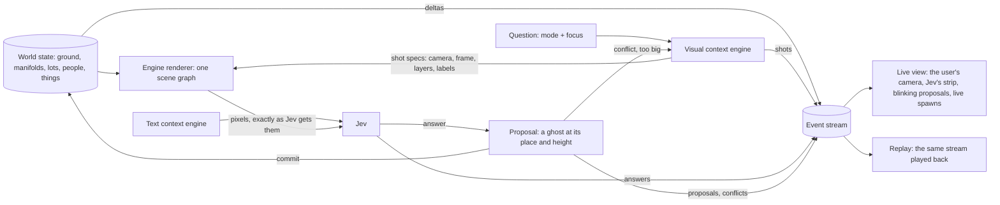

# The visual context engine, debugging by display, and terrain spawning (design, 2026-10-31)

The user's redesign of how Jev sees the world and how we see what Jev does, starting with the spawning department and
its first faculty, terrain. Status: **approved by the user (2026-10-31: step mode, these frames, the basic shapes plus rectangles, spheres and donuts); the live view, the engine page as Jev's player, and terrain spawning are built and were run once on vol 1 (§5.5).** It sits beside the text
context engine ([context-engine.md](context-engine.md)): that one composes what Jev reads, this one what Jev looks at,
and every question gets both.

## 1. The user's three calls

1. **Debugging is the engine's own display.** Whatever Jev is shown in the backend, and wherever its answer puts
   something, is debugged by the user watching the live world engine, interactively. A manifold being placed at a height
   blinks there, in the world, while the buildings it spawns rise underneath it, live. No separate debug pages, no
   reading frames after the fact.
2. **The user's camera is the user's.** It has its own render area and goes anywhere; Jev's views never move it. This
   holds through the whole engine design, not only for debugging.
3. **Spawning is a loop of looks, and the looks come from one engine.** A unified visual input harness for Jev (the
   visual context engine), as the text context engine is for text. Built first for the spawning department; terrain first
   of all: city-grade places one by one, an overview, a zoom when the answer conflicts, then the height on ghost slices;
   terrain-level manifolds and basic shapes only, never a specific building.

## 2. What is wrong today

| Today | The problem |
|---|---|
| Each step draws its own pictures: births a PNG writer (`playground/world-map.mjs`), things the capture loop's ghosts (`two-view-things.mjs`), terrain the landscape mock page (`terrain.mjs`), movement its spots | Four renderers, four ideas of a camera, a scale and a label. What Jev saw is not what the user sees. |
| The live page shows the last question and a picture | The answer's effect on the world is not shown where it happens; a wrong placement is found later, by reading. |
| One camera in the player, moved by "Follow Jev" | The user cannot look elsewhere while Jev works, or look at Jev's view from outside. |
| The engine replays the whole line at every event | Every birth question is recorded again and again (the vol 1 run asked 134 birth questions on the first load and kept repeating them per event). |
| Terrain pictures: outlines of circles (terrain.mjs) | Nearly nothing for Jev to see; its answers leaned on the text alone (holders at 0.23–0.38; "over the middle" every time). |

## 3. The architecture

### 3.1 One renderer, two kinds of camera

- **The engine renderer** is the world page's three.js scene (the streamed world of `apps/playground/src/data/world.ts`,
  the landscapes and their fill, underground, people, things). It runs in two places: headless (the backend, for Jev's
  shots) and in the user's browser (the live view and the replay). Both build the same world from the same state and the
  same deltas, so they draw the same thing.
- **Jev's cameras** render to offscreen targets of a fixed frame (the shot's size), captured as pixels and sent to Jev.
  The same pixels go into the event stream, so the user sees exactly what Jev saw.
- **The user's camera** renders to its own canvas, the main area of every view (live, replay, world, read mode): free
  orbit, fly and walk, anywhere in the world, never moved by Jev. Jev's camera is drawn in the user's world as a frustum
  (a wire pyramid from where Jev looked), and "Look from Jev" is a button that copies it for a moment, not a mode that
  takes the camera away.
- Every view is a camera, a viewport and a set of layers; there is no global camera anywhere in the engine.

### 3.2 The event stream

One typed log a run (`stage/simulation/live/stream.jsonl`, replacing `frames.jsonl`), each line one of:

| Kind | What it carries |
|---|---|
| `shot` | the shot spec (mode, camera, frame, layers, labels and what each means, metres per pixel, how a box reads back into the world) and its picture |
| `ask` | the text context's state, the questions, which shots they are about |
| `answer` | Jev's answers with their distributions, boxes and confidence |
| `proposal` | what the answer would put in the world: a manifold patch (type, centre, radius, height profile, height), or a basic shape, at its place and height |
| `conflict` | why a proposal cannot stand as it is (§5.3), and the zoom it leads to |
| `commit` | the proposal made part of the world |
| `spawn` | the world's deltas as the commit fills in: lots, buildings, roads, halls, with the order they rise in |
| `focus` | the cards of the text Jev is reading for this question (the coloured card stream, the ones it looks at lit) and the scene's time caption |

The live view plays the stream as it is written; the replay plays the same file; nothing else is needed to debug a run.

### 3.3 The live view (debugging by display)

- **Main area:** the user's camera on the world.
- **Proposals blink** in the world at their place and height (a pulse of about one second) until committed; committed
  ground then fills in and the buildings it spawns rise underneath, lot by lot, in the order the fill makes them.
- **Conflicts** are drawn in red where they are (the ancient walls a modern patch would overlap, the outline that is too
  big), with the zoom box they lead to.
- **Jev's strip:** the shots of the current question as Jev got them, its options with their labels, the answer's
  distribution; tapping a shot shows its frustum in the world and its picture full size.
- **The text it read:** the coloured card stream with the cards it is looking at lit, and the scene's time caption as a
  scene comes up (as in the terrain replay page).
- **Step mode** for debugging: the backend waits after each answer until the user steps on (or lets it run), so a
  placement can be looked at from anywhere before the next one changes the world.

## 4. The visual context engine

Like the text context engine: a question comes in with a **mode** and a **focus**; the engine **probes** the surroundings,
**plans** the shots, has the renderer draw them, and returns them with a **manifest**.

- **Focus:** a place, a region (a box in world metres), a height range, the proposal under question.
- **Probe** (code, no model): what is under and around the focus: the ground types and their eras (modern, ancient), the
  heights standing there (lots' floors, roofs, landmarks), the underground halls, how much of the view the focus takes,
  what is placed already, the people there.
- **Plan:** which shots, from where, how large, which layers and labels; the complexity of the view sets how many labels
  and how close the camera goes, the way the text engine's score sets its quotas.
- **Layers** (each on or off per shot): the world as it stands; a *vague background* (the city desaturated and fogged,
  for a sense of space); ghosts (lettered, white, the candidates); slices (a horizontal plane at a height, cutting the
  buildings it meets); intersection lines (red, dotted, where a slice cuts a building); rulers (poles with heights);
  outlines (the places, the manifolds, named); the proposal (blinking in the live view, solid in a shot); the conflict
  (red); a grid with metres.
- **Frames:** an overview is wide, 16:10 like a laptop screenshot (1440×900); a top-down map is square (1024×1024); a zoom
  keeps the aspect of what it zooms into.
- **Manifest:** every label and what it means, the camera, metres per pixel at the focus, and how a box on the picture
  reads back into world metres (the box questions answer in fractions of the picture).
- **Modes**, built in this order: `terrain.overview`, `terrain.zoom`, `terrain.height` (§5); then `birth` (the level,
  then the map), `thing` (the candidates and sky ghosts we have, moved onto the engine), `gather` (where a group stands),
  `move` (destinations off the spots).

## 5. Terrain spawning (the first faculty of the spawning department)

### 5.1 What it may place

Only terrain: a **manifold** (a landscape patch: its type, centre, radius and outline from the type's family, its height
profile; `src/ground/stage/landscape.ts`) or a **basic shape** of ground (a plateau, a basin, a hill, a raised platform, a
cut or a ramp). Never a named or specific building: buildings are what the manifold's fill spawns underneath it.

### 5.2 The order

The volume's city-grade places (the cities the reading names; for vol 1, Academy City) one by one; for each, the parts the
volume mentions that are ground of it (its districts and areas, from the place tree and the terrain holders), in story
order of their first scene. Each part is one loop (§5.3); each commit changes the world the next look sees.

### 5.3 The loop for one part

1. **Overview.** Two shots: the city's skyline, zoomed out, from the side and above (16:10), and the city from straight
   above in 2D (square), each with its parts so far outlined and named. With the text (the text context engine's state:
   the sentences that name the part, its scenes' environment cards, facts), Jev answers a box on the 2D map (where) and a
   choice of ground type (what), with its size read from the box.
2. **Conflict check** (code): the proposal against what is underneath and around:
   - era: a modern patch over ancient ground, or ancient over modern (ancient never overlaps anything);
   - scale: the box far too big or too small for the part's scale (a street's ground the size of a district), or a type
     whose least size the box cannot hold;
   - size against the view: a box that takes most of the overview, where a far-away look cannot place it well.
   With a conflict, or a big box, **zoom**: a new pair of shots of the box with a margin, the conflict drawn in red, and
   the same question again. At most two zooms, then the best answer stands and the conflict is kept in the stream.
3. **Height.** One shot from the side and above of the chosen area: ghost slices of the patch at every height the engine
   has, each lettered with its height, the city vague in the background; where a slice cuts an existing building, a red
   dotted line along the cut. The heights: deep underground (20–110 m down), the subway (12 m down), just under the
   street (0–25 m down), the street (0), raised ground and platforms by floors (3 m each), the roofs standing there, and
   the sky above them. Jev picks a letter (a choice, with each letter's height in the manifest).
4. **Proposal and commit.** The patch blinks at its height in the live view; it commits, its fill spawns live underneath
   (the lots, then the buildings rising), and the next part's overview sees it.

Each step's shots, questions, answers, proposals, conflicts and spawns go to the stream (§3.2): the live view shows them as
they happen, the replay plays them again.

### 5.4 What it keeps

`stage/terrain.json` keeps, per city, its parts' manifolds (type, centre, radius, shape numbers, height) and basic shapes,
with the questions that made them; the engine fills the ground from it, as it fills landscapes now. The holders step of
the current `terrain.mjs` (which site is in which) stays as the first look of a part whose place in the tree is unknown.

### 5.5 First run, vol 1 (2026-10-31) — built and run

`novel sim terrain` on vol 1, watched on the host's play/terrain page: 4 cities (夜晚的都市, 东京西部的学园都市, 纽约,
日本首都), 38 questions, 51 shots, 1.5 minutes (the user let it run on after the first step). Which parts are in which
city: 16 of the 17 districts and streets went to 学园都市 (0.85–0.87 for its districts); 夜晚的都市, a description of the same
city, got the bridge; 纽约 none. What came out: the bridge a platform; 15 parts commercial ground and 第六学区 a park, all at
street level but 通道 (a passage) at the subway's 12 m down; heights were sure (0.94–1 for most).

What is wrong, seen on the pictures:
- **Everything piled in the middle.** Jev boxed nearly every part over the ground already there, one on another, so the
  city is a stack of outlines round its first patch. No rule stopped it: same-era manifolds may overlap, and no zoom was
  triggered (no conflicts at all).
- **Districts the size of streets** (第七学区 180 × 165 m): the size rule was too loose (a district under half its least
  radius), and districts came after the streets inside them (story order), so they spawned almost nothing (1–3 buildings).
- **The map is mostly empty dark ground**, framed on a small city with room to grow; nothing on it says how big the city is
  meant to be.

Next (to be agreed): parts largest first, each district placed in the city and its streets in the district (the holder's
map); a part over another part is a conflict unless the text puts it inside; districts held to a district's size; the
city's intended extent drawn on the map.

## 6. Order of work

1. **The event stream and the live view's skeleton:** the user's own camera and render area, Jev's strip, the frustum,
   the blinking proposal, live spawns from deltas; the replay on the same stream. Tried on the terrain stream we already
   have (converted).
2. **The visual context engine's core in the engine page:** shot specs (camera, frame, layers, labels, manifest) drawn by
   the world renderer headless; the probe; the vague background, slices and red dotted cuts.
3. **Terrain on it:** overview, conflict and zoom, height ghosts, commit; on vol 1's Academy City, watched live.
4. **Births and things move onto it** (and the world-map PNG writer and the landscape mock page retire for questions).
5. **Then the world engine's redesign** for the new extraction (no line replay per event).

## 7. Questions for the user

- Step mode by default for terrain while we debug (the backend waits for you after each answer), or running, with a pause?
- The frames: 1440×900 for overviews and 1024×1024 for maps, or smaller to save Jev's tokens?
- Basic shapes: plateau, basin, hill, platform, cut, ramp. More, or fewer, to start?
- "Overall really big": zoom when the box takes more than a quarter of the overview, or another share?
