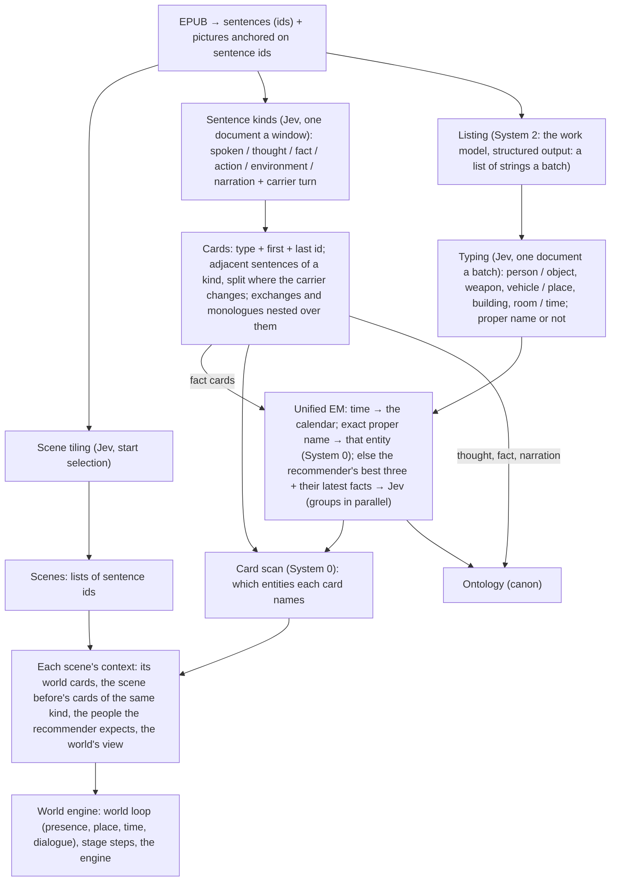

# World engine v2

The world engine is the second version of this CLI: a book is read into a world first (who is where, when, in which
building, above or under the ground), and everything else (dialogue, movement, things, fights, identity) is decided inside
that world. This document is its design going forward. The reader's version, with every feature block built so far, is
[world-engine.html](world-engine.html).

- **Branch:** `v2` on origin. Work lands on it directly, with no pull requests; `main` stays the v1 CLI.
- **Live tests** run from v2 builds (a separate fully built checkout, as before).
- **Earlier designs it builds on:** [world-first-design.md](../world-first-design.md), [underground-design.md](../underground-design.md),
  [stage-simulation-design.md](../stage-simulation-design.md), [places-holo-stage.md](../places-holo-stage.md),
  [city-fill-design.md](../city-fill-design.md).

## 1. The principle: structured input

Jev reads a **state** that can be text, a JSON object or an array. Questions can name parts of it by path, each choice
option can carry its own criterion, and a noul question takes what counts as yes and as no. A request has no limit on its
number of questions, only on its size (64k tokens a request and 32k for the state with one question, Jev 1.14), and
billing is per input token. So the state is paid once a request, however many questions read it.

The rules for every Jev request in v2:

1. **The state is a document.** A JSON object: definitions once (what each kind or option means), items keyed by id (the
   passage's sentences, the place's spots, the candidates, the units), the decision's own part last.
2. **Questions are short and point into it** (`passage.<id>`, `spots`, `candidates.<id>`, `units.<n>`), with a short
   label per option, not its definition repeated.
3. **One request per decision step**, holding every question of that step. Steps that do not depend on each other run at
   once (windows of a block, units of an event, blocks of a book).
4. **Pictures only where the picture is the evidence:** box questions (where a thing stands, where a blast hits, where
   someone starts on a floor, where a group gathers) and the model catalog. What the engine knows as data goes as data.
5. **Chains stay where answers depend on the last one** (event by event inside a scene); fan out where they do not.

Measured on 2026-10-30 (vol 1, Jev 1.14):

| Step | Before | Structured | Notes |
|---|---|---|---|
| Sentence kinds, 300 sentences | 1.1 s, 8 requests (text, definitions in every question) | 0.25 s, 3 requests at once | 86% same kinds; quoted lines now read as spoken, not thought |
| Dialogue exchanges, 300 sentences | 4.1 s, 37 chained requests (start and end selection) | 0.25 s, 3 requests | 14 exchanges both; median 6 → 11 sentences; mostly the same exchanges |
| Movement, 36 events (211 questions per kind) | 22.8 s of Jev on rendered pictures, plus 2–6 s of replay and Chrome reload per event | 4.4 s, no Chrome | confidence in the end spot 0.25 → 0.93 (8 spots); moves agree 91%, way 96% |
| One request per scene (36 events → 4) | — | 0.6 s | far less sure (0.46 against 0.92): the chain of events stays |

A recorded pick of 36 events took 449 s; Jev answered in 28 s of it. The rest was the pick loop replaying the engine from
the line's start and reopening the 3D page in headless Chrome before each event (and a 222 s stretch before the first
event question, not yet accounted for: a full-line load measures about 15 s).

## 2. Extraction (the Digger)

### 2.0 The reading flow (the user's sketch, 2026-10-30) — built

Three systems, as in the sketch: **System 0** is string match (sentence and card scans, exact names), **System 1** is Jev
with a composed context, **System 2** is the main model (the work model for listing; the agent for the review pool).

**The flow, step by step** (`src/v2/`, run with `experiments/v2/read.mjs`):
1. **Sentences.** The book's sentences keep their ids (`b<block>_s<n>`); the album's pictures hang on sentence ids. The
   sentence is the smallest unit of everything after: scenes, cards and appearances are lists of sentence ids.
2. **At once:** scene tiling (the mature start-selection tiler); sentence kinds; listing then typing, batch by batch.
3. **Sentence kinds** (`segmentation.ts`): six kinds, `environment` (a place, the weather, what stands around) new beside
   narration; and for every sentence whether its **carrier** changes (who speaks it, who acts in it, or what it is about).
   **Cards** (`kindCards`): adjacent sentences of one kind are one card, `{kind, first, last}`, a new card where the carrier
   changes. Exchanges (a conversation as long as its people stay, its narration and actions inside) and monologues are
   cards over those runs, nested (`inside`). Dialogue, action and environment cards go to the world engine; thought, fact and
   narration to the ontology.
4. **Listing** (`listing.ts`, System 2): 30 sentences a batch to the work model with fixed instructions and a structured
   output, `{"names": [...]}`: every important person, object, weapon, vehicle, place, building, room and time, as the
   passage writes it. A string the passage does not hold word for word is dropped, and so are pronouns.
5. **Typing** (`typing.ts`, System 1): one structured document a batch (the types once, the sentences by id, the strings by
   key with the sentences that hold them); each string chooses a type, and a noul says whether it is a **proper name**.
6. **Unified EM** (`em.ts`), batch by batch in reading order (the chart grows as it reads):
   - a time goes to the times (EM for times is the calendar's, later);
   - a string that is a proper name already in the chart (the whole chart) is that entity, with no model: its sentences are
     recorded as appearances;
   - otherwise the **recommender** scores the chart's entities of its category: nearness of their appearances before it
     (within 80 sentences, nearer counting more), how often they appear, and the names they share; the best three, and the
     latest facts that name them, go to **Jev** in one structured request per group of 16 strings (a batch's groups in
     parallel). Each string chooses a candidate, another new string of the same batch (two names of one person born together
     find each other), or new. Below 0.6 it is new, its best candidate kept for the world engine's second EM.
   - **A description is not a name** (the one change to the sketch, after the first run): typing's proper-name answer
     decides. A proper name joins the chart's names and matches anywhere; a description or a common word (少女, 那个刺猬头,
     屋顶, 车站) is the entity's name only where EM said it, so it goes to the recommender each time and never tags a sentence
     elsewhere. On the first run the lister's 他 had become 上条当麻's alias, which would have tagged every 他 in the book.
7. **Card scan** (System 0): every card's sentences scanned for the chart's proper names (a longer name masks the shorter
   inside it), plus the appearances EM recorded; each card lists the entities it names and where.
8. **Context** for each scene: its world cards, the scene before's cards of the same kinds in order, the people the
   recommender expects from the last three scenes, and (at run time) the world's view of who is where.
9. **Out:** the data and the run's log as YAML (`docs/v2/schema.yaml` is the schema; `<out>/v2/*.yaml`), the world loop's base
   layer (`<out>/base/`), and with `experiments/v2/workspace.mjs` a world-first workspace whose canon is this reading (scenes,
   entities, events from action cards, who takes part), so the world loop, the stage steps and the engine run on it as they
   are.

**Measured on vol 1, 2026-10-30** (5,202 sentences, Jev 1.14, deepseek-chat; a fraction of a dollar in all):

| Step | Requests | Time |
|---|---|---|
| Scene tiling | 224 Jev | 5.4 s |
| Sentence kinds | 56 Jev | 1.6 s |
| Listing | 177 work model | 3.0 s |
| Typing | 177 Jev | 24.8 s (inside the listing loop) |
| EM | 158 Jev | 14.2 s |
| Card scan | — | 0.1 s |
| **The whole reading** | 552 Jev + 160 work model | **42 s wall** |

46 scenes; 227 exchanges, 337 monologues, 450 action cards, 120 environment cards, 183 facts; 2,231 strings, of which 657
matched a proper name exactly, 569 joined an entity through Jev, 632 were new, 120 were times. The chart: 174 people, 318
things, 140 places, 57 times. Then, on the same reading: the world loop (46 scenes, 332 Jev calls, 40 s); scale (140
places), landscape (27), objects (14 work-model calls, 50 objects), building EM (7 buildings), movement (41 scenes, 615
calls, 16 s, 174 moves); one story line of 46 scenes for the engine.

**EM against the old extraction's people** (vol 1's earlier roster, 31 people): 上条当麻 gathers 上条, 当麻, 阿上, 上条先生
and his descriptions where they were said; 御坂美琴 gathers 美琴, 御坂, 御坂同学, 超电磁炮, 第三位; 食蜂操祈 gathers 食蜂, 蜂蜜色少女,
常盘台的女王. Still apart, for the world engine's second EM: 姐姐大人 (where EM met it before 美琴 was a candidate), 禁书目录 and
茵蒂克丝, 最后之作 and 御坂御坂, 一方通行 and 统括理事长. Many more people than before (174 against 31): one-scene descriptions
(小混混, 追击者) are people of their own, and a description EM was unsure of is a new one each time.

### 2.1 Sentence kinds — built
Every sentence is spoken, thought, fact, action or narration, and for each, whether the people in a conversation change
there (`dlg_kind`, `dlg_turn`). One structured document per 100 sentences (the kinds defined once, the sentences keyed by
id, the 8 before as context), windows asked at once. From the kinds:
- a **dialogue exchange** runs as long as the same people talk, narration and actions between the lines inside it; it
  ends where the people change or after 8 sentences with no one speaking;
- a **monologue** is a run of thought (two asides allowed): a card of its own, its member the one thinking;
- **facts** (background knowledge of the world) go to the changeset's `faculty:facts` note, the base layer's
  `facts.json`, and every later scene's context.

Why sentence kinds came back after 2026-10-22: the retired design joined a sentence to the one before only when it
continued the same speaker's turn with no narration between, so it found turns (median one sentence). The new stitch keeps
an exchange open through narration and replies.

### 2.2 Events as actions and movements — built
The scene prompt asks for what a person does or what physically happens: who goes where and how (walks, runs, climbs,
jumps, falls, flies, enters, leaves, goes up or down, carries someone, fights, strikes, breaks something), saying where
they go when the text does. Speech and thought are no longer events: they are exchanges and monologues.

### 2.3 Things that move — proposed (new)
Vehicles, mechs and other nominated objects become movable things: the objects step lists them per scene with their kind
(vehicle, mech, carried object), they enter the roster beside the characters, and they can join a unit (§4).

### 2.4 Scene tiling — candidate
The same pattern could tile scenes (a noul per sentence: does a new scene start here, in one document per window). The
2026-10-22 note says per-sentence scene starts fragmented scenes; a stitch rule (a start needs a change of place, time or
viewpoint, and a minimum length) must be tested on vol 1 before it replaces start selection.

## 3. The world loop

Built: scene by scene, Jev says who is there and where, and when against the scene before; the world keeps its laws
(nobody vanishes, nobody is in two places at once, a flashback moves nobody now), adds or flags event actors, settles
dialogue nodes (live, group, remote, public), and sends what is unsure to the review pool (Pi). v2 changes:
- **The composed context becomes a document:** `{ world: {person: {at, since}}, facts: [...], story: [...], scene: {...},
  focus: {...} }`, trimmed the same way when over budget.
- **Presence and time in one request** where possible: the time questions for each place option asked at once
  (speculative fan-out), the one for the chosen place kept.
- **Building EM batched per scene:** every building mention of a scene in one request, the book's named buildings in the
  state once by id.

## 4. Movement: units, ways, destinations (the user's design)

Per event, in story order (the chain stays):

1. **Units.** One request: for each person (and each movable thing in the scene), does it move, and who or what it moves
   with as one unit (carrying or carried, dragged, holding on, riding together; chasing or following is not together).
   The units are the joined groups. A unit of one is a person on their own.
2. **Way.** Per unit: which way it goes (up, down, same level, out of the building, into the building; for people with
   powers, the direct directions).
3. **Destination.** Per unit, all at once:
   - a **choice over the place's spots** on the structured state (the place, its spots by id with what each is, where each
     unit stands now, the scene's text, the events so far, this event) when the destination is one of the spots;
   - a **box on that unit's own picture** (its floor slice, its level underground, the map around it) when the
     destination is a room, a roof or a place the spots do not name. A box needs a picture and each unit's picture
     differs, so each such unit is its own request, sent in parallel.
4. **The engine plays the event** with those answers (one destination per unit; its members end beside each other), and
   the world as it stands (each person's spot, from the engine's nodes) is the next event's `now`.

What changes in the pick loop: no Chrome reload and no full-line replay per event for movement. Pictures are drawn only
for box destinations, things and fights. The engine plays forward event by event instead of replaying from the start.

Measured (36 recorded events, 211 person slots): 12 movers in 11 units, 10 with more than one member; the units question
took 3.5 s in all, destinations 0.9 s as parallel requests per unit and 1.0 s as one request. Right: she grabs 食蜂 and
jumps to the rooftop (one unit, one destination); 上条 carrying the girl across the plaza. Wrong: a unit kept after one
member leaves the other behind; a person paired with another name of herself (an EM miss). So: ask the pair question
with criteria for leaving, and settle identities before units.

Today's state: the v1 movement faculty (`novel stage movement`) asks pairs per event and the engine joins them into
groups with a leader; the live picker (`novel sim pick`) does not ask pairs, and treats two people the event names going
to the same spot as together.

## 5. Identity (EM)

Five matchers today: universal EM at birth (per block, the recommender's candidates), universal EM after apply (pairs:
same and distinct), world identity (`identity.mjs`: confident matches merged unless the world has them in two places at
once; epithets), traces alike (two people whose scenes run alike, at a chapter's end), and building EM (`buildings.mjs`).
v2 makes each a structured request:
- **Candidates once, by id:** `{ candidates: {id: {names, where, passages}}, passages: {scene: text}, names: {key: {name,
  aliases, scene}} }`; each name's question is a choice over candidate ids plus `NEW_PERSON`. Descriptions are no longer
  repeated per question, so more candidates fit (beyond today's 12).
- **One request per block** (every scene's names together) instead of one per scene; blocks in parallel.
- **Pairs as a document** (`pairs: [{a, b}]`, each side's dossier once), same and distinct per pair.
- **Units ask after identities**, so one person under two names never makes a unit with herself.

## 6. Live, host and Pi
- The live page shows each request's exact state (a structured state as its JSON) and pictures, folded on the world page.
- `novel sim pick` asks movement on structured states (pictures only for boxes); `novel sim run --pace` plays it.
- Pi runs the commands the guard allows (`sim pick --max-calls ≤ 60`, `sim run --pace 0.5–5`), from v2 builds.

## 7. Order of work
1. Movement on structured states in the pick loop (each person's spot now from the engine); the model catalog's
   one-question calls as one request; time the stretch before the first event question.
2. Units of people, ways and per-unit destinations (spots by choice, boxes for rooms, roofs and underground).
3. Identity as structured requests (at birth and universal); identities before units.
4. Movable things (vehicles, mechs, nominated objects) in the objects step, the roster and units.
5. The world loop's context as a document; presence and time in one request; building EM per scene.
6. Scene tiling test with a stitch rule.
7. The engine playing forward without replays.

## 8. Open questions
- When a destination is a spot choice and when a box: by the unit's way (a floor, a roof, underground → box), or always
  ask both and keep the surer?
- The way's vocabulary: the five ways, or the fourteen cube directions the v1 movement faculty had.
- Jev reads Chinese less well than English (its docs say so): keep confidence gates, and the review pool for what falls
  under them.
