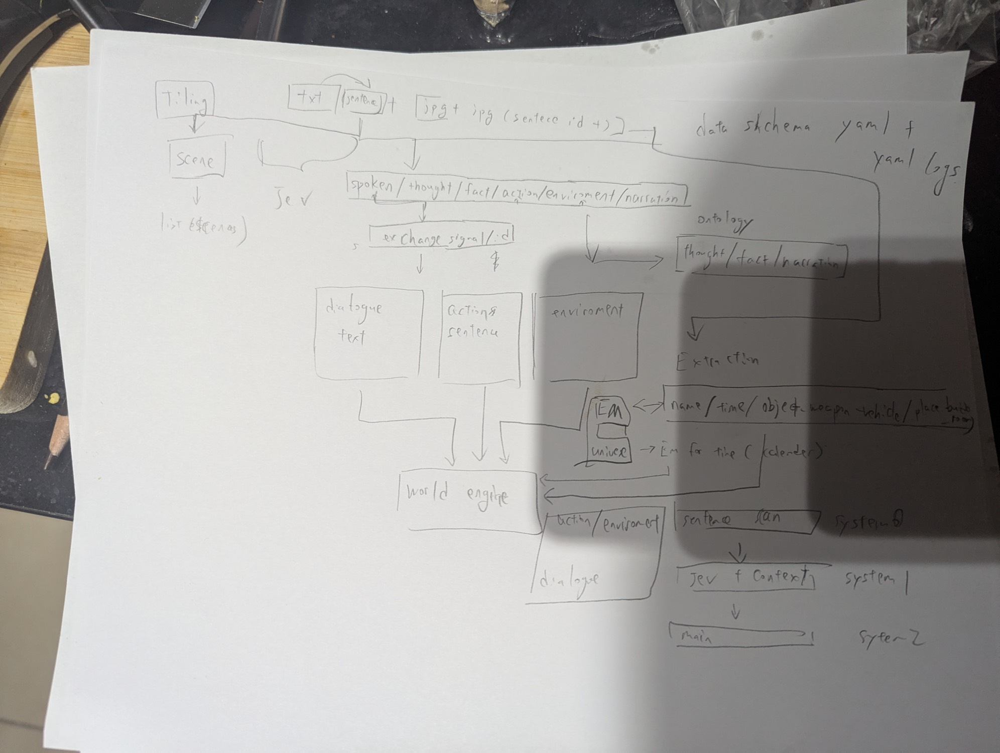
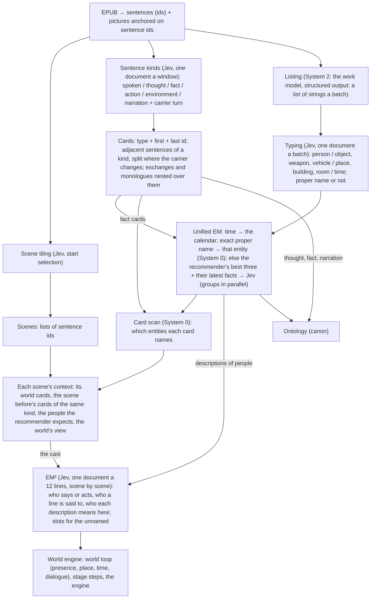

# World engine v2

The world engine is the second version of this CLI: a book is read into a world first (who is where, when, in which
building, above or under the ground), and everything else (dialogue, movement, things, fights, identity) is decided inside
that world. This document is its design going forward. The reader's version, with every feature block built so far, is
[world-engine.html](world-engine.html).

- **Branch:** `v2` on origin. Work lands on it directly, with no pull requests; `main` stays the v1 CLI.
- **Live tests** run from v2 builds (a separate fully built checkout, as before).
- **Earlier designs it builds on:** [world-first-design.md](../world-first-design.md), [underground-design.md](../underground-design.md),
  [stage-simulation-design.md](../stage-simulation-design.md), [places-holo-stage.md](../places-holo-stage.md),
  [city-fill-design.md](../city-fill-design.md).

## 1. The principle: structured input

Jev reads a **state** that can be text, a JSON object or an array. Questions can name parts of it by path, each choice
option can carry its own criterion, and a noul question takes what counts as yes and as no. A request has no limit on its
number of questions, only on its size (64k tokens a request and 32k for the state with one question, Jev 1.14), and
billing is per input token. So the state is paid once a request, however many questions read it.

The rules for every Jev request in v2:

1. **The state is a document.** A JSON object: definitions once (what each kind or option means), items keyed by id (the
   passage's sentences, the place's spots, the candidates, the units), the decision's own part last.
2. **Questions are short and point into it** (`passage.<id>`, `spots`, `candidates.<id>`, `units.<n>`), with a short
   label per option, not its definition repeated.
3. **One request per decision step**, holding every question of that step. Steps that do not depend on each other run at
   once (windows of a block, units of an event, blocks of a book).
4. **Pictures only where the picture is the evidence:** box questions (where a thing stands, where a blast hits, where
   someone starts on a floor, where a group gathers) and the model catalog. What the engine knows as data goes as data.
5. **Chains stay where answers depend on the last one** (event by event inside a scene); fan out where they do not.

Measured on 2026-10-30 (vol 1, Jev 1.14):

| Step | Before | Structured | Notes |
|---|---|---|---|
| Sentence kinds, 300 sentences | 1.1 s, 8 requests (text, definitions in every question) | 0.25 s, 3 requests at once | 86% same kinds; quoted lines now read as spoken, not thought |
| Dialogue exchanges, 300 sentences | 4.1 s, 37 chained requests (start and end selection) | 0.25 s, 3 requests | 14 exchanges both; median 6 → 11 sentences; mostly the same exchanges |
| Movement, 36 events (211 questions per kind) | 22.8 s of Jev on rendered pictures, plus 2–6 s of replay and Chrome reload per event | 4.4 s, no Chrome | confidence in the end spot 0.25 → 0.93 (8 spots); moves agree 91%, way 96% |
| One request per scene (36 events → 4) | — | 0.6 s | far less sure (0.46 against 0.92): the chain of events stays |

A recorded pick of 36 events took 449 s; Jev answered in 28 s of it. The rest was the pick loop replaying the engine from
the line's start and reopening the 3D page in headless Chrome before each event. The long stretch before the first event
question (222 s then) is the line's loads: loading the line in the page is where the world-first engine asks its own
questions (births, meetings, gatherings), one request each on a picture. On vol 1's v2 line (2026-10-30) the first load
asked 232, the model catalog 22 more, and the load after it, with things now drawn as models, asked the 232 again (the
pictures changed, so nothing was reused): about 5 minutes before the first event.

## 2. Extraction (the Digger)

### 2.0 The reading flow (the user's sketch, 2026-10-30) — built

Three systems, as in the sketch: **System 0** is string match (sentence and card scans, exact names), **System 1** is Jev
with a composed context, **System 2** is the main model (the work model for listing; the agent for the review pool).

**The flow, step by step** (`src/v2/`, run with `experiments/v2/read.mjs`):
1. **Sentences.** The book's sentences keep their ids (`b<block>_s<n>`); the album's pictures hang on sentence ids. The
   sentence is the smallest unit of everything after: scenes, cards and appearances are lists of sentence ids.
2. **At once:** scene tiling (the mature start-selection tiler); sentence kinds; listing then typing, batch by batch.
3. **Sentence kinds** (`segmentation.ts`): six kinds, `environment` (a place, the weather, what stands around) new beside
   narration; and for every sentence whether its **carrier** changes (who speaks it, who acts in it, or what it is about).
   **Cards** (`kindCards`): adjacent sentences of one kind are one card, `{kind, first, last}`, a new card where the carrier
   changes. Exchanges (a conversation as long as its people stay, its narration and actions inside) and monologues are
   cards over those runs, nested (`inside`). Dialogue, action and environment cards go to the world engine; thought, fact and
   narration to the ontology.
4. **Listing** (`listing.ts`, System 2): 30 sentences a batch to the work model with fixed instructions and a structured
   output, `{"names": [...]}`: every important person, object, weapon, vehicle, place, building, room and time, as the
   passage writes it. A string the passage does not hold word for word is dropped, and so are pronouns.
5. **Typing** (`typing.ts`, System 1): one structured document a batch (the types once, the sentences by id, the strings by
   key with the sentences that hold them); each string chooses a type, and a noul says whether it is a **proper name**.
6. **Unified EM** (`em.ts`), batch by batch in reading order (the chart grows as it reads):
   - a time goes to the times (EM for times is the calendar's, later);
   - a string that is a proper name already in the chart (the whole chart) is that entity, with no model: its sentences are
     recorded as appearances;
   - otherwise the **recommender** scores the chart's entities of its category: nearness of their appearances before it
     (within 80 sentences, nearer counting more), how often they appear, and the names they share; the best three, and the
     latest facts that name them, go to **Jev** in one structured request per group of 16 strings (a batch's groups in
     parallel). Each string chooses a candidate, another new string of the same batch (two names of one person born together
     find each other), or new. Below 0.6 it is new, its best candidate kept for the world engine's second EM.
   - **A description is not a name** (the one change to the sketch, after the first run): typing's proper-name answer
     decides. A proper name joins the chart's names and matches anywhere. A description of a person (少女, 那个刺猬头,
     姐姐大人) is no one's name at all: it goes to EM² (§2.0.1), which says who it means each time it stands. A thing's or a
     place's description (屋顶, 手机) is its name only where EM said it. On the first run the lister's 他 had become 上条当麻's
     alias, which would have tagged every 他 in the book; on the second, 姐姐大人 had become a person of its own.
7. **Card scan** (System 0): every card's sentences scanned for the chart's proper names (a longer name masks the shorter
   inside it), plus the appearances EM recorded; each card lists the entities it names and where.
8. **Context** for each scene: its world cards, the scene before's cards of the same kinds in order, the people the
   recommender expects from the last three scenes, and (at run time) the world's view of who is where.
9. **EM²** (`roles.ts`, §2.0.1): who says or does each line, who a line is said to, and who each description of a person
   means there. Each card's people are then the ones it names and the ones its lines and descriptions point at
   (`people: [{id, how: [named, speaks, acts, addressed, described], at}]`); an event's actors and an exchange's people
   come from them.
10. **Out:** the data and the run's log as YAML (`docs/v2/schema.yaml` is the schema; `<out>/v2/*.yaml`), the world loop's base
   layer (`<out>/base/`), and with `experiments/v2/workspace.mjs` a world-first workspace whose canon is this reading (scenes,
   entities, events from action cards, who takes part), so the world loop, the stage steps and the engine run on it as they
   are.

**Measured on vol 1, 2026-10-30, before EM²** (5,202 sentences, Jev 1.14, deepseek-chat; a fraction of a dollar in all):

| Step | Requests | Time |
|---|---|---|
| Scene tiling | 224 Jev | 5.4 s |
| Sentence kinds | 56 Jev | 1.6 s |
| Listing | 177 work model | 3.0 s |
| Typing | 177 Jev | 24.8 s (inside the listing loop) |
| EM | 158 Jev | 14.2 s |
| Card scan | — | 0.1 s |
| **The whole reading** | 552 Jev + 160 work model | **42 s wall** |

46 scenes; 227 exchanges, 337 monologues, 450 action cards, 120 environment cards, 183 facts; 2,231 strings, of which 657
matched a proper name exactly, 569 joined an entity through Jev, 632 were new, 120 were times. The chart: 174 people, 318
things, 140 places, 57 times. Then, on the same reading: the world loop (46 scenes, 332 Jev calls, 40 s); scale (140
places), landscape (27), objects (14 work-model calls, 50 objects), building EM (7 buildings), movement (41 scenes, 615
calls, 16 s, 174 moves); one story line of 46 scenes for the engine.

**EM against the old extraction's people** (vol 1's earlier roster, 31 people): 上条当麻 gathers 上条, 当麻, 阿上, 上条先生
and his descriptions where they were said; 御坂美琴 gathers 美琴, 御坂, 御坂同学, 超电磁炮, 第三位; 食蜂操祈 gathers 食蜂, 蜂蜜色少女,
常盘台的女王. Still apart, for the world engine's second EM: 姐姐大人 (where EM met it before 美琴 was a candidate), 禁书目录 and
茵蒂克丝, 最后之作 and 御坂御坂, 一方通行 and 统括理事长. Many more people than before (174 against 31): one-scene descriptions
(小混混, 追击者) are people of their own, and a description EM was unsure of is a new one each time. EM² (below) answers both.

### 2.0.1 EM² — who is this, here (the user's call, 2026-10-30) — built

**Why.** After the first full run, 137 of the 174 people had only descriptions for names (姐姐大人, 少女, 那个刺猬头, 老师), and
the worst was a sink: 姐姐大人 stands in the book's first sentence, before 美琴 is named, so it became a person of its own, and
every later 姐姐大人 joined that person (the recommender ranks a shared name highest). And 1,789 of the 2,419 world sentences
(spoken, action, environment) name no one: their people are 我 and 你 (743 in spoken lines), 他 and 她 (206), or no word at
all. The world engine needs exactly that: who speaks, who acts, who is spoken to. EM answers *which entity is this name*,
once. The new question is *who is this, here*: asked where it stands, because the same words point at different people (少女
is 茵蒂克丝 in one scene and someone else in the next; 姐姐大人 is 美琴 in 白井黑子's lines).

**Two plans were weighed;** the user chose the second:
- A: each vague string (pronoun, description) triggers its own EM, answered per occurrence and never added to the names.
  It misses 我 and 你 and the lines with no word for the person, and a description before any name still has no one to
  point at.
- **B: roles and slots.** Only names enter the chart. Lines and descriptions are resolved against the scene's cast.

**How** (`src/v2/roles.ts`, after the card scan and the contexts; scenes in reading order, a scene's batches in order):
- **Asked:** every spoken and action sentence, and every sentence that holds a description of a person (the descriptions
  typing found, scanned everywhere, a longer name masking the ones inside it: 御坂妹妹 is a name, not 妹妹). 12 asked
  sentences a request; the passage runs from 3 sentences before the first to the last.
- **The cast**, most likely first, at most 16: the people named in the passage, then in the scene, the people already
  placed in the scene, the people a description of the batch has meant before (habits), the world's present people (when
  the engine has them), the scene before's people, the recommender's people; and up to 6 slots of this scene and the one
  before. Each with its other names and its latest fact.
- **The document:** `{task, cast: {id: {name, also, named, fact}}, before: {id: {text, who, to}}, passage: {id: text},
  descriptions: {d1: {text, in, meant}}}`. `before` carries the last answered lines of the previous batch; `meant` is a
  description's habit (御坂美琴 ×5 (in lines of 白井黑子 ×3)).
- **The questions:** `role:who:<id>` (spoken: who says it; action: who acts), `role:to:<id>` (spoken: who it is said to),
  each a choice over the cast, the batch's descriptions (`d1`: whoever it means here), `unnamed` and `none`; `ref:d1` for
  each description, a choice over the cast, `new`, `general` (people in general: 学生 as students at large) and `none`.
- **Answers:** below 0.5 no one is sure (the answer is kept: `answer`, `confidence`). A description that is `new`, or not
  sure, opens a **slot**: an unnamed person of the scene (`slot_<scene>_<n>`), later lines and descriptions can choose it,
  the scene after sees it too. A slot is never anyone's name; the world engine's second EM may join a slot to a person.
  A line that points at a description takes whoever it meant.
- **Habits:** each description that meant a person is counted, with the speaker of the line it stood in; shown with it next
  time (`meant`) and its people put in the cast. A prior, never an exact match.

**Measured on vol 1** (the same reading; tiling, kinds, listing and typing from the cache): EM 154 Jev requests, 17 s; EM²
247 requests, 37 s; 54 s wall, 398 Jev requests paid (the `general` choice cost 244 more on a rerun). The chart now holds
**35 people** (174 before; the old extraction had 31), 318 things, 140 places, 57 times.
- 2,272 lines: 1,561 with a sure speaker or actor; of 1,677 spoken lines, 741 with a sure listener (391 answered no one in
  particular). Unsure answers sit at a median 0.38: often right, but a cast of 16 spreads the odds.
- 692 descriptions where they stand: 401 meant a person, 206 an unnamed one (141 slots), 74 people in general, 11 not a
  person. 姐姐大人 → 御坂美琴 every time (8; three in 白井黑子's lines); 少年 → 上条当麻 37 of 41; 第三位 → 美琴 10 of 10;
  警备员 → 黄泉川爱穗 19 of 24; 克隆人 → 妹妹们 14 of 15; 三色猫 is not a person.
- Read against the text (16 sure answers drawn at random): about 12 right; one wrong person (御坂妹's line given to
  御坂御坂, a name EM split); the rest not decidable from the passage. A wrong one seen in passing: a line whose speaker calls
  themself a Level 0 given to 美琴 at 0.9 (the speaker is 上条).
- Still split, for the second EM: 最后之作 / 御坂御坂 / 最终信号, 茵蒂克丝 / 禁书目录.

### 2.0.2 Facts, the action rule and crowds (the user's notes, 2026-10-30) — built

**Facts are the source of truth for every EM** (`src/v2/facts.ts`). Every fact card is a fact in an ordered ledger
(`fact_000001` …, reading order), so the facts grow as the book does. Who a fact is about: the chart's proper names in it
(rescanned as EM gives people more names, so a fact read before a name was known is found once it is), and the descriptions
EM² resolved in it (`via: description`). Each fact keeps its time (the latest time node at or before it); facts are
ordered by reading order until the calendar places the time nodes, and then a later fact about the same thing (an update)
is ordered by story time. As EM and EM² run, the ledger is asked for the latest facts before the place they decide: for
EM, about each candidate and holding the string itself; for EM², about the first eight of the cast and holding each
description. They go in the document once each, keyed by id, with what they were fetched for (`facts: {fact_000012:
{about: [char_000001, names.n3], text}}`), and the task says to trust them. Each EM result and EM² reference keeps the
fact ids it was given.

**The action rule.** An action is an action or movement by someone or something that matters (a person, a crowd, an
important object, weapon or vehicle, a building or a place), or the story going back in time; something happening in the
background with no one who matters in it is narration. Three places carry it:
- the sentence kinds' definitions say so (action, and narration's "what happens in the background");
- EM² asks of every action who or what acts (the cast, slots, the things and places the passage names, or `time`: the
  story goes back in time), and a noul, whether it matters to the story or is background;
- after EM², an action where nothing acts (`none`, `unnamed`, people in general) or that is background becomes narration
  (`was: action`, and `actor` if something acted); the cards are cut again.
A count of appearances was tried first and dropped: EM had made every cleaning robot of the book one thing, seen in eight
scenes, so the robot passing in scene 1 still counted as important.

**Crowds.** The listing asks for crowds and groups of people who are there; typing has a `crowd` type; a crowd is never a
name (EM keeps it as a description); EM² resolves it where it stands: a person of the cast, a crowd slot (`kind: crowd`),
people in general, or not a person. A crowd can act, be spoken to, and is drawn by the world engine as a group.

**Measured on vol 1** (`~/claude-world-first/v2-vol1-facts`; the listing changed, so everything after the tiling was asked
again: 177 work-model requests, 645 Jev, 87 s; then the matters question, 259 Jev, 43 s):
- Kinds with the new definitions: 425 action cards (450 before), 82 environment (120), 923 narration (841); then the action
  rule turned 31 more actions into narration (the cleaning robot among them). 43 actions have a thing or a place acting.
  No line was answered as going back in time: vol 1 has no flashback the classifier took for an action.
- Facts: 155; 76 are about someone (32 through a description); EM gave facts for 277 of the 878 strings it asked about,
  EM² for 364 of 1,141 descriptions.
- Crowds: 129 crowd slots. 暗部 → a crowd 20 times, people in general 10; 大人 → people in general 21 of 21; 人们 → people in
  general 13, a crowd 4.
- 1,588 of 2,216 lines with a sure speaker or actor; 720 of 1,674 spoken lines with a sure listener (a line is no longer
  said to its own speaker: the next answer is taken).
- 38 people (35 before). New wrong ones from the new listing's typing: 圣诞少女 (舞殿's epithet, typed as a proper name),
  10032号 (御坂妹), 斯芬克斯 (the cat), 停机坪 (a helipad).
- Found: EM for things has the sink EM for people had. A thing's description (机器人, 清扫机器人) is a name only where EM
  said it, but the recommender pulls each new one to the entity that already has it, so every cleaning robot is one thing.
  The same answer as for people fits: a thing's description resolved where it stands, in its scene.

### 2.0.3 Things: only named things, vehicles and weapons (the user's rule, 2026-10-30) — built

The user's answer to the sink above: only important named things, vehicles or weapons count, never everyday things. Vol 1's
chart had 351 things, 283 of them unnamed everyday objects (手机 seen 42 times, the cleaning robots, a plastic bag, bread,
a wall), and only six named objects. Now:
- **typing** has a `routine` type (an everyday thing: a phone, a bag, food, clothes, furniture, a door or a wall, a machine
  at its routine work) with no category, and `object` is an important thing the story names or singles out. The listing
  asks for weapons, vehicles and things with a name of their own, not everyday things.
- **EM**: a thing is an entity only with a name of its own (typing's proper ≥ 0.5): a named object, vehicle or weapon. An
  unnamed vehicle or weapon (那辆车, 手枪) is a description, as a person's is; an unnamed object or an everyday thing is
  `routine`: no entity, never asked, never an actor.
- **EM²** resolves a vehicle's or a weapon's description where it stands: a named one of its type in the passage, an
  unnamed one of the scene or the scene before (a slot, `kind: vehicle | weapon`), vehicles in general, or none. Such a slot
  can act; a spoken line is never said by one. The matters noul and the `none` answer name everyday things as background,
  so an everyday thing acting makes the line narration.
- **The world engine** gets the scene's unnamed vehicles and weapons with its things (an event's `things`, the roster's
  things), apart from the unnamed people and crowds (`extras`).

**Measured on vol 1** (`~/claude-world-first/v2-vol1-things`; the listing and typing changed, so everything after the
tiling was asked again: 177 work-model requests, 602 Jev, 81 s):
- The chart's things went from 351 to 14: 10 named objects (天空之眼, 禁书目录, 圣经 …), 1 named vehicle (锤头鲨), 3 named
  weapons. 145 strings were everyday things (手机, 清扫机器人, 遥控器, 大门, 面包 …), now no entity.
- 40 slots of unnamed vehicles and weapons (20 each: 货车, 救援直升机, VTOL战斗机, 手枪, 暗杀用手枪 …); other descriptions of
  them went to vehicles or weapons in general (无人机, 航母) or to 锤头鲨 (无人追踪车, 警备员的特殊车辆).
- 49 actions became narration (31 before), ten of them holding an everyday thing (the cleaning robot of scene 1, a phone
  showing errors, a door opening). 25 lines have a thing or a place acting (a van, a helicopter, a fighter, a pistol, a
  building), none of them an everyday thing.
- Wrong still: typing took an ability (幻想杀手) and a network (御坂网络) for named objects, and a fist (拳头) for a weapon
  (six slots); a few lines went the wrong way (two people's fists clashing became narration; a TV broadcast was given to the
  fireworks).
- The sentence kinds' definition of an action names everyday things as narration; the run used a longer short label for
  action than the one kept (labels stay under 50 characters).

### 2.0.4 Concepts, and whose they are (the user's call, 2026-10-30) — built, not run

Typing took an ability (幻想杀手) and a network (御坂网络) for named objects. A concept is now one of the options: an
ability, a power, a technique or a spell, a network or a system, a project or a plan, which someone has, uses or runs. The
listing asks for the concepts the story names; typing has `concept`; EM makes a named concept an entity (`concept_…`, its
own category, its candidates only concepts), and a concept with no name of its own is no entity. A concept can be owned:
for the concepts of a batch with no owner yet, one Jev request asks whose each is (the people the passage names, many
people or a group, or no one's), and a sure answer becomes the concept's owner, kept with the sentence it was said from.
Until an owner is known, the question comes back the next time the concept appears. A fact about a concept is about its
owner too: EM and EM² get it among the owner's facts, and the ledger lists the owner (`via: concept`). EM² shows the
concepts of its passage with their owners as context; a concept never acts, its owner does. Canon has the concepts
(`Concept`) and `OWNS` from the owner; the world base has them in its roster.

### 2.0.5 Story time and the calendar — built, not run

**Before (2026-10-30, until this was built), in the v2 reading:** a time word is listed, typed `time`, and EM keeps it as a time node keyed by its exact text,
with the sentences it is in. So 早上 in chapter 1 and 早上 in chapter 5 are one node, and nothing reads its value. A fact's
time is the latest time node at or before it, in reading order. EM² can answer that an action line goes back in time (none
did on vol 1). Nothing decides whether a time word sets the scene's time or is only mentioned, nothing makes story periods,
and canon has no time at all, so `novel calendar build` finds nothing to place: the calendar of the v2 vol 1 workspace has
0 periods (and so does the v1 world-first one).

**In the world loop:** the clock counts scenes. Jev says when each scene is against the one before, among the relations
the laws allow (carrying on, later, the same time elsewhere, a flashback, back to the present), and keeps the time words
the scene names as its time node. That is the only story time the engine has.

**What exists from v1** (the time-place faculty and the calendar, never run on these workspaces): the time lexicon reads
a time word's value (a date, a clock time, a part of the day, "the next day", "three years ago"); Jev gives each time word
that could set a scene's time a role (ADVANCE, FLASHBACK, RETURN, REFERENCE); code makes story periods from them (an anchor
until the next one, a flashback stack, story order, a date derived only from stated words); periods become TimePoints with
scenes OCCURS_DURING them; the calendar places every period of a universe on one clock (Year 1 relative; a stated or
derived day, at its clock time or part of the day; an undated period as a range between dated neighbours; a date that
contradicts story order reported, never reordered).

**The proposal** (for approval, then one vol 1 run to check it):
1. Each time word where it stands, with its value from the lexicon, not one node per text.
2. In EM²'s existing request per batch (no extra requests), a `time:` question per time word of the batch: the four
   roles, with the current period, its date, and an open flashback in the document. Flashbacks then come from time words
   too, not only from action lines.
3. The v1 assembly code makes the periods; canon writes TimePoints and OCCURS_DURING; the calendar is built from them, with
   no model.
4. Each fact's time is its period, and the ledger orders facts by story time on the calendar: the latest facts before a
   decision are the latest in the story, a flashback's facts sort into the past, an update comes after what it updates.
5. Checked on vol 1: the periods with their dates and flashbacks, the conflicts, a time strip per scene on the data page,
   and the world loop's "when" answers against the calendar's order.

**Built** (`src/v2/time.ts`, after the user agreed): as proposed, with one change. The roles are not asked inside EM²'s
requests but in a request of their own per scene with time words to ask about (at most one a scene, plus a continuation
question after a flashback scene), run after EM and before EM². This way EM² already gets its facts ranked by story time.
The request is a structured document: the four roles defined once, the story's time so far (the current anchor, its
date, an open flashback), the sentences around each time word, and the words keyed `t1…`. A strong cue is ADVANCE by rule;
a word in a quote or deep in a scene only mentions a time; Jev's answer goes through v1's floors (an unsure move or an
unsure flashback stays a mention). Each scene gets a caption ("Year 1 · 12-24", "the past: 3 years before", "time not
stated"), each fact its period, and the ledger ranks facts by story order. Canon writes TimePoints and OCCURS_DURING, so
`novel calendar build` works on the workspace; the world base carries each scene's time and caption. The data page
shows the caption at each scene and marks each time word with its role.

`experiments/v2/inspect.mjs` makes one private page of a reading: each scene's text tiled into its cards and coloured by
kind, the names, descriptions and times marked where they stand, each line's people, and under any sentence every record
it is part of (the book's text is in it: never public).

### 2.1 Sentence kinds — built
Every sentence is spoken, thought, fact, action or narration, and for each, whether the people in a conversation change
there (`dlg_kind`, `dlg_turn`). One structured document per 100 sentences (the kinds defined once, the sentences keyed by
id, the 8 before as context), windows asked at once. From the kinds:
- a **dialogue exchange** runs as long as the same people talk, narration and actions between the lines inside it; it
  ends where the people change or after 8 sentences with no one speaking;
- a **monologue** is a run of thought (two asides allowed): a card of its own, its member the one thinking;
- **facts** (background knowledge of the world) go to the changeset's `faculty:facts` note, the base layer's
  `facts.json`, and every later scene's context.

Why sentence kinds came back after 2026-10-22: the retired design joined a sentence to the one before only when it
continued the same speaker's turn with no narration between, so it found turns (median one sentence). The new stitch keeps
an exchange open through narration and replies.

### 2.2 Events as actions and movements — built
The scene prompt asks for what a person does or what physically happens: who goes where and how (walks, runs, climbs,
jumps, falls, flies, enters, leaves, goes up or down, carries someone, fights, strikes, breaks something), saying where
they go when the text does. Speech and thought are no longer events: they are exchanges and monologues.

### 2.3 Things that move — proposed (new)
Vehicles, mechs and other nominated objects become movable things: the objects step lists them per scene with their kind
(vehicle, mech, carried object), they enter the roster beside the characters, and they can join a unit (§4).

### 2.4 Scene tiling — candidate
The same pattern could tile scenes (a noul per sentence: does a new scene start here, in one document per window). The
2026-10-22 note says per-sentence scene starts fragmented scenes; a stitch rule (a start needs a change of place, time or
viewpoint, and a minimum length) must be tested on vol 1 before it replaces start selection.

## 3. The world loop

Built: scene by scene, Jev says who is there and where, and when against the scene before; the world keeps its laws
(nobody vanishes, nobody is in two places at once, a flashback moves nobody now), adds or flags event actors, settles
dialogue nodes (live, group, remote, public), and sends what is unsure to the review pool (Pi). v2 changes:
- **The composed context becomes a document:** `{ world: {person: {at, since}}, facts: [...], story: [...], scene: {...},
  focus: {...} }`, trimmed the same way when over budget.
- **Presence and time in one request** where possible: the time questions for each place option asked at once
  (speculative fan-out), the one for the chosen place kept.
- **Building EM batched per scene:** every building mention of a scene in one request, the book's named buildings in the
  state once by id.

## 4. Movement: units, ways, destinations (the user's design)

Per event, in story order (the chain stays):

1. **Units.** One request: for each person (and each movable thing in the scene), does it move, and who or what it moves
   with as one unit (carrying or carried, dragged, holding on, riding together; chasing or following is not together).
   The units are the joined groups. A unit of one is a person on their own.
2. **Way.** Per unit: which way it goes (up, down, same level, out of the building, into the building; for people with
   powers, the direct directions).
3. **Destination.** Per unit, all at once:
   - a **choice over the place's spots** on the structured state (the place, its spots by id with what each is, where each
     unit stands now, the scene's text, the events so far, this event) when the destination is one of the spots;
   - a **box on that unit's own picture** (its floor slice, its level underground, the map around it) when the
     destination is a room, a roof or a place the spots do not name. A box needs a picture and each unit's picture
     differs, so each such unit is its own request, sent in parallel.
4. **The engine plays the event** with those answers (one destination per unit; its members end beside each other), and
   the world as it stands (each person's spot, from the engine's nodes) is the next event's `now`.

What changes in the pick loop: no Chrome reload and no full-line replay per event for movement. Pictures are drawn only
for box destinations, things and fights. The engine plays forward event by event instead of replaying from the start.

Measured (36 recorded events, 211 person slots): 12 movers in 11 units, 10 with more than one member; the units question
took 3.5 s in all, destinations 0.9 s as parallel requests per unit and 1.0 s as one request. Right: she grabs 食蜂 and
jumps to the rooftop (one unit, one destination); 上条 carrying the girl across the plaza. Wrong: a unit kept after one
member leaves the other behind; a person paired with another name of herself (an EM miss). So: ask the pair question
with criteria for leaving, and settle identities before units.

Today's state: the v1 movement faculty (`novel stage movement`) asks pairs per event and the engine joins them into
groups with a leader; the live picker (`novel sim pick`) does not ask pairs, and treats two people the event names going
to the same spot as together.

## 5. Identity (EM)

Five matchers today: universal EM at birth (per block, the recommender's candidates), universal EM after apply (pairs:
same and distinct), world identity (`identity.mjs`: confident matches merged unless the world has them in two places at
once; epithets), traces alike (two people whose scenes run alike, at a chapter's end), and building EM (`buildings.mjs`).
v2 makes each a structured request:
- **Candidates once, by id:** `{ candidates: {id: {names, where, passages}}, passages: {scene: text}, names: {key: {name,
  aliases, scene}} }`; each name's question is a choice over candidate ids plus `NEW_PERSON`. Descriptions are no longer
  repeated per question, so more candidates fit (beyond today's 12).
- **One request per block** (every scene's names together) instead of one per scene; blocks in parallel.
- **Pairs as a document** (`pairs: [{a, b}]`, each side's dossier once), same and distinct per pair.
- **Units ask after identities**, so one person under two names never makes a unit with herself.

## 6. Live, host and Pi
- The live page shows each request's exact state (a structured state as its JSON) and pictures, folded on the world page.
- `novel sim pick` asks movement on structured states (pictures only for boxes); `novel sim run --pace` plays it.
- Pi runs the commands the guard allows (`sim pick --max-calls ≤ 60`, `sim run --pace 0.5–5`), from v2 builds.

## 7. Order of work
0. **Done 2026-10-30:** the reading flow of the sketch (§2.0), on vol 1 end to end into the engine; the model catalog in one
   request per theme (21 things: 0.42 s, 17 of 21 the same as one request each); the stretch before the first event
   explained (the line's loads, above). Then EM² (§2.0.1): roles and slots, on vol 1 (35 people; 1,561 of 2,272 lines
   with a sure speaker or actor), and the reading's data page. Then the fact ledger as the evidence of both EMs, the action
   rule, and crowds (§2.0.2). Then things: only named things, vehicles and weapons (§2.0.3). Then concepts and their
   owners (§2.0.4, not run yet); the calendar's proposal (§2.0.5) and the context composing engine's design
   ([context-engine.md](context-engine.md)), both for approval. Not yet run through the world engine.
1. Movement on structured states in the pick loop (each person's spot now from the engine); births and meetings of the
   line's load as structured requests too (one per scene, not one per person on a picture), and kept across the reload
   after models.
2. Units of people, ways and per-unit destinations (spots by choice, boxes for rooms, roofs and underground).
3. Identity as structured requests (at birth and universal); identities before units.
4. Movable things (vehicles, mechs, nominated objects) in the objects step, the roster and units.
5. The world loop's context as a document; presence and time in one request; building EM per scene.
6. Scene tiling test with a stitch rule.
7. The engine playing forward without replays.

## 8. Open questions
- When a destination is a spot choice and when a box: by the unit's way (a floor, a roof, underground → box), or always
  ask both and keep the surer?
- The way's vocabulary: the five ways, or the fourteen cube directions the v1 movement faculty had.
- Jev reads Chinese less well than English (its docs say so): keep confidence gates, and the review pool for what falls
  under them.
