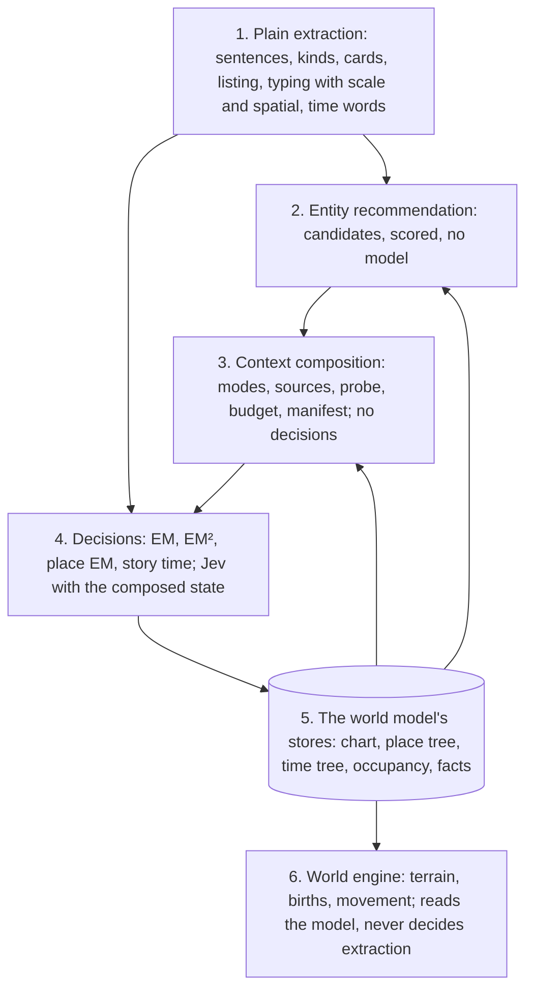

# The world model, its laws, and the engineering layers (design, 2026-10-31)

The user's frame (2026-10-31), written down so every part of v2 is built against it: a novel's world is **spacetime**
(places and times) and **matter** (people, crowds, things, vehicles, weapons) in it, tied together by **spatial
relations**. Places and matter obey different laws, so they are different kinds of entity in every system: places are
spacetime itself (a tree), matter moves through it (a graph). The systems that read a novel into this model (plain
extraction, entity recommendation, the context engine, EM and EM², the world engine) are separate layers, each with its
own job and interface, each supporting the others and none doing another's work. Status: **design for review; the place
layer (§4–§6) is built against it** (`placeRecommend.ts`, `readingGraph.ts`, `context/`, `placeEm.ts`; EM² no longer asks
about places) and run on vol 1 with Jev (§8).

## 1. The world model

| Kind | What it is | Its shape | Examples |
|---|---|---|---|
| **Place** (spacetime) | where things can be; it never moves | a **tree** by containment, graded by scale | 日本 › 东京都 › 东京西部的学园都市 › 第七学区 › 公寓 › 房间 |
| **Time** (spacetime) | when things are | an **ordered tree** (story › year › day › part of day; the past), its children in story order | Year 1 › 12-24 › 00:00 (`time.ts`) |
| **Matter** (movables) | what is somewhere at some time and can move | a **graph** of relations, no shape imposed | 上条当麻, 御坂美琴, a crowd of officers, a car, a mech |
| **Spatial relation** (the middle layer) | that a movable is at a place at a time, and how | a **relation** matter × place × time (× level) | 美琴 is on the roof of a five-storey building in 第七学区 at 12-24 00:00 |
| Concept | abstract, owned by matter | no place, no time of its own | 幻想杀手 (上条's) |

The middle layer is what was new this week: 地面, 地下, 屋顶, 走廊 are not places but the level a movable stands at inside a
place (`spatial.ts`). A scene's setting is the coarse spatial relation (everyone present is at the scene's place at the
scene's time); spatial words refine it; later, movement (arrives, leaves, goes up to the roof) is a change of it. This
model is general: nothing in it is particular to this book.

## 2. The laws

### 2.1 Places are a tree (the containment matrix)

Let the book name n places, and let C be their containment matrix: C[i][j] = 1 when place j directly holds place i.
Joining the places at the top (the roots) under one virtual root, the story's world, makes one tree; its undirected
adjacency A = C + Cᵀ then has the tree's laws:

| Law | In the matrix | What the system does with it |
|---|---|---|
| One parent each | every row of C has exactly one 1, but the roots' rows, which have none | a place's parent is **one choice** from candidates, never a set of relations |
| As many links as places, less the roots | C has n − r ones; A has 2(n − r), symmetric, zero diagonal | the tree is checked by counting: a missing parent is a root, an extra one is an error |
| No loops | C is nilpotent: Cᵏ = 0 past the tree's depth | a parent that would close a loop is never taken |
| Graded by scale | C[i][j] = 1 only if scale(j) > scale(i): region › city › district › street › building › room (a region may hold a region, a building a building) | candidates for a parent are only places larger than it; this alone cuts most options |
| Leaves exist | every tree of more than one place has at least two leaves; rooms and buildings are the leaves | unnamed places (EM² slots) are leaves under a named place |
| One address | the path from a place to the root is unique | "where" is an address (region › … › room); two places relate through their lowest common ancestor |
| Bipartite by depth | the tree is two-coloured by depth parity | (not used yet) |

### 2.2 Matter is a graph

Relations among movables (knows, speaks to, owns, fights, rides) are a general graph: any number of links, loops allowed,
nothing graded. Identity (who a name or a description is) is a matching of mentions to entities, many mentions to one
entity. Nothing about the tree's laws holds here, which is why the systems that decide matter cannot be reused as they are
for places, and the reverse.

### 2.3 Spatial relations: the occupancy matrix

For each time node t, let O(t) be the occupancy matrix, movables × places: O(t)[m][p] = 1 when movable m is at place p.
**Occupancy is the world engine's** (the user's call, 2026-10-31): its scene continuity holds it (everyone stays where they
were until something moves them). What extraction gives is evidence (a scene's setting, a spatial word tied to who it is
about), which interrupts or corrects the engine's occupancy at the step it comes in; place EM writes that evidence
(`occupancy`, by setting or by spatial word), never the matrix itself.

| Law | In the matrix | What the system does with it |
|---|---|---|
| One place at a time | every row of O(t) has at most one 1 | a person present in a scene is at the scene's setting; a second place needs a move |
| Being somewhere is being in its ancestors | O(t)[m][p] = 1 implies m is in every place on p's address | a question about where m is only asks the finest place |
| Change is movement | a row that differs between t and the next time node is a move (a trip) | the world engine's movement is the change of this matrix, not a new fact |
| Level within a place | a spatial word gives the level inside p (underground, street, inside, roof, wall, sky) | the engine's height slices; births and moves read it |

### 2.4 Time is an ordered tree

The time tree (`time.ts`: story › year › season › day › part of day, and the past as a branch of its own) has the place
tree's laws, by level instead of scale: one parent each, n − r links, no loop, graded (a part of day in a day, a day in a
year). It is also **ordered** (the user's call, 2026-10-31): a node's children stand in story order, so the tree is a plane
tree whose left-to-right order of scenes is the story's order; reading order may differ from it (a flashback sits in the
past branch; a scene told later can come earlier on the tree). Where the story goes back on the tree without a flashback,
the order law is broken, and `time.ts` records it (`treeConflicts`).

## 3. The engineering layers

| Layer | Its one job | It may use | It never |
|---|---|---|---|
| 1. Plain extraction | turn text into mentions: kinds, cards, strings typed (with a place's scale; spatial words as such), time words | the work model (listing), Jev (kinds, typing) | decide who or where anything is |
| 2. Entity recommendation | rank candidates for a decision: who a name may be, which place holds a place, which place a description means | the stores, by code | call a model, decide, or write |
| 3. Context composition | compose the state document a decision is asked on: evidence ranked and cut to a budget, with a manifest of what went in | the stores, the recommender's candidates, by code | decide, or call Jev itself |
| 4. Decisions | ask Jev the question, accept or not by rule, write the result into the stores | layers 2 and 3 through their interfaces; Jev | compose its own evidence, or reach into another decision's internals |
| 5. Stores (the world model) | hold what was decided: the chart (matter), the place tree, the time tree, occupancy, the fact ledger | — | change on its own |
| 6. World engine | build and run the world from the model: terrain, births, movement, the live view | the stores, its own visual context engine, Jev | redo an extraction decision |

**Matter and places are separate kinds in layers 2–4**, because the laws differ: the matter recommender ranks by nearness,
frequency and shared names (`em.ts` `recommend`); the place recommender ranks parents of a graded tree (§4). EM decides
matter's identities and EM² who a description of a person, crowd, vehicle or weapon is; **place EM** decides places: the
tree, what an unnamed place description means, and each scene's setting (§5). Spatial relations are written by place EM
(settings) and by code from spatial words (`spatial.ts`).

Each layer is tested alone with fixtures: a recommender test needs no model, a context test checks the document byte for
byte, a decision test runs on a mock Jev.

## 4. The place recommender (layer 2)

Code over the stores, no model call. It answers three kinds of question, each with candidates scored by evidence:

**Parent of a named place.** Candidates: every named place larger than it (the graded law). Evidence, each a score:

| Evidence | Weight | Example |
|---|---|---|
| name inside a name | 3 | 学园都市第七学区 holds 学园都市 |
| stated right before it (X的Y, X，Y, XY) | 2 each time | a city named, then a district of it, in one breath |
| named in the same sentence | 0.5 each | |
| set in the same scene's environment cards | 0.5 each | |
| narrative adjacency: scenes set in it sit next to scenes set in the candidate | 0.25 each | a scene in 第七学区 right after one in 学园都市 |
| facts about both (the ledger's `about`) | 1 each | a fact that names both |
| scale distance | +0.3 for the next scale up; weak evidence (sentence, setting, adjacency, facts) halved three levels up or more | a district's city before its region; a school's country far below its city |

A candidate must be larger (the graded law). The text's own word outranks typing at equal scale: a place whose name holds
the other's, or that the text states right before it, is a candidate even when typing gave both the same scale (东京都 and
东京西部的学园都市, both typed cities); the tree then raises the parent (§5). A smaller place never is.

**What a place description means** (街上, 大楼, 这座城市, 便利店). Candidates: a named place on the scene's address of a
compatible scale (这座城市 → the city on the address), an unnamed place of this scene or the one before with the same
words, or a new unnamed place. **The recommender learns** (the user's call, 2026-10-31), as EM²'s habits do for people:
what the same words have meant is a prior (这座城市 has meant 东京西部的学园都市 three times), and words Jev has given one
named place twice, and nothing else, are taken by rule from then on, with no question (`habits` in the result).

**A scene's setting.** Candidates: the named places its environment cards name (deepest first), its action cards name,
it names at all, the setting before it; then an unnamed building or room its environment names.

Each answer carries its candidates, their scores and the evidence behind each score, which the context engine shows Jev
and the manifest keeps.

## 5. Place EM (layer 4): replacing EM²'s place questions

**Why.** EM² asked about places inside its people requests: two questions per place description (`ref:` which place it
means, `within:` which named place holds it), about 546 questions on vol 1 for 273 descriptions, with every named place of
the passage offered whatever its scale, and no recommender behind the options. It made 106 unnamed places, 54 of them held
by nothing, and found only 40 descriptions meaning a named place. The tree's laws make most of that work unnecessary: a
place needs one parent from a few larger candidates, and most descriptions are a building or a room in the scene's own
setting.

**The flow,** after EM (named places, with their scale from typing) and EM² (now people, crowds, vehicles and weapons only):
1. **The tree.** For each named place, the recommender's parents. A parent is taken without Jev when the best has name or
   stated evidence and leads the second by a clear margin (score ≥ 2 and twice the second); the rest go to Jev in one
   request (mode `place-parent`), each with its top four and none. The tree is assembled surest first, under the laws:
   no loops, graded, one parent each; the counts are checked (n − r links).
2. **Settings.** Each scene's place by the recommender's tiers (environment, action, named; carried on where nothing is
   named; deeper where the scene sets a place under it). Jev (mode `setting`) only where the scene's environment names
   places on two branches of the tree, or nothing is named and the time tree says the scene does not go on.
3. **Unnamed place descriptions,** scene by scene, by rule first: the same words as an unnamed place of this scene or the
   one before are that place; words that name a named place (第七学区的便利店) are held by it; a building, room or street is a
   new unnamed place held by the scene's setting (the deepest place on its address larger than it). Jev (mode
   `place-ref`, one request a scene) only for a description that may be a named place (a city, a district, a region:
   这座城市, 学区; or one of the same scale as a named place on the scene's address: 学校 in a scene set in 常盘台中学), with
   the recommender's candidates. Unnamed places are leaves (the tree's law); a room the environment
   names deepens the setting.
4. **Occupancy evidence.** Everyone present in a scene is at its setting at its time (`by: setting`); each spatial word
   adds a level for who its line ties it to (`by: spatial`). This is the text's evidence; the world engine's scene
   continuity holds occupancy and takes it as an interruption or a correction at that step (§2.3).

**Outputs** (the reading's `places`): the tree (each named place's parent, scale, what said each), the unnamed places
(label, scene, scale, parent, held by what), the settings, the occupancy, and each question's manifest. The world script
(`script.ts`) reads the settings and occupancy instead of guessing them.

## 6. The context engine (layer 3), built for places first

The engine of [context-engine.md](context-engine.md) (approved 2026-10-30, not built until now): `compose(mode, focus,
stores) → { state, questions, manifest }`. Built now as the core with the place modes, then EM, EM² and the world loop's
modes move onto it one by one (each checked by identical documents before anything changes).

| Mode | Focus | Sources | Questions |
|---|---|---|---|
| `place-parent` | named places whose parent the recommender is unsure of | the place's sentences; facts about it and each candidate; its co-mentions and stated pairs; the candidates' addresses and scales; narrative adjacency | `tree:<key>`: one of the candidates or none |
| `setting` | a scene whose setting is unsure | the environment cards; the scene's opening; the setting before; the candidates' addresses | `setting:<scene>` |
| `place-ref` | a scene's descriptions that may be a named place | the passage; the scene's address; the candidates with their scales; earlier answers for the same words (habits) | `place:<key>` |

- **Sources** rank items (score, cost in characters); the **budget** cuts in the mode's order (oldest and weakest
  evidence first; the focus and the questions never); the **render** writes one state document keyed by id; the
  **manifest** records every item in and every item cut, with its source and score.
- **Facts by Cypher.** Once the facts are settled, the reading builds its own graph in memory (`readingGraph.ts`: the
  entities with a place's scale, the scenes in order, which places each scene names and whether its environment does, the
  facts and what each is about) and the sources ask it in Cypher: the latest facts about a place, the facts about a place
  and a candidate parent together, how often scenes naming the two sit side by side. The world engine asks the
  workspace's graph the same way once canon is written (`retrieval.ts`).
- **The probe** measures the focus's surroundings and scales the quotas by the complexity score (§3.1 of the engine's
  design): for places, the recommender's margin (ambiguity), the evidence count (evidence gap), and the scene's cut
  (continuity).
- **Deterministic:** the same stores and focus give the same document, so the cache keeps working.

## 7. What changes in the code

| Where | Change |
|---|---|
| `src/v2/placeRecommend.ts` (new) | the place recommender: evidence index, parents, setting tiers, description candidates |
| `src/v2/context/` (new) | the engine: `compose`, sources, budget, render, manifest, probe; `modes/place.ts` |
| `src/v2/placeEm.ts` (new; `places.ts` folds into it) | place EM: tree, settings, unnamed places, occupancy |
| `src/v2/roles.ts` | EM² no longer asks about places (no `ref:`/`within:` for place descriptions; no `placeLinks`) |
| `src/v2/flow.ts` | place EM after EM²; the result carries `places` (tree, unnamed, settings, occupancy) |
| `src/v2/script.ts` | the world script takes settings and occupancy from place EM; its own tiers stay only for older readings |

## 8. How it is measured (vol 1)

Against the reading of 2026-10-31 (`v2-vol1-scales`): place questions asked (≈546 in EM²), requests, named places with a
parent (5 of 14), unnamed places held (52 of 106), descriptions found to be named places (40), scenes whose setting needed
Jev, and the tree's law checks (links = n − r, no loop, graded; `laws` in the result). The data page shows each place
answer with its manifest.

**First measure, no paid call** (place EM on that reading's saved data, a stand-in Jev answering none and unnamed): 26
questions in 11 requests (2 `place-parent`, 9 `place-ref`), against ≈546 in 272 EM² requests; 0.6 s of code. By rule alone:
学园都市第七学区 in 东京西部的学园都市 (its name); the other parents go to Jev with their candidates (东京西部的学园都市: 东京都
2.3, 日本 1.3). Settings: 26 by what the scene names, 8 an unnamed room or building of its environment, 7 carried, 4 by
action, 1 by environment; none needed Jev. 110 descriptions of places: 131 unnamed places (115 held by the setting, 1 by
the text, 15 by nothing yet: their setting has no larger place until Jev answers the tree), 5 the same as one before.
Occupancy: 126 by setting, 21 by spatial words.

**Run with Jev on vol 1 (2026-10-31, `~/claude-world-first/v2-vol1-placeem`, cache from `v2-vol1-scales`):** $0.172 (4.1 M
Jev input tokens, 43 s): EM² 263 requests (272 before; its references 1,206, the 273 of places gone), place EM 11 requests
for 26 questions. Then one change and a rerun of place EM alone ($0.001, 9 requests): the parent question had told Jev
"nothing in the text links them" of every candidate without textual evidence, which steered it to none (纽约 lost
合众国); it now says such a candidate is a larger place the text does not link, and that a place may hold another as it is
known to (a city in its country). The tree: 日本 › 东京都 › 东京西部的学园都市 › 第七, 第十五, 第六学区 (第七 by its name, the
rest by Jev at 0.81–0.93), 常盘台中学 in 东京西部的学园都市 (0.51), 合众国 › 纽约 (0.71), 魔道书图书馆 in 英国清教第零圣堂区
(0.88); the laws hold (14 places, 6 roots, 8 links, no loop, all graded). Settings: 21 by what the scene names, 12 carried,
7 an unnamed room or building of its environment, 4 by action, 2 by environment; none needed Jev. Descriptions: 114 new
unnamed places by rule (held by the setting but 1 by the text and 5 by nothing: their scene is set in a building the tree
puts nowhere, so the script samples them near that scene), 5 the same as before, 7 a named place by Jev (城市, 这座城市, 夜晚的
都市 → 东京西部的学园都市; 飞镖酒吧), 10 no particular place; learned: 城市 and 这座城市 → 东京西部的学园都市. The engine from it:
no stand-in area, 东京西部的学园都市 931 m across, every unnamed place on the canvas (most gold: held by the setting, a guess).

## 9. Questions answered (the user, 2026-10-31)

- Do place descriptions teach the recommender? **Yes**, as for people: habits, a prior and then a rule (§4, §5).
- Who holds occupancy over time? **The world engine**, by scene continuity; the text's spatial relations interrupt or
  correct it when they come in (§2.3, §5).
- Is time a tree? **An ordered tree** (§2.4).
