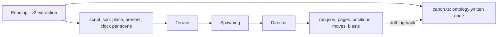
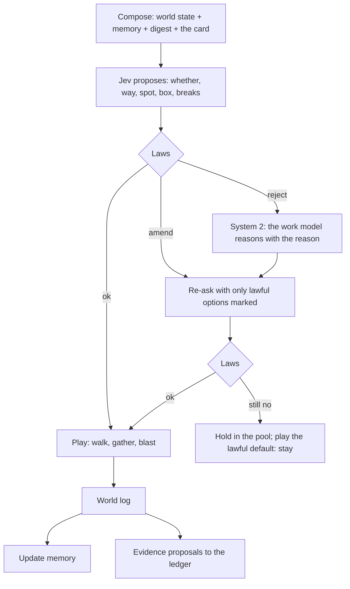

# Stage 3: the world and the ontology, one loop (2026-11-02)

**Status:** plan, not built. Written after the first full director run of volume 1 (run `d20261102081221`).

The user, on what v2 missed:

> We need to completely redesign how the world engine's runtime interacts with the ontology. We missed the ontology
> structure maintenance by a lot in v2. The reason we ran the world engine with the ontology is that the world engine
> keeps continuity and gives evidence for mappings and extraction the text can't settle (spatial and detailed movement
> Jev can't simply determine from text). We missed that entirely. We also miss the other way round: the world engine
> rejecting Jev's proposals to the ontology because physics says no.

This stage holds the work model beside Jev ([next-steps.md](next-steps.md): card digests, a runtime system 2, memory
across scenes) as one of its parts: the work model reads, the world checks, the ontology keeps what survives.

## 1. What v1 had, and v2 lost

v1's world-first design ([../world-first-design.md](../world-first-design.md), approved 2026-10-29) ran the world *with*
extraction:
- **Laws on every answer** (§4 there): nobody vanishes; nobody is in two places at once; a flashback moves nobody; no text,
  no change; travel takes time; conversation needs nearness; a thing is held by one person or lies at one place;
  knowledge flows only by witnessing, hearing or being told; a physical event's actors are there.
- **The world as evidence** (§11): EM merges and splits from who is never together, presence the two-places law keeps
  rejecting, people acting on knowledge they couldn't have; place containment from trips with no time for travel.
- **A pool and a gate** (§11): what the laws can't settle goes to the main agent in batches; its answers become pins;
  the world replays from the cache with them; a pin the laws reject goes back with the reason.
- **Records** (§12): presence, stayed, place, relation, clock, time node per scene; dialogue nodes with kind and
  parties; tracks with anchors; holdings; knowledge with sources.

v2 today runs one way only:

What that leaves, measured on volume 1:

| | v2 now |
|---|---|
| Ontology files written after the reading | none: `state-changes`, `timelines`, `branches` are empty; `events.summaryEn` is the source sentence |
| Spoken lines with no speaker / under 0.6 sure (EM²) | 646 / 806 of 1,666 |
| Scenes where the script places nobody | 4 of 46 |
| Moves Jev chose that never walked, with no reason recorded | 21 |
| Jev answers the world checks against physics | none: a target, a floor, a leap, a meeting are taken as given |
| Director outcomes (who stood where, met whom, what broke) back in the ontology | none |

## 2. The principle: both directions, through one ledger

1. **World to ontology: evidence and continuity.** The engine is the only part that knows where everyone physically is,
   what is reachable, how long a trip takes, who is within earshot, what stands and what broke. What it finds is
   recorded as evidence and offered to the ontology as proposals: who was present, where a scene is, who could have
   said a line, which building a mention is, which floor a room is on, how places nest, what order scenes can happen
   in.
2. **Ontology to world, checked: physics can say no.** Every proposal that would change the world or the ontology (from
   the reading, from Jev, from the work model, from a note of the user's) passes the world's laws first. A proposal the
   laws reject is not applied: it goes back with the reason and what the world would allow, to system 2 and Jev again;
   one that still fails goes to the pool. Nothing is silently dropped or silently applied.
3. **One ledger.** Every proposal and every verdict is a record with its source, its evidence and its state, so the user
   and the developer can see why the ontology says what it says (the Why panel's next tabs).

## 3. The layers of the ontology

| Layer | Written by | Changes how | Holds |
|---|---|---|---|
| **Text** | the reading (extraction) | only through the ledger | sentences, kinds, cards, mentions, EM and EM² with how sure, facts, the place tree, time words |
| **World log** | the engine at play time, per run | append-only | presence per scene (present, stayed, arrived, left), tracks (anchors and walked segments), meetings, dialogue nodes (kind, parties, nearness), holdings, damage, knowledge entries, bindings (a place to a building's lot, a named room to a skeleton room, a floor), proven time relations |
| **Memory** | the work model | per card and per scene | the digest of each card; short- and long-term memory ([the design page](next-steps.md)) |
| **Ledger** | everyone who proposes; the laws; the gate | append-only | proposals, verdicts (accepted, amended, rejected, held, pinned), their evidence and source |
| **Canon** | applied from the ledger | by accepted proposals only | the ontology as the rest of the system reads it: entities, events with real summaries, relations, scenes, state changes, timelines, branches |

Text is never edited in place; canon is what the ledger has accepted on top of it. A run that is played again replays
the ledger's pins, so an answer the user or the agent gave is never lost.

## 4. The laws, for v2's 3D world

v1's nine, made physical now that the world is a real city with floors, plus the checks the 3D world allows:

| Law | Evidence the world gives the ontology | Proposals it rejects | v2 now |
|---|---|---|---|
| 1. Nobody vanishes | presence carried scene to scene; "stayed" lists | a scene's cast that drops someone still there | partial (carry on, no record) |
| 2. Nobody is in two places at once | who is where at each clock tick | presence or a speaker in a scene at the same time elsewhere | missing |
| 3. A flashback moves nobody | the past's own tracks | moves played in a flashback against now | missing |
| 4. No text, no change | fragments carry the scene before | changes with no line behind them | missing |
| 5. Travel takes time | path lengths and pace on the walk graph | "right after" across a city; a move too far for the card | missing |
| 6. Conversation needs nearness | who is within 4 m or the same room (live), 25 m or the same floor (public) | a speaker or listener out of earshot; a live talk with the parties apart | dialogue gathers by rule; no check |
| 7. One holder, one place for a thing | custody records | a thing in two hands or places | missing |
| 8. Knowledge flows | who witnessed or heard what | someone acting on what they couldn't know | missing |
| 9. Actors are there | actors' positions at the event | an action by someone not present | partial (actors filtered) |
| 10. Reachability (new) | the walk graph: doors, stairs, roofs, the underground | a target no walk reaches; a floor the building lacks; a room with no door | a failed walk now records why; nothing more |
| 11. Bodies and buildings (new) | footprints, floors, what stands and what broke | standing inside a wall; a building inside another; a floor above the roof | buildings no longer overlap |
| 12. Abilities (new) | a person's stated powers (the concepts' owners) | a leap onto a five-floor roof by someone who can't; a flight with no means | missing |
| 13. Destruction is physical (new) | what each hit broke, by strength and material | a blast with nothing said to break; breaking what is already gone | asked on clear evidence; no check |

Each law is code, not a model call: a check on a proposal against the world log, giving `ok`, `amend` (with the lawful
alternatives) or `reject` (with the reason).

## 5. The runtime loop, per card

- **Constrained re-asking.** An amended question shows only what the world allows: the reachable spots, the floors the
  building has, the directions with a walk; the rejected answer is named so Jev knows what failed.
- **A held card plays its lawful default** (nobody moves) and is marked in Why; the run never waits.
- **Evidence proposals** after each card: a speaker the nearness law makes certain or impossible, a present person the
  script missed, a meeting, a custody change.

## 6. The world back into the ontology

| Proposal from the world | When | Example |
|---|---|---|
| Speaker of a line | a dialogue card is played | only one person within earshot of the listener could have said it; EM² said "no one" |
| Presence in a scene | a scene starts and ends | someone carried on in the room the scene stays in, the script left them out |
| A scene's place | people's positions at the scene's start | everyone stands in a building the script calls a street |
| A place's container | a trip with no time for travel | two places that are one building's floors |
| Time relation | travel law | "right after" impossible across the city: "later" |
| Building identity | a named building's mention lands on a lot | the same café in two scenes is one lot |
| A room's floor | a named room bound at its first scene | the office is on the third floor from then on |
| EM merge or split | chapter end | two identities never present together, same companions; one person rejected by the two-places law again and again |
| State change | a blast, a fall, a capture | a building damaged; someone hurt |

Each goes through the ledger: accepted when nothing conflicts and it is world-derived (positions, presence, bindings),
held for the gate when it changes identity or a fact (EM, speakers against a sure reading). The user's rule stands:
facts are never approved automatically; world records are the world's own.

## 7. The pool, the gate and the user's notes

- **The pool:** held proposals in batches to the main agent (Pi), who answers from the text (`novel source grep`,
  `similar`, `novel query`) as v1's world-first design has it; answers become pins; the world replays from the cache.
- **The user's notes** (World · Live's Why) become pool items too: a note on a card is shown to the agent with the card's
  records, and an answer pins the card.
- **The gate** sees only identity, facts against a sure reading, cross-book records, and conflicts the laws can't settle.

## 8. What the user sees

- **Why, per card:** Digest, Memory, Jev's questions (with system 2), **Laws** (each check, passed or failed, why), and
  **Proposals** (what the card proposed to the ontology and the verdict).
- **The run report:** laws broken and how each was settled; proposals by verdict; the pool's items and answers; the
  ontology's changes since the reading (a diff by layer).
- **Reading:** a line whose speaker the world changed is marked in the book, with the old and new speaker.

## 9. Milestones

| | Builds | No model calls? | Done when |
|---|---|---|---|
| W1 · World log and ledger | the director writes world-log records (presence, tracks, meetings, holdings, damage, bindings) and evidence proposals; canon's empty files filled from accepted ones | yes | volume 1's run replayed from cache writes them; `state-changes`, `timelines` non-empty |
| W2 · Laws as checks | laws 1–13 as code on every director proposal; violations logged only | yes | counts of each law's violations on volume 1 |
| W3 · Saying no | amend and reject: constrained re-asking, the lawful default, held items | Jev only | no move played against a law; failed walks 0 or held with a reason |
| W4 · The work model | digest and memory ([next-steps.md](next-steps.md) §1, §3) in every composed context | work model | digests read well on scenes 1–3 in Why |
| W5 · System 2 | the reasoning pass on doubts and rejections ([next-steps.md](next-steps.md) §2) | work model + Jev | before/after on every doubted card |
| W6 · Back into the ontology | speaker, presence, place, time, binding, EM proposals through the ledger; the pool to the agent; replay with pins | agent | unsure speakers resolved or held; scenes with nobody 0 |
| W7 · UI | Why's Laws and Proposals tabs; the run report; marked lines in the book | yes | the user reads a run's changes without the developer |
| W8 · Volume 1 again | all of it | all | against `d20261102081221`: moves, failed walks, speakers resolved, laws broken, cost |

Order: W1 and W2 first (cheap, they show the size of the problem), then W3, then the work model (W4, W5), then W6 and W7
together, then W8.

## 10. Decisions for the user

1. World records (presence, positions, bindings) applied without review, facts and identity always through the gate?
2. EM merges from world evidence: applied with a flag as v1 decided (2026-10-29), or always to the gate now?
3. When the laws reject a reading's sure answer (a speaker at 0.9 out of earshot): the reading wins and the world is
   rechecked, or the world wins?
4. Abilities (law 12): read from the concepts' owners only, or also asked of the work model per person?
5. Replays: each run replays the whole volume with pins (cached), or only from the first changed scene?
