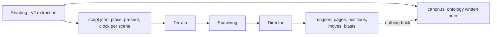
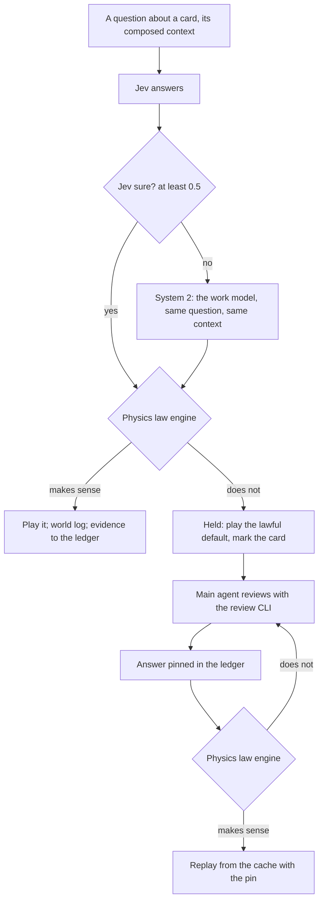

# Stage 3: the world and the ontology, one loop (2026-11-02)

**Status:** plan (Track B of [next-steps.md](next-steps.md)), not built. Written after the first full director run of volume 1 (run `d20261102081221`).

The user, on what v2 missed:

> We need to completely redesign how the world engine's runtime interacts with the ontology. We missed the ontology
> structure maintenance by a lot in v2. The reason we ran the world engine with the ontology is that the world engine
> keeps continuity and gives evidence for mappings and extraction the text can't settle (spatial and detailed movement
> Jev can't simply determine from text). We missed that entirely. We also miss the other way round: the world engine
> rejecting Jev's proposals to the ontology because physics says no.

This is **Track B** of [next-steps.md](next-steps.md). Track A, the summarization layer (a work model's digest of each
card and scene, and its memory across scenes), is decoupled from it and built in parallel (the user, 2026-11-02): A
makes each question better informed, B checks every answer, whatever asked it, and keeps the ontology.

## 1. What v1 had, and v2 lost

v1's world-first design ([../world-first-design.md](../world-first-design.md), approved 2026-10-29) ran the world *with*
extraction:
- **Laws on every answer** (§4 there): nobody vanishes; nobody is in two places at once; a flashback moves nobody; no text,
  no change; travel takes time; conversation needs nearness; a thing is held by one person or lies at one place;
  knowledge flows only by witnessing, hearing or being told; a physical event's actors are there.
- **The world as evidence** (§11): EM merges and splits from who is never together, presence the two-places law keeps
  rejecting, people acting on knowledge they couldn't have; place containment from trips with no time for travel.
- **A pool and a gate** (§11): what the laws can't settle goes to the main agent in batches; its answers become pins;
  the world replays from the cache with them; a pin the laws reject goes back with the reason.
- **Records** (§12): presence, stayed, place, relation, clock, time node per scene; dialogue nodes with kind and
  parties; tracks with anchors; holdings; knowledge with sources.

v2 today runs one way only:

What that leaves, measured on volume 1:

| | v2 now |
|---|---|
| Ontology files written after the reading | none: `state-changes`, `timelines`, `branches` are empty; `events.summaryEn` is the source sentence |
| Spoken lines with no speaker / under 0.6 sure (EM²) | 646 / 806 of 1,666 |
| Scenes where the script places nobody | 4 of 46 |
| Moves Jev chose that never walked, with no reason recorded | 21 |
| Jev answers the world checks against physics | none: a target, a floor, a leap, a meeting are taken as given |
| Director outcomes (who stood where, met whom, what broke) back in the ontology | none |

## 2. The principle: both directions, through one ledger

1. **World to ontology: evidence and continuity.** The engine is the only part that knows where everyone physically is,
   what is reachable, how long a trip takes, who is within earshot, what stands and what broke. What it finds is
   recorded as evidence and offered to the ontology as proposals: who was present, where a scene is, who could have
   said a line, which building a mention is, which floor a room is on, how places nest, what order scenes can happen
   in.
2. **Ontology to world, checked: physics can say no.** Every proposal that would change the world or the ontology (from
   the reading, from Jev, from the work model, from a note of the user's) passes the world's laws first. A proposal the
   laws reject is not applied: it goes, with the reason and what the world would allow, to a main agent who reviews it
   with the evidence the text holds (§5, §7). Nothing is silently dropped or silently applied.
3. **One ledger.** Every proposal and every verdict is a record with its source, its evidence and its state, so the user
   and the developer can see why the ontology says what it says (the Why panel's next tabs).

## 3. The layers of the ontology

| Layer | Written by | Changes how | Holds |
|---|---|---|---|
| **Text** | the reading (extraction) | only through the ledger | sentences, kinds, cards, mentions, EM and EM² with how sure, facts, the place tree, time words |
| **World log** | the engine at play time, per run | append-only | presence per scene (present, stayed, arrived, left), tracks (anchors and walked segments), meetings, dialogue nodes (kind, parties, nearness), holdings, damage, knowledge entries, bindings (a place to a building's lot, a named room to a skeleton room, a floor), proven time relations |
| **Memory** | the work model (Track A) | per card and per scene | card and scene digests; short- and long-term memory ([next-steps.md](next-steps.md)) |
| **Ledger** | everyone who proposes; the laws; the gate | append-only | proposals, verdicts (accepted, amended, rejected, held, pinned), their evidence and source |
| **Canon** | applied from the ledger | by accepted proposals only | the ontology as the rest of the system reads it: entities, events with real summaries, relations, scenes, state changes, timelines, branches |

Text is never edited in place; canon is what the ledger has accepted on top of it. A run that is played again replays
the ledger's pins, so an answer the user or the agent gave is never lost.

## 4. The laws, for v2's 3D world

The deeper discussion, with what the engine enforces today and each law's rule: [physics-laws.md](physics-laws.md). Continuity is
scoped to a strand (the user, 2026-11-02): it holds to the end of a strand and never carries into another.

v1's nine, made physical now that the world is a real city with floors, plus the checks the 3D world allows:

| Law | Evidence the world gives the ontology | Proposals it rejects | v2 now |
|---|---|---|---|
| 1. Nobody vanishes | presence carried scene to scene; "stayed" lists | a scene's cast that drops someone still there | partial (carry on, no record) |
| 2. Nobody is in two places at once | who is where at each clock tick | presence or a speaker in a scene at the same time elsewhere | missing |
| 3. A flashback moves nobody | the past's own tracks | moves played in a flashback against now | missing |
| 4. No text, no change | fragments carry the scene before | changes with no line behind them | missing |
| 5. Travel takes time | path lengths and pace on the walk graph | "right after" across a city; a move too far for the card | missing |
| 6. Conversation needs nearness | who is within 4 m or the same room (live), 25 m or the same floor (public) | a speaker or listener out of earshot; a live talk with the parties apart | dialogue gathers by rule; no check |
| 7. One holder, one place for a thing | custody records | a thing in two hands or places | missing |
| 8. Knowledge flows | who witnessed or heard what | someone acting on what they couldn't know | missing |
| 9. Actors are there | actors' positions at the event | an action by someone not present | partial (actors filtered) |
| 10. Reachability (new) | the walk graph: doors, stairs, roofs, the underground | a target no walk reaches; a floor the building lacks; a room with no door | a failed walk now records why; nothing more |
| 11. Bodies and buildings (new) | footprints, floors, what stands and what broke | standing inside a wall; a building inside another; a floor above the roof | buildings no longer overlap |
| 12. Abilities (new) | a person's stated powers (the concepts' owners) | a leap onto a five-floor roof by someone who can't; a flight with no means | missing |
| 13. Destruction is physical (new) | what each hit broke, by strength and material | a blast with nothing said to break; breaking what is already gone | asked on clear evidence; no check |

Each law is code, not a model call: a check on a proposal against the world log, giving `ok`, `amend` (with the lawful
alternatives) or `reject` (with the reason).

## 5. The runtime loop, per card: system 2 and the law engine

System 2, as the user defined it (2026-11-02): **the same context falls to an LLM request when confidence is low.** When
Jev's answer to a question is below 0.5, the work model is asked the very same question with the very same composed
context. Whichever answer is used (Jev's when it is sure enough, else the work model's), it goes into the physics law
engine to see whether it makes sense. If it doesn't, a main agent reviews it with the review CLI (§7), gathering as
much evidence as it needs from the ontology, the reading and the original book.

- **Both answers are kept** when system 2 ran: Jev's, the work model's, and which was used; the law engine's verdict on
  the one used.
- **A held card plays its lawful default** (nobody moves, the line has no speaker) and is marked in Why; the run never
  waits for the review.
- **The agent's answer is a proposal too:** the laws check it before it is pinned, as v1's world-first design has it; a
  pin the laws reject goes back to the agent with the reason.
- **Evidence proposals** after each played card: a speaker the nearness law makes certain or impossible, a present person
  the script missed, a meeting, a custody change.

## 5a. Ground truth and back-propagation (the user, 2026-11-02)

> While Jev's live play makes a correction that the main agent confirms, what it proposed is now ground truth: the engine
> back-propagates the existing ontology logs, until the last ground truth, for all characters in the strand.

v1 had the principle ([../world-first-design.md](../world-first-design.md) §8.3: a person's track is anchors joined by free
segments; a live meeting re-samples each mover's segment from their last anchor as a bridge ending at the meeting), and
its own status table says the re-timing was never built ("a meeting is walked at the dialogue, from where the mover is,
not re-timed back to their last anchor"). v1's code that is there: the meetings (`export-strand-demo.mjs` meetingOf:
who came to whom, a group's box), the pool, its pins and replays (`experiments/world-first/pool.mjs`,
`src/cli/commands/extract/worldCommands.ts`). v2's director uses none of it: its talk gathers by rule.

### What counts as ground truth

Every position in the world log carries how it came to be, ranked:

| Rank | Source | Example |
|---|---|---|
| 1 | **Pinned**: the main agent's answer, or Jev's confirmed by it (W5), checked by the laws | "she was on the roof all along" |
| 2 | **Stated**: the text puts someone at a spot, read surely (a spatial word, a named room bound) | "in the office on the third floor" |
| 3 | **Met**: a live meeting or a group's box (L6) | two people talking face to face |
| 4 | **Answered**: Jev's or the work model's answer that the laws passed | a move to a spot in a wedge |
| 5 | **Ruled**: the engine's default | spawning's start, carry on, a gathering walk, off-page |

An **anchor** is a position of rank 1–3. Ranks 4–5 are hypotheses between anchors.

### Back-propagation

When a new anchor lands for someone at moment t in strand S (a pin above all):

1. **Their span.** Find their last anchor before t in S (or the strand's start). Everything the world log has for them
   between the two is hypothesis and is re-derived.
2. **Their track.** Re-solve the span as a bridge on the path integral (below: it runs backward in time): from the last anchor to the new one, through
   any stated destination in between (rank 2–3 stay fixed), under the laws (L5 time, L10 reach, L12 ways). Their scene
   starts in the span are re-placed on it, so a **spawn** made by rule moves to where the bridge has them (spawning is
   back-propagated too).
3. **Everyone tied to them.** A position derived from theirs is re-derived the same way back to that person's own last
   anchor: someone who went "with" them, someone gathered to them to talk, a group whose box was drawn round them. The
   ties are recorded with each move, so the set is exact; it stays inside S.
4. **The laws again.** Every law is re-run over the revised span. What still breaks goes to the review; a revision may
   not move any anchor (rank 1–3): a conflict with one is a conflict for the agent, never silently resolved.
5. **The logs.** The world log keeps both: the old span marked superseded by this revision, the new one current, with
   the anchor that caused it. Canon's records derived from the span (presence, places, meetings, speakers) are
   re-proposed through the ledger.
6. **What comes after t.** Continuity carries the new positions forward. A later answer whose question showed the old
   positions is checked by the laws on replay; only answers that now break a law are asked again (the cache keeps the
   rest).

### The path integral runs backward in time too (the user, 2026-11-02)

The engine's motion is a path integral (`pathIntegral.ts`): every walk weighs e^(−S/T), and a walk is drawn with an
h-transform, where h[s] is the summed weight of every walk from s into the target set. That h is the propagator run
**backward from the future**: from where someone must end up, back to every place they could be now. Back-propagation
is this, not a separate method:

- **A span with an anchor at each end** is a bridge: walks are drawn forward with the new anchor's h (they end there by
  construction), starting from the last anchor; a stated destination in between splits the span into bridges.
- **Where they were at a moment in between** (a scene's start, a card's end) is the forward weight from the last anchor
  times the backward weight to the new one: α(s) · h(s). With a time budget (L5, where the story states the time), the
  two are the finite-horizon propagators, α_m forward m steps and h_(N−m) backward N − m, so the moment's spread is
  α_m · h_(N−m); without one, the moment is placed along a drawn bridge by its share of the span's play.
- **A spawn** made by rule, with an anchor later in the strand and none before, is drawn from spawning's own choices
  weighted by h: P(start = s) ∝ prior(s) · h(s), so where someone first appears agrees with where they must be later.
- **Too far to be lawful** shows as weight: when h at the last anchor (or α_N at the new one) is zero, no walk joins
  them in the time there is, and the anchor pair is a conflict for the review (L5, L10), found by the propagator itself.
- **The ensemble** (several draws, already drawn for every move) shows how sure the revised track is: tight between
  close anchors, spread where the story leaves room.

The forward field needs the walk graph reversed (climbing and descending cost differently), solved once per span like
the backward one.

### The objective: change the history least (the user, 2026-11-02)

> The history should change the least, in space and in destruction energy, when back-propagating multiple
> possibilities.

A new anchor can usually be met many ways: which tied people move and which stay, who came to whom, which of a bridge's
draws is kept. Of all the revisions that keep every anchor and break no law, the engine takes the one that changes the
history least:

J(revision) = Σ over people and moments of the span ‖x′ − x‖ + μ · Σ over blasts |ΔE|

- **Space:** each person, at each moment the world log records (a scene's start, a card's end), the distance between
  where the revision has them and where the history had them; a floor counts as its height (3 m), so moving someone
  up a building is a change too.
- **Destruction energy:** a blast's energy is what it broke (the volume of each building part it took, by how hard the
  part is); ΔE is a blast added, removed, moved or made stronger or weaker. A revision that leaves every blast as it
  was costs nothing here; μ weighs a joule of change against a metre.
- **Constraints, not costs:** anchors (rank 1–3) never move, and every law holds. J ranks only the lawful revisions.

How the engine applies it:

1. **Inside the path integral:** the bridge's action gains a pull toward the old track, a potential V(s) = α · (the
   distance from s to where the history had the person at that point of the span), so the walks it draws stay near the
   old history unless the new anchor forces them away (the Feynman–Kac form: weight e^(−(S + ΣV)/T)).
2. **Between discrete choices:** each alternative (who came to whom; whether a tied person is re-derived or keeps their
   track because the new one still holds them lawfully) is played out, and the one with the least J is kept; a tied
   person whose old track stays lawful is not moved at all.
3. **Among the drawn walks:** of the ensemble's draws, the one with the least J is played; the others stay as the
   ensemble's spread.
4. **In the ledger:** each revision records its J (metres and joules changed, and for whom). A revision above a size
   the user sets goes to the review rather than being applied, so a small pin can't quietly rewrite a chapter.

### Where it sits

Back-propagation needs the world log with each position's rank and ties (W1), the laws (W2), and pins (W5); it is
built with W5 and runs on every pin from then on. The meetings (who came to whom, a group's box) come back with L6 once
Jev gives each dialogue card its kind.

## 6. The world back into the ontology

| Proposal from the world | When | Example |
|---|---|---|
| Speaker of a line | a dialogue card is played | only one person within earshot of the listener could have said it; EM² said "no one" |
| Presence in a scene | a scene starts and ends | someone carried on in the room the scene stays in, the script left them out |
| A scene's place | people's positions at the scene's start | everyone stands in a building the script calls a street |
| A place's container | a trip with no time for travel | two places that are one building's floors |
| Time relation | travel law | "right after" impossible across the city: "later" |
| Building identity | a named building's mention lands on a lot | the same café in two scenes is one lot |
| A room's floor | a named room bound at its first scene | the office is on the third floor from then on |
| EM merge or split | chapter end | two identities never present together, same companions; one person rejected by the two-places law again and again |
| State change | a blast, a fall, a capture | a building damaged; someone hurt |

Each goes through the ledger and its gates (§7b): applied when the laws pass it and it is the world's own or agrees
with the reading; otherwise decided by a main agent (G1), never by default.

## 7. The review: a main agent with a high-privilege CLI

What the law engine rejects is reviewed by a main agent: Pi (v1's main agent, through its console's queue), or another
agent such as Codex, all through the same CLI. The CLI is high privilege: it reads everything the workspace holds,
the full text included, and writes only answers into the ledger.

| Command | Gives | Status |
|---|---|---|
| `novel query <dir> <cypher>` | Cypher on the ontology's graph | exists |
| `novel source grep <dir> <regex>` | the source text's lines matching a pattern | exists |
| `novel source similar <dir> <text>` | the passages most like a text (RAG) | exists |
| `novel source epub <dir> [--doc N] [--grep <regex>]` | the original EPUB read in full, one document or all, or grepped, as published | new |
| `novel reading <dir> card\|scene\|line <id>` | the v2 reading of a card, a scene or a line: kinds, EM and EM² with how sure, facts, the place and time | new |
| `novel world log <dir> --scene\|--person\|--card <id>` | the world log: who was where, tracks, meetings, holdings, damage | new |
| `novel world held <dir>` | the held items: the question, the answers (Jev's, the work model's), the law that failed and why, the lawful alternatives | new |
| `novel world answer <dir> <item> <option> --reason <text> --evidence <refs>` | an answer, checked by the laws, pinned in the ledger with its evidence | new |

- **Batches:** held items go to the agent in batches (8, as v1); the world never waits for them.
- **The user's notes** (World · Live's Why) become held items too: a note on a card is shown to the agent with the
  card's records, and an answer pins the card.
- **Replay:** pins are replayed from the cache (only what changed is asked again).
- **A main agent decides everything the laws don't** (§7b): identity, a fact against a sure reading, abilities,
  cross-book records; what its answers can't make lawful stays held, playing its lawful default, and is reported.

## 7a. v1's review boundary (for decision 1)

How v1 formats the ontology and what its review gate covers (`src/ground/connectors/bundle.ts`,
`src/solidifier/merge/{changeset,semantic,apply}.ts`, [../unified-review.md](../unified-review.md),
[../world-first-design.md](../world-first-design.md) §11):

- **Format.** A per-book bundle of JSONL files, the source of truth (`entities`, `relations`, `events`, `scenes`,
  `timelines`, `branches`, `state-changes`; the graph is rebuilt from them). Writes come only as **ChangeSets** of
  proposals (`upsert_entity`, `create_event`, `create_scene`, `add_relation`, `add_alias`, `set_state_change`), applied
  by one path (`applyChangeSet`) and only when the set is **approved**.
- **Reviewed (semantic facts).** Each proposal is split into facts, each needing original evidence and a decision
  (accept, hold, reject with a reason): an entity's **identity**; an **alias**; a **state change**; an event's
  **actors**; a scene's **presence**, **mentions**, **location**, each dialogue **turn** (speaker, addressee) and each
  **dialogue member**; every **relation** (except an event's own actor's `PARTICIPATES_IN`). Unreviewed facts default
  to held; nothing accepted without the source shown.
- **Not reviewed: the source's organisation.** The ids, sentences, chapter and order of scenes and events (what the
  facts hang on) publish with the set.
- **Bypassing review, by design:**
  - `novel ingest --base-layer`, only in a world-first workspace: the base layer (scenes, events, dialogue exchanges, the
    roster) applied without fact review (`manifest.worldFirst`); `--auto-approve` is a separate, explicit mode.
  - **The world loop's own records** (world-first): presence, place, time, dialogue kind and parties, starts and moves
    are the world's, kept by its laws, never reviewed; the stage's outputs live in `stage/`, not in canon.
  - **EM from world evidence:** a merge with no conflict against the laws applied automatically, flagged
    (`emFromWorld`), undoable; anything else to packets.
  - **What the laws can't settle** goes to the main agent's pool (pins, replay), not to the user.
- **The user's gate** saw only low-confidence identity merges, conflicts the laws can't settle, and cross-book packets
  (the universe's causality, atlas and calendar), each through the same review lifecycle (show, evidence, decide, apply).

## 7b. Review gates for v2: review by exception (decided 2026-11-02)

The user's concern with v1's boundary: the world log now records many kinds of things, and reviewing them as v1
reviewed facts would bury the user. On volume 1 alone one run wrote 339 world records and 359 ledger entries, and the
reading has 2,196 roles (643 under 0.5). Decided: **nothing is reviewed as a record; only exceptions are, in two
gates, the second seeing bundles, not lines.** No gate is the user (the user: an agent understands better than a
person, because of how long its context is), and there is no tier above the main agent: **every main agent (Pi, Codex
or another) has all the rights.** The user reads what was decided and can reverse any of it.

### The two gates

| Gate | Who | Sees | Volume on volume 1 (estimate) |
|---|---|---|---|
| **G0 · The laws** | code | every proposal, every run | all of it, in milliseconds |
| **G1 · A main agent** | any: Pi, Codex or another, with the review CLI and the whole book, its ontology, world log and universe to read; each with all the rights | what G0 holds, bundled by scene; identity, abilities, big revisions, cross-book records; a sample of what G0 passed | today 112 held items in 23 scenes, so ~23 bundles, plus a handful of identity and ability items per book; fewer once system 2 and Jev's dialogue kinds run |

### Classes: what goes where

| Class | Examples | Route |
|---|---|---|
| **W · World mechanics** | positions, walks, tracks, meetings by rule, bindings, blast geometry | never reviewed; the world log only; canon gets their summary (where each person is at a scene's end) applied automatically when lawful |
| **S · Story state the world derives** | presence, a scene's place, time relations, a line's speaker, hurt, a building damaged | applied automatically when G0 passes and it agrees with the reading or the reading was unsure (below 0.5); otherwise G1 |
| **R · Revisions** (back-propagation) | a pin's re-derived span | applied when its size J is below the threshold; above it G1 |
| **I · Identity** | a merge or a split, a new person, a description that means someone | a clean merge (no law against it, strong evidence) applied with a flag, undoable, as v1; anything else G1 |
| **A · Abilities** | the per-character config (it lets someone past the physics) | written by G1 with evidence; every change in the run's report, since one wrong entry changes everything a person does |
| **X · Cross-book** | a strand continued into the next book, the atlas, the calendar | G1, one bundle per book |

### What keeps the volume down

1. **Bundles, not records.** G1 gets one item per scene: the scene's held breaks together, with its text, the world log's
   records for it and the alternatives the laws allow. One answer can settle several breaks (one misplaced person
   explains three L6 breaks). Identity questions are one item each, ability changes one list, cross-book one bundle per
   book. The user gets a report per run: what G0 applied and G1 decided, by class, with what each changed, readable in
   World · Live.
2. **Reach decides priority.** Each item is scored by how much it would change (its J, §5a) times how far it reaches
   (the later scenes and people that depend on it, from the log's ties). Items are answered highest first, within a
   budget per run (G1 a fixed number of bundles); what's left over stays held and plays its lawful
   default. Nothing waits on review.
3. **Audits instead of approvals.** Of what G0 passes and is applied automatically, a small random share (say 2%) goes
   to G1 as an audit. Each class keeps its audit error rate; a class whose rate rises above a limit is routed to G1
   automatically until it falls again. The gates tighten where the engine is wrong and loosen where it's right.
4. **Everything applied is undoable.** Canon changes only through the ledger, and every applied entry can be reverted
   with what depended on it. A note on a card in World · Live (Why) is the user's way to reverse or pin, at the moment
   they notice, without reviewing anything ahead of time.
5. **The reading's own answers stay out of review.** v2's extraction is not reviewed per fact (as v1's was): its answers
   are the text layer, trusted by their confidence; a weak one is checked by the world (G0) and system 2 rather than by
   a person.

### Who decides

The laws decide what applies on its own (classes W and S when lawful, small revisions, clean merges flagged), and each
class's audit rate is on record. Everything else is decided by a main agent with the evidence in front of it, never
by default; any main agent has all the rights (the user, 2026-11-02), there is no senior tier, and the user is not a
gate: every decision is reported and can be reversed or pinned from World · Live.

## 8. What the user sees

- **Why, per card:** Jev's questions (with system 2's answer beside Jev's where it ran), **Laws** (each check, passed or
  failed, why), **Proposals** (what the card proposed to the ontology and the verdict), and the **review** (the agent's
  evidence and answer) for a held card. Track A adds Digest and Memory.
- **The run report:** laws broken and how each was settled; proposals by verdict; the held items and the agent's answers; the
  ontology's changes since the reading (a diff by layer).
- **Reading:** a line whose speaker the world changed is marked in the book, with the old and new speaker.

## 9. Milestones (Track B)

| | Builds | Model calls | Done when |
|---|---|---|---|
| W0 · A valid world | each building's inside walked on its own plan, joined to the street only at its doors; holdings independent of the order chunks are reached in; the world's own check (no building shut, no room shut) at generation and at every scene; every failed walk with a code and what replays it | none | the check finds nothing on a generated city or round 第十五学区; two load orders give the same world; held walks coded |
| W1 · World log and ledger | the director writes world-log records (presence, tracks, meetings, holdings, damage, bindings), each position with its rank (§5a) and what it was derived from, and evidence proposals; canon's empty files filled from accepted ones | none | volume 1's run replayed from cache writes them; `state-changes`, `timelines` non-empty |
| W2 · The law engine | laws 1–13 as code on every answer; verdicts logged only | none | counts of each law's violations on volume 1 |
| W3 · System 2 | below 0.5, the same question with the same context to the work model; both answers kept | work model | how often it runs, how often the two differ, on volume 1 |
| W4 · Laws decide | the law engine's verdict acts: what makes sense plays, what doesn't is held and plays the lawful default | none | no move played against a law; failed walks held with a reason |
| W5 · The review | the CLI's new commands (§7), on v1's pool, pins and replays; held items to the main agent in batches; answers checked and pinned; **back-propagation from every pin** (§5a); the user's notes as items | agent | every held item of volume 1 answered or sent to the gate |
| W6 · Back into the ontology | speaker, presence, place, time, binding, EM proposals through the ledger into canon | none | unsure speakers settled or held; scenes with nobody 0 |
| W7 · UI | Why's Laws, Proposals and review; the run report; changed lines marked in the book | none | the user reads a run's changes without the developer |
| W8 · Volume 1 again | all of it, with Track A where it is ready | all | against `d20261102081221`: moves, failed walks, speakers settled, laws broken, held and answered, cost |

**Built (2026-11-02): W1 and W2**, without L12 (abilities wait for the main agent's config). `world-engine/log/`
writes each director run's world log (`stage/world/log/<run>.jsonl`: presence, positions, meetings, blasts, bindings,
each position ranked and with what it carries on from and whom it is tied to) and its ledger
(`stage/world/ledger/<run>.jsonl`: location changes by canon event, a timeline per strand, damage, and every law's
break held for review); `world-engine/laws/` checks the laws (`stage/director/laws.json`). The director writes all three
after every run. Nothing goes into canon yet: the ledger's proposals wait for decision 1. On run `d20261102081221`:
172 presences, 69 positions, 56 meetings, 3 blasts, 39 bindings; ranks 160 ruled, 77 answered, 4 stated; 241 location
changes, 3 timelines, 3 damage records proposed, 112 breaks held.

**Built (2026-11-02): W3**, system 2 (`world-engine/director/system2.mjs`): every director question Jev answers below 0.5
goes to the work model with the same composed state (the pictures named, not sent; every option in words), and its
answer is used when it is one of the options; a box stays Jev's. Both answers are kept with the card (or the scene, for
its director's pass) in `run.json` (`system2`), and the run's log says how often it ran, was used and differed. Checked
end to end on scene 1 with a fake Jev unsure of everything: 148 answers went to the work model in 17 requests. The
director turns it on when `WORK_LLM_*` is configured (the reading's DeepSeek), and says so when it is not.

**Built (2026-11-02): W4**, the laws deciding as the director plays: continuity per strand at every scene's start (L1:
someone comes in from the scene the strands name, never from another strand's state); each dialogue card where someone
spoken to stands apart is given its kind by Jev (L6: face to face gathers, remote moves nobody, public is heard within
25 m and held beyond); an actor with no place is held (L9); a move no walk reaches is held with why (L10; someone already
at their spot is not a break). Every verdict is kept with its card (`laws`) and goes into the ledger as applied or held.
Checked with stand-ins on scenes 1–6 of a scratch copy: 233 moves, 158 walked, 41 already there, 12 talks given a kind,
3 actors and 34 moves held. Found on the way: a room in a turned building could be shut (its door's plan cell falls
between world cells); first patched, then fixed at its root by W0's interior topology.

**Built (2026-11-02): W0**, a valid world (the user's research handoff, `Text_to_City_Research_Handoff.md`: separate
interior topology with explicit portals, a generation-time validator, order-independent chunks, failure codes and
minimal replays; the same as the field's practice: areas joined by portals rather than one grid over everything, and a
chunk a pure function of its seed and place). In `apps/playground/src/data/world.ts`:

- *Interior topology.* A turned building's inside is no longer joined cell by cell on the world grid, which aliased its
  turned plan (a corridor and a room a grid step apart were joined through a wall; a door whose plan cell fell between
  world cells shut its room). Its plan is walked instead: each plan cell is stood for by the world cell nearest it (its
  own, else the nearest of its kind on that floor), and two plan cells are joined only by the plan's rules (corridor to
  corridor, within a room, a room to a corridor at its door, a stair to the floor above). The street joins it only at
  its doors. A square building's plan is the world grid, and is walked by the same rules.
- *Order-independent holdings.* A cell two buildings could stand on goes to the first in the source's order
  (`ownCell`), not to whichever was reached first; a test reaches the chunks in two orders and gets the same holdings
  and the same walk.
- *The world's own check* (`worldIssues`): `NO_ENTRANCE` (a building wholly in the graph not reached from the street)
  and `SHUT_ROOM` (a room not reached). A test runs it on a generated city (none), and on one building with every
  corridor gone (`NO_ENTRANCE`). It found what the tests had not: 43 rooms on upper floors shut, because a stair whose
  plan cell no world cell held joined no floors (fixed: stairs are joined on the plan), and one building swallowed by
  another in a city whose overlaps were not cleared (as the export does). The director runs it round every scene's
  start and keeps what it finds with the scene (`world`); the ledger holds it for the review (`kind: world`).
- *Failure codes.* A held walk says why as a code: `NO_TARGET` (nowhere to stand there), `OFF_WALK` (where they stand
  is off the walk round them and their target), `NO_PATH` (no way there on foot), with the least that replays it (the
  seed's key, where they stood, the first targets, how they went), in the card's moves and its L10 verdict.

Order: W0 under all of it; W1 and W2 first (no model calls; they show the size of the problem), then W3 and W4, then W5 and W6, W7 alongside,
then W8. Track A runs in parallel throughout.

## 10. Decisions for the user

1. ~~Review gates~~ **Decided (§7b):** review by exception; G0 the laws, G1 any main agent with all the rights; the user
   reads reports and reverses through notes. Its numbers still to set: the audit share, the error-rate limit per
   class, G1's budget per run.
2. ~~EM merges~~ **Decided (§7b):** a clean merge applied with a flag, undoable, as v1; anything else to G1.
3. When the laws reject a reading's sure answer (a speaker at 0.9 out of earshot): the reading wins and the world is
   rechecked, or the world wins?
4. Abilities (law 12): read from the concepts' owners only, or also asked of the work model per person?
5. Replays: each run replays the whole volume with pins (cached), or only from the first changed scene?
7. Back-propagation's weights: μ (a joule of destruction against a metre), α (the pull toward the old track), and the
   size of a revision above which it goes to the review.
6. System 2's threshold: 0.5 for every question, or its own per question kind (whether, direction, spot, speaker)?
