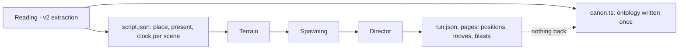
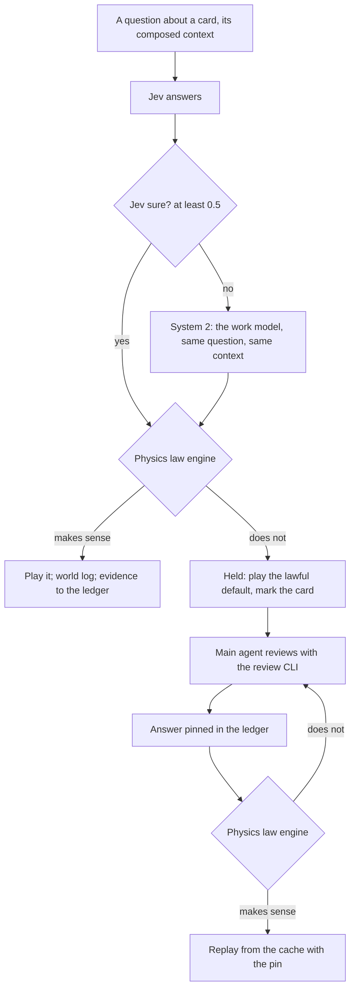

# Stage 3: the world and the ontology, one loop (2026-11-02)

**Status:** plan (Track B of [next-steps.md](next-steps.md)), not built. Written after the first full director run of volume 1 (run `d20261102081221`).

The user, on what v2 missed:

> We need to completely redesign how the world engine's runtime interacts with the ontology. We missed the ontology
> structure maintenance by a lot in v2. The reason we ran the world engine with the ontology is that the world engine
> keeps continuity and gives evidence for mappings and extraction the text can't settle (spatial and detailed movement
> Jev can't simply determine from text). We missed that entirely. We also miss the other way round: the world engine
> rejecting Jev's proposals to the ontology because physics says no.

This is **Track B** of [next-steps.md](next-steps.md). Track A, the summarization layer (a work model's digest of each
card and scene, and its memory across scenes), is decoupled from it and built in parallel (the user, 2026-11-02): A
makes each question better informed, B checks every answer, whatever asked it, and keeps the ontology.

## 1. What v1 had, and v2 lost

v1's world-first design ([../world-first-design.md](../world-first-design.md), approved 2026-10-29) ran the world *with*
extraction:
- **Laws on every answer** (§4 there): nobody vanishes; nobody is in two places at once; a flashback moves nobody; no text,
  no change; travel takes time; conversation needs nearness; a thing is held by one person or lies at one place;
  knowledge flows only by witnessing, hearing or being told; a physical event's actors are there.
- **The world as evidence** (§11): EM merges and splits from who is never together, presence the two-places law keeps
  rejecting, people acting on knowledge they couldn't have; place containment from trips with no time for travel.
- **A pool and a gate** (§11): what the laws can't settle goes to the main agent in batches; its answers become pins;
  the world replays from the cache with them; a pin the laws reject goes back with the reason.
- **Records** (§12): presence, stayed, place, relation, clock, time node per scene; dialogue nodes with kind and
  parties; tracks with anchors; holdings; knowledge with sources.

v2 today runs one way only:

What that leaves, measured on volume 1:

| | v2 now |
|---|---|
| Ontology files written after the reading | none: `state-changes`, `timelines`, `branches` are empty; `events.summaryEn` is the source sentence |
| Spoken lines with no speaker / under 0.6 sure (EM²) | 646 / 806 of 1,666 |
| Scenes where the script places nobody | 4 of 46 |
| Moves Jev chose that never walked, with no reason recorded | 21 |
| Jev answers the world checks against physics | none: a target, a floor, a leap, a meeting are taken as given |
| Director outcomes (who stood where, met whom, what broke) back in the ontology | none |

## 2. The principle: both directions, through one ledger

1. **World to ontology: evidence and continuity.** The engine is the only part that knows where everyone physically is,
   what is reachable, how long a trip takes, who is within earshot, what stands and what broke. What it finds is
   recorded as evidence and offered to the ontology as proposals: who was present, where a scene is, who could have
   said a line, which building a mention is, which floor a room is on, how places nest, what order scenes can happen
   in.
2. **Ontology to world, checked: physics can say no.** Every proposal that would change the world or the ontology (from
   the reading, from Jev, from the work model, from a note of the user's) passes the world's laws first. A proposal the
   laws reject is not applied: it goes, with the reason and what the world would allow, to a main agent who reviews it
   with the evidence the text holds (§5, §7). Nothing is silently dropped or silently applied.
3. **One ledger.** Every proposal and every verdict is a record with its source, its evidence and its state, so the user
   and the developer can see why the ontology says what it says (the Why panel's next tabs).

## 3. The layers of the ontology

| Layer | Written by | Changes how | Holds |
|---|---|---|---|
| **Text** | the reading (extraction) | only through the ledger | sentences, kinds, cards, mentions, EM and EM² with how sure, facts, the place tree, time words |
| **World log** | the engine at play time, per run | append-only | presence per scene (present, stayed, arrived, left), tracks (anchors and walked segments), meetings, dialogue nodes (kind, parties, nearness), holdings, damage, knowledge entries, bindings (a place to a building's lot, a named room to a skeleton room, a floor), proven time relations |
| **Memory** | the work model (Track A) | per card and per scene | card and scene digests; short- and long-term memory ([next-steps.md](next-steps.md)) |
| **Ledger** | everyone who proposes; the laws; the gate | append-only | proposals, verdicts (accepted, amended, rejected, held, pinned), their evidence and source |
| **Canon** | applied from the ledger | by accepted proposals only | the ontology as the rest of the system reads it: entities, events with real summaries, relations, scenes, state changes, timelines, branches |

Text is never edited in place; canon is what the ledger has accepted on top of it. A run that is played again replays
the ledger's pins, so an answer the user or the agent gave is never lost.

## 4. The laws, for v2's 3D world

The deeper discussion, with what the engine enforces today and each law's rule: [physics-laws.md](physics-laws.md). Continuity is
scoped to a strand (the user, 2026-11-02): it holds to the end of a strand and never carries into another.

v1's nine, made physical now that the world is a real city with floors, plus the checks the 3D world allows:

| Law | Evidence the world gives the ontology | Proposals it rejects | v2 now |
|---|---|---|---|
| 1. Nobody vanishes | presence carried scene to scene; "stayed" lists | a scene's cast that drops someone still there | partial (carry on, no record) |
| 2. Nobody is in two places at once | who is where at each clock tick | presence or a speaker in a scene at the same time elsewhere | missing |
| 3. A flashback moves nobody | the past's own tracks | moves played in a flashback against now | missing |
| 4. No text, no change | fragments carry the scene before | changes with no line behind them | missing |
| 5. Travel takes time | path lengths and pace on the walk graph | "right after" across a city; a move too far for the card | missing |
| 6. Conversation needs nearness | who is within 4 m or the same room (live), 25 m or the same floor (public) | a speaker or listener out of earshot; a live talk with the parties apart | dialogue gathers by rule; no check |
| 7. One holder, one place for a thing | custody records | a thing in two hands or places | missing |
| 8. Knowledge flows | who witnessed or heard what | someone acting on what they couldn't know | missing |
| 9. Actors are there | actors' positions at the event | an action by someone not present | partial (actors filtered) |
| 10. Reachability (new) | the walk graph: doors, stairs, roofs, the underground | a target no walk reaches; a floor the building lacks; a room with no door | a failed walk now records why; nothing more |
| 11. Bodies and buildings (new) | footprints, floors, what stands and what broke | standing inside a wall; a building inside another; a floor above the roof | buildings no longer overlap |
| 12. Abilities (new) | a person's stated powers (the concepts' owners) | a leap onto a five-floor roof by someone who can't; a flight with no means | missing |
| 13. Destruction is physical (new) | what each hit broke, by strength and material | a blast with nothing said to break; breaking what is already gone | asked on clear evidence; no check |

Each law is code, not a model call: a check on a proposal against the world log, giving `ok`, `amend` (with the lawful
alternatives) or `reject` (with the reason).

## 5. The runtime loop, per card: system 2 and the law engine

System 2, as the user defined it (2026-11-02): **the same context falls to an LLM request when confidence is low.** When
Jev's answer to a question is below 0.5, the work model is asked the very same question with the very same composed
context. Whichever answer is used (Jev's when it is sure enough, else the work model's), it goes into the physics law
engine to see whether it makes sense. If it doesn't, a main agent reviews it with the review CLI (§7), gathering as
much evidence as it needs from the ontology, the reading and the original book.

- **Both answers are kept** when system 2 ran: Jev's, the work model's, and which was used; the law engine's verdict on
  the one used.
- **A held card plays its lawful default** (nobody moves, the line has no speaker) and is marked in Why; the run never
  waits for the review.
- **The agent's answer is a proposal too:** the laws check it before it is pinned, as v1's world-first design has it; a
  pin the laws reject goes back to the agent with the reason.
- **Evidence proposals** after each played card: a speaker the nearness law makes certain or impossible, a present person
  the script missed, a meeting, a custody change.

## 5a. Ground truth and back-propagation (the user, 2026-11-02)

> While Jev's live play makes a correction that the main agent confirms, what it proposed is now ground truth: the engine
> back-propagates the existing ontology logs, until the last ground truth, for all characters in the strand.

v1 had the principle ([../world-first-design.md](../world-first-design.md) §8.3: a person's track is anchors joined by free
segments; a live meeting re-samples each mover's segment from their last anchor as a bridge ending at the meeting), and
its own status table says the re-timing was never built ("a meeting is walked at the dialogue, from where the mover is,
not re-timed back to their last anchor"). v1's code that is there: the meetings (`export-strand-demo.mjs` meetingOf:
who came to whom, a group's box), the pool, its pins and replays (`experiments/world-first/pool.mjs`,
`src/cli/commands/extract/worldCommands.ts`). v2's director uses none of it: its talk gathers by rule.

### What counts as ground truth

Every position in the world log carries how it came to be, ranked:

| Rank | Source | Example |
|---|---|---|
| 1 | **Pinned**: the main agent's answer, or Jev's confirmed by it (W5), checked by the laws | "she was on the roof all along" |
| 2 | **Stated**: the text puts someone at a spot, read surely (a spatial word, a named room bound) | "in the office on the third floor" |
| 3 | **Met**: a live meeting or a group's box (L6) | two people talking face to face |
| 4 | **Answered**: Jev's or the work model's answer that the laws passed | a move to a spot in a wedge |
| 5 | **Ruled**: the engine's default | spawning's start, carry on, a gathering walk, off-page |

An **anchor** is a position of rank 1–3. Ranks 4–5 are hypotheses between anchors.

### Back-propagation

When a new anchor lands for someone at moment t in strand S (a pin above all):

1. **Their span.** Find their last anchor before t in S (or the strand's start). Everything the world log has for them
   between the two is hypothesis and is re-derived.
2. **Their track.** Re-solve the span as a bridge on the path integral (below: it runs backward in time): from the last anchor to the new one, through
   any stated destination in between (rank 2–3 stay fixed), under the laws (L5 time, L10 reach, L12 ways). Their scene
   starts in the span are re-placed on it, so a **spawn** made by rule moves to where the bridge has them (spawning is
   back-propagated too).
3. **Everyone tied to them.** A position derived from theirs is re-derived the same way back to that person's own last
   anchor: someone who went "with" them, someone gathered to them to talk, a group whose box was drawn round them. The
   ties are recorded with each move, so the set is exact; it stays inside S.
4. **The laws again.** Every law is re-run over the revised span. What still breaks goes to the review; a revision may
   not move any anchor (rank 1–3): a conflict with one is a conflict for the agent, never silently resolved.
5. **The logs.** The world log keeps both: the old span marked superseded by this revision, the new one current, with
   the anchor that caused it. Canon's records derived from the span (presence, places, meetings, speakers) are
   re-proposed through the ledger.
6. **What comes after t.** Continuity carries the new positions forward. A later answer whose question showed the old
   positions is checked by the laws on replay; only answers that now break a law are asked again (the cache keeps the
   rest).

### The path integral runs backward in time too (the user, 2026-11-02)

The engine's motion is a path integral (`pathIntegral.ts`): every walk weighs e^(−S/T), and a walk is drawn with an
h-transform, where h[s] is the summed weight of every walk from s into the target set. That h is the propagator run
**backward from the future**: from where someone must end up, back to every place they could be now. Back-propagation
is this, not a separate method:

- **A span with an anchor at each end** is a bridge: walks are drawn forward with the new anchor's h (they end there by
  construction), starting from the last anchor; a stated destination in between splits the span into bridges.
- **Where they were at a moment in between** (a scene's start, a card's end) is the forward weight from the last anchor
  times the backward weight to the new one: α(s) · h(s). With a time budget (L5, where the story states the time), the
  two are the finite-horizon propagators, α_m forward m steps and h_(N−m) backward N − m, so the moment's spread is
  α_m · h_(N−m); without one, the moment is placed along a drawn bridge by its share of the span's play.
- **A spawn** made by rule, with an anchor later in the strand and none before, is drawn from spawning's own choices
  weighted by h: P(start = s) ∝ prior(s) · h(s), so where someone first appears agrees with where they must be later.
- **Too far to be lawful** shows as weight: when h at the last anchor (or α_N at the new one) is zero, no walk joins
  them in the time there is, and the anchor pair is a conflict for the review (L5, L10), found by the propagator itself.
- **The ensemble** (several draws, already drawn for every move) shows how sure the revised track is: tight between
  close anchors, spread where the story leaves room.

The forward field needs the walk graph reversed (climbing and descending cost differently), solved once per span like
the backward one.

### Where it sits

Back-propagation needs the world log with each position's rank and ties (W1), the laws (W2), and pins (W5); it is
built with W5 and runs on every pin from then on. The meetings (who came to whom, a group's box) come back with L6 once
Jev gives each dialogue card its kind.

## 6. The world back into the ontology

| Proposal from the world | When | Example |
|---|---|---|
| Speaker of a line | a dialogue card is played | only one person within earshot of the listener could have said it; EM² said "no one" |
| Presence in a scene | a scene starts and ends | someone carried on in the room the scene stays in, the script left them out |
| A scene's place | people's positions at the scene's start | everyone stands in a building the script calls a street |
| A place's container | a trip with no time for travel | two places that are one building's floors |
| Time relation | travel law | "right after" impossible across the city: "later" |
| Building identity | a named building's mention lands on a lot | the same café in two scenes is one lot |
| A room's floor | a named room bound at its first scene | the office is on the third floor from then on |
| EM merge or split | chapter end | two identities never present together, same companions; one person rejected by the two-places law again and again |
| State change | a blast, a fall, a capture | a building damaged; someone hurt |

Each goes through the ledger: accepted when nothing conflicts and it is world-derived (positions, presence, bindings),
held for the gate when it changes identity or a fact (EM, speakers against a sure reading). The user's rule stands:
facts are never approved automatically; world records are the world's own.

## 7. The review: a main agent with a high-privilege CLI

What the law engine rejects is reviewed by a main agent: Pi (v1's main agent, through its console's queue), or another
agent such as Codex, all through the same CLI. The CLI is high privilege: it reads everything the workspace holds,
the full text included, and writes only answers into the ledger.

| Command | Gives | Status |
|---|---|---|
| `novel query <dir> <cypher>` | Cypher on the ontology's graph | exists |
| `novel source grep <dir> <regex>` | the source text's lines matching a pattern | exists |
| `novel source similar <dir> <text>` | the passages most like a text (RAG) | exists |
| `novel source epub <dir> [--doc N] [--grep <regex>]` | the original EPUB read in full, one document or all, or grepped, as published | new |
| `novel reading <dir> card\|scene\|line <id>` | the v2 reading of a card, a scene or a line: kinds, EM and EM² with how sure, facts, the place and time | new |
| `novel world log <dir> --scene\|--person\|--card <id>` | the world log: who was where, tracks, meetings, holdings, damage | new |
| `novel world held <dir>` | the held items: the question, the answers (Jev's, the work model's), the law that failed and why, the lawful alternatives | new |
| `novel world answer <dir> <item> <option> --reason <text> --evidence <refs>` | an answer, checked by the laws, pinned in the ledger with its evidence | new |

- **Batches:** held items go to the agent in batches (8, as v1); the world never waits for them.
- **The user's notes** (World · Live's Why) become held items too: a note on a card is shown to the agent with the
  card's records, and an answer pins the card.
- **Replay:** pins are replayed from the cache (only what changed is asked again).
- **The gate** (the user) sees what no agent should settle alone: identity, a fact against a sure reading, cross-book
  records, and conflicts the agent's answers can't make lawful.

## 8. What the user sees

- **Why, per card:** Jev's questions (with system 2's answer beside Jev's where it ran), **Laws** (each check, passed or
  failed, why), **Proposals** (what the card proposed to the ontology and the verdict), and the **review** (the agent's
  evidence and answer) for a held card. Track A adds Digest and Memory.
- **The run report:** laws broken and how each was settled; proposals by verdict; the held items and the agent's answers; the
  ontology's changes since the reading (a diff by layer).
- **Reading:** a line whose speaker the world changed is marked in the book, with the old and new speaker.

## 9. Milestones (Track B)

| | Builds | Model calls | Done when |
|---|---|---|---|
| W1 · World log and ledger | the director writes world-log records (presence, tracks, meetings, holdings, damage, bindings), each position with its rank (§5a) and what it was derived from, and evidence proposals; canon's empty files filled from accepted ones | none | volume 1's run replayed from cache writes them; `state-changes`, `timelines` non-empty |
| W2 · The law engine | laws 1–13 as code on every answer; verdicts logged only | none | counts of each law's violations on volume 1 |
| W3 · System 2 | below 0.5, the same question with the same context to the work model; both answers kept | work model | how often it runs, how often the two differ, on volume 1 |
| W4 · Laws decide | the law engine's verdict acts: what makes sense plays, what doesn't is held and plays the lawful default | none | no move played against a law; failed walks held with a reason |
| W5 · The review | the CLI's new commands (§7), on v1's pool, pins and replays; held items to the main agent in batches; answers checked and pinned; **back-propagation from every pin** (§5a); the user's notes as items | agent | every held item of volume 1 answered or sent to the gate |
| W6 · Back into the ontology | speaker, presence, place, time, binding, EM proposals through the ledger into canon | none | unsure speakers settled or held; scenes with nobody 0 |
| W7 · UI | Why's Laws, Proposals and review; the run report; changed lines marked in the book | none | the user reads a run's changes without the developer |
| W8 · Volume 1 again | all of it, with Track A where it is ready | all | against `d20261102081221`: moves, failed walks, speakers settled, laws broken, held and answered, cost |

Order: W1 and W2 first (no model calls; they show the size of the problem), then W3 and W4, then W5 and W6, W7 alongside,
then W8. Track A runs in parallel throughout.

## 10. Decisions for the user

1. World records (presence, positions, bindings) applied without review, facts and identity always through the gate?
2. EM merges from world evidence: applied with a flag as v1 decided (2026-10-29), or always to the gate now?
3. When the laws reject a reading's sure answer (a speaker at 0.9 out of earshot): the reading wins and the world is
   rechecked, or the world wins?
4. Abilities (law 12): read from the concepts' owners only, or also asked of the work model per person?
5. Replays: each run replays the whole volume with pins (cached), or only from the first changed scene?
6. System 2's threshold: 0.5 for every question, or its own per question kind (whether, direction, spot, speaker)?
