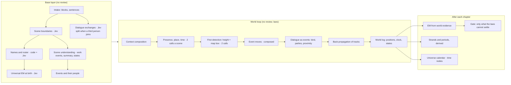

# World-first extraction: design

**Status:** approved 2026-10-29, with the decisions in §15; being built (§14). Branch `claude/world-first`.

**The experiment so far:** `experiments/world-first/`, run on vol 1. It covers presence, place and time with context composition and four laws. Everything else here is designed but not built.

## 1. The idea

The world model runs with extraction, not after it.
1. **Base layer:** the faculties that need no review give a book's base layer. That is its sentences, scenes, events, dialogue exchanges, and the roster of who and what it names, with identity settled at birth.
2. **World loop:** the world reads the book scene by scene in reading order. Jev decides (always in the composed context) who is in each scene, where, when, where each person starts, who talks to whom and how, and who moves.
3. **Laws:** the world enforces its laws on every answer: continuity, exclusivity, proximity in conversation. What it can't make lawful goes to the gate.

A reviewer reading one scene at a time can't keep these laws; the engine keeps them by construction. So presence, place, time, dialogue ownership and movement need no review.

Vol 1 already shows the gain:

| | Before | World-first |
|---|---|---|
| Scenes with nobody present | 34 of 77 | 7 |
| Vanish and return where the story carries straight on in one place | 13 | 0 |
| Flashbacks found | 0 | 4 |
| Scenes with a place | 34 | 77 |

The old timeline missed all four flashbacks; scene 6 says outright that the story goes back to earlier.

## 2. The pipeline, before and after

Today, presence, dialogue members, time and place, the place tree, strands and in-book causality each come out of their own faculty and pass review one block at a time. Under world-first, all of them come out of the world loop, and in-book causality goes.

## 3. Every faculty, decided

### Digger

| Faculty | Today | World-first | Why |
|---|---|---|---|
| Intake: blocks, sentences (code) | Chapter blocks, sentence ids | Keep | The provenance anchor for everything. |
| Album: illustrations, portraits | Image anchors; OCR heads bound to characters | Keep | Later, portraits can dress the people in the world. |
| Scene boundaries (Jev) and adjudication (work) | Jev points at scene starts; uncertain cuts adjudicated | Keep. Fragments (under 20 characters, no events) are no longer a defect: the fragment law carries the scene before. | About 10% of scenes are fragments. They caused most empty casts; the world absorbs them without calls. |
| Dialogue exchanges (Jev) | One continuous exchange of speech, "involving one or more people" | Keep, with a new rule: **a third person joining starts a new exchange** (§8.1). | Every live dialogue node then has exactly two parties, so its proximity can be enforced. |
| Dialogue structure, speaker attribution (work), dialogue members (Jev + work) | Turns, speaker per turn, members per card | **Replaced** by the world's dialogue rules (§8): kind and parties decided in the scene's context, under the laws. No line-by-line speakers. | Members are unstable. Vol 1: 17 of 73 cards have fewer than two people. Vol 3: 227 of 267. Vol 2: no cards at all. |
| Name detector (code + Jev) | Known names by code; new names and nicknames by Jev | Keep | The roster. |
| Entities and presence (work), presence detector (Jev) | Who is present, from the scene alone | **Split.** Entity detection stays (the roster, and who is mentioned where). Presence moves to the world (§6). | Presence from one scene can't know who stayed; this was the vanishing. |
| Universal EM at birth (Jev), fragment-at-birth | Each new name against the universal recommender, before minting | Keep, before the world runs | The world needs one identity per person, or the two-places law misfires. |
| Scene understanding (work) | Events, summary, state changes | Keep events, summaries, emotions and goals. Each state change's **location goes** (the world owns it). **Possessions and knowledge become world laws** (§4). | Its location is a free-text string ("学园都市第七学区车站前的繁华街"); the world has the real one. |
| Extraction (work), grounding assembly | Events in source language, ids, cast from presence | Keep. It reads the mentioned people, not a decided cast; each event's participants become actor hints that the world checks (§4). | Events must exist before the world runs, because they drive moves. |
| Miniloop (no work model) | Names and presence by Jev | Names keep; presence goes to the world | As above. |

### Time and place (Digger)

| Faculty | Today | World-first | Why |
|---|---|---|---|
| Time lexicon (code) | Finds and normalises time words (dates, clock times, "+1 day") | Keep, as the **time-node candidates** of the time question. It replaces the experiment's regex. | Deterministic, and it normalises for the calendar. |
| Roles (Jev): advance, flashback, return, reference | Each time word's role decides periods | **Replaced** by the world's time relation (after, later, same time, flashback, back), asked under the laws (§6) | The laws rule out impossible orders; the roles can't. |
| Periods (code) | Built from roles | **Derived** from the world clock and its time nodes | One source of order. |
| Containment (code) | "东京都新宿区": stated in one sentence | Keep, as place-tree evidence | Free and exact. |
| Place-tree sweep and repair (Jev) | Parents for places | Keep for the central build. The world adds evidence: a trip between two places with no time for travel means one contains the other, or they're adjacent. | Places must nest before the city is built. |
| Strand questions ("who is present?") | Borrowed casts decide strand order | **Removed** | The world's presence makes them moot. |
| Story strands | Lanes from presence and time | **Derived**: the clock's branches. A "same time" scene opens a lane; a flashback is a lane in the past. | Same order, one source. |

### Solidifier

| Faculty | Today | World-first | Why |
|---|---|---|---|
| Semantic review gate (Pi), ChangeSets, revise | Every block's proposals reviewed; at most 2 revisions | **Reduced** to what the laws can't settle (§11). The base layer and the world log aren't reviewed. Its guard limits stay: the call budget, and a stop on unresolved conflicts. | An agent doesn't keep physics or continuity; the engine does. |
| Apply | Approved ChangeSets into canon | Keep | |
| **Causality, in a book** (Jev pairs, sweeps) | CAUSES proposals between events and lines | **Removed** (§10) | The book is continuous now. The world log gives every event its lineage. Vol 1 had 5 cause links. |
| Universe causality | Across books, on the calendar | Keep | Books aren't continuous with each other. |
| EM after apply | Sweeps; `um_` packets below confidence | Keep, plus **world evidence** (§11) | Continuity finds merges and splits that text similarity can't. |
| Identity: shared things | One list of named buildings and things | Keep; feeds item continuity | |
| Universe atlas | Same place, part of, across books | Keep; the world's places feed it | |
| Universe calendar | One clock for a universe | Keep; fed by the world's time nodes and clock | |
| Recall pins, fixes | A reviewer pins a decision key | Keep. Pins reach world decisions too: `present:<scene>:<person>`, `kind:<dialogue>`, `start:<person>`, `met:<dialogue>`. | One way to correct the loop. |

### Stage

| Faculty | Today | World-first |
|---|---|---|
| Scale, landscape, architecture (Jev) | Place sizes, ground, building kinds | Keep (the central build) |
| Objects, impacts, live picks (Jev, pictures) | Things in places, fight spots | Keep, **with context composition** (today they get one event's summary) |
| Movement (Jev) | Opening spots and per-event moves | **Starts** become first-detection height + box (§7). **Per-event moves** stay, composed. **Pairs** stay. Dialogue proximity adds anchors (§8). |

## 4. The laws

1. **Nobody vanishes.** Not being detected never removes anyone. A person stays where they were last placed until a later scene places them elsewhere, and the trip is logged. In a scene that carries straight on in the same place, people from the scene before who aren't mentioned are still there. *Built.*
2. **Nobody is in two places at once.** A scene at the same time as a stretch of the clock can't share a person with a scene at another place on that stretch. The time question offers only lawful relations. *Built.*
3. **A flashback is the past.** It logs and moves nobody now. The scenes after it stay in the past until one goes back to the main time. *Built.*
4. **Without text, nothing changes.** A fragment carries the scene before. *Built.*
5. **Travel takes time.** A person who appears at another place "right after" must be able to get there in that time, at walking or running pace, or by a stated power. Otherwise the relation is "later", or it's a conflict.
6. **Conversation needs proximity.**
   - Live: the two parties together (§8).
   - Public: everyone in earshot.
   - Remote: the two parties not together.
7. **Things are held by one person or lie at one place.** A thing moves only with its holder or through an event. A thing can't be in two places either. This turns state changes' possessions into tracked items.
8. **Knowledge flows.** A person learns something only by being present when it happens, by hearing it in a dialogue they're in (or a public one in earshot), or because the text says they learned it. A person acting on knowledge they couldn't have is evidence of a wrong presence or a wrong identity, and goes to EM or the gate.
9. **Actors are there.** A physical event's actors are present at its place. A remote actor (phone, power at a distance) is allowed only when the event says so. An actor the world doesn't have present is either added (the presence was missed) or the event is flagged.

## 5. Context composition (every decision)

Each decision gets the same shape. Built for presence, place and time; it extends to all decisions.
- **World:** who is where, since which scene and time, and their states (holding, hurt, knows).
- **Story so far:** the latest scenes, newest last, with their place, time, people and summary.
- **This scene in full:** the original text; for an event or a dialogue, up to its end.
- **Focus:** the decision's own part: the candidates, the event, the exchange's text, the parties' positions, and a map picture for boxes.

The budget is about 10,000 characters (Jev reads about 32k tokens). Over budget, the oldest story goes first, then the least recently placed people, then the middle of a very long scene. The scene's start and the focus are never cut.

| Decision | Focus |
|---|---|
| Presence and place | The scene's events; the candidates (named, actors, the scene before's people); place options |
| Time | Who is in it, where; the lawful relations; time-word candidates |
| Start: height | The person, the place's levels |
| Start: map box | A top-down picture of that level of the place |
| Event moves | The event; everyone's position now |
| Dialogue kind and parties | The exchange's text; who is present; who is elsewhere and reachable |
| Dialogue meeting | The two parties' tracks since their last anchors |
| Things and impacts | The event, positions, the pictures (as today) |

## 6. Presence, place and time (two calls a scene)

As built in the experiment, with three changes:
- time-node candidates come from the time lexicon, normalised;
- the travel law (§4.5) filters "right after";
- actor hints are checked (§4.9).

**Call 1** asks about each candidate: "Is X physically in this scene (at its place, taking part, or within sight or earshot)? Being only mentioned, remembered, or on a phone is not being there." It also asks which place: the place of the scene before, places the text names, places where the candidates are, or a new unnamed place.

**Call 2** asks when it is, among the lawful relations, and the time the text names. Unnamed places get a name once a later scene names them; they're adopted, as on the canvas today.

## 7. Starting positions: at first detection only

Positions come from three sources, and spot questions from only one of them:

1. **First detection.** The first time a person is present (or first again after a flashback put them in the past), two calls:
   - **Height:** which level of the place, as a choice: underground, ground, each floor of the building in question, roof, in the air.
   - **Map box:** a top-down picture of that level (the street map outdoors, the floor plan indoors), rendered by the stage's capture loop with the people already placed drawn in. Jev's `box` primitive gives a 2D box; its centre, at that height, is the start (snapped to the nearest walkable cell).
2. **Event moves**, composed, as the movement faculty asks today: who moves, and to which spot, how and which way.
3. **Dialogue anchors** (§8), and persistence.

After a person's start, no spot question is asked for them again. Conversation and events carry their track.

## 8. Dialogue as events

### 8.1 The node (a group conversation is one node of kind *group*; §8.2)

A dialogue node is a dialogue exchange: a span of sentences in one scene, placed on the scene's timeline between the events before and after it, in narrative order. The exchange prompt gains one rule (`selectExchangeSpans`, after "Alternating voices do not require a new exchange."):

> "A new exchange also begins when a third person joins: the first sentence where someone other than the two people already speaking speaks or is spoken to. One person addressing everyone at once (a shout, an announcement, a loudspeaker) stays one exchange until someone answers."

A live node therefore has exactly two parties. A group of three talking is a chain of nodes, each one a pair, linked as continuing one another.

### 8.2 The kinds, and their calls

**Call 1, every node:** the node's kind, and its parties. Kind is a choice:
- **live:** two people face to face;
- **group:** three or more people talking together face to face;
- **remote:** a phone, video, message, letter or telepathy;
- **public:** one voice to everyone around.

The parties are two choices among the present people and the reachable people elsewhere.

| Kind | Calls | What the world does |
|---|---|---|
| **Group** | 2 | **Call 2:** one bounding box on a top-down map of the place, where the group stands. Everyone in it is placed within the box, and it becomes an anchor for each of them, back-propagated like a live meeting (§8.3). That's all. |
| **Public** | 1 | The speaker is party 1. The listeners are everyone present in the focus scene, including the unseen people who stayed, within earshot (about 25 m outdoors; the same floor indoors). The node is marked `public: true` in the ontology. Knowledge flows to every listener (§4.8). |
| **Remote** | 2 | **Call 2, ownership:** which party is here holding the phone, and is the other party in a place the world knows (choice among their place, another place, unknown). Law: the remote party is not present here. If the world has them present, the kind is wrong, or the presence is. Their position doesn't change. |
| **Live** | 2 | Law: the two parties are within conversation distance at the node's time: the same room, or about 4 m outdoors and in corridors. If they already are, call 2 isn't needed. If not, call 2 asks **who came to whom**: A came to B, B came to A, they met between, or they were together all along and a track is wrong. Then the world back-propagates (§8.3). |

### 8.3 Back-propagation (live dialogue)

Each person's track is a series of **anchors** joined by free segments:
- their start (§7);
- a stated event destination;
- an earlier dialogue meeting.

The path integral samples each free segment as a bridge between its two anchors, as the engine samples moves today.

When a live node at time *t* finds its parties apart:
1. **Meeting point *m*.** It's B's position if A came to B, A's if B came to A, or a walkable cell both can reach, between them, if they met.
2. **For each party who moved:** take their last anchor before *t*. Re-sample the segment from that anchor to *t* as a bridge ending at *m*. An event in that span that moved them to a stated spot is itself an anchor, so the segment starts after it.
3. **Travel law.** If *m* can't be reached in the time the span allows, the node is a **conflict**: re-ask its kind once (it may be remote), then flag it to the gate.
4. **The meeting becomes an anchor.** Later nodes and events build on it.

In a flashback, back-propagation runs inside the past's tracks only.

Dialogue nodes are events on the timeline, equal to the extracted events. Causal retrieval already treats lines and events as equal units.

## 8a. Nominated rooms

A nominated room is a room the text names: a place Jev scales as *room* (保安室, a named office, an apartment's room). It's a place inside a building, so it's bound to one real room of that building's skeleton. It stays bound to that room for the rest of the book.

**Binding: once, at the first scene there, 2 calls.**
- **Building:** the room's parent place, if that's a building. Otherwise the building of the scene's place. A room the ontology puts nowhere dwells in its proposed parent or a random building, like any other place (§3, central build).
- **Floor:** one choice among the building's levels.
- **Room:** one box on that floor's plan. The room is the skeleton room whose area holds the box's centre. Nobody else's nominated room may already be bound to it.

**What binding gives:**
- **Starts:** anyone first detected in a scene at the room starts inside it. Their map box is asked on that floor's plan and kept within the room.
- **Live dialogue:** "the same room" means the same bound room.
- **Movement:** leaving the room is a move; the room never moves.
- **Records:** the place keeps `building`, `floor` and `room` (the skeleton room's index).

## 9. How positions evolve

| Source | When | Calls |
|---|---|---|
| Start (height + map box) | First detection | 2 per person |
| Room binding (floor + plan box) | First scene at a nominated room | 2 per room |
| Group box | Each group node | 1 (its call 2) |
| Persistence | Always | 0 |
| Event moves | Each event with a mover | 1–2 per event (as today) |
| Dialogue anchors and back-propagation | Each live node whose parties are apart | 1 (call 2 of the node) + engine sampling |
| Travel between places | A present person whose last place differs | 0 (the map route, as today) |

## 10. Causality inside a book: removed

The world is continuous, so in-book CAUSES pairs, their Jev checks and their sweeps go. For any event, the world log gives its **lineage**, with no calls:
- the events before it, on the clock, that share its actors;
- the events at its place;
- the dialogues its actors heard;
- the state changes that led into it.

Causal retrieval and the viewer's arrows read lineage instead of CAUSES edges. Lineage shows what led up to an event; it doesn't claim "A directly caused B". Universe causality, across books on the calendar, stays.

## 11. Review and EM

**EM at birth stays** with name detection, before the world: one identity per person.

**After each chapter, the world gives EM evidence.** A merge with no conflict against the laws is applied automatically, with a flag (`emFromWorld`) on the merged record that says why, so it can be undone. Anything else goes to `um_` packets.
- **merge candidates:** two identities never present together, with overlapping names and shared companions;
- **split candidates:** presence the two-places law keeps rejecting;
- **knowledge-flow breaks:** someone acting on what they couldn't know.

**The review pool and the main agent (2026-10-29).** What the world can't settle, it flags into a pool, and the world never waits for it:
- presence Jev is unsure of;
- a dialogue or an actor the laws reject;
- an epithet tied to several people;
- two identities whose traces run too alike.

How it runs:
1. **Batches:** every batch of items (8 by default) is sent to the main agent, Pi (the first host in `src/adapters/hosts.ts`), through its console's queue. The world loop runs on the same machine, so it writes to that queue in-process, with the same checks as the HTTP route.
2. **Answers:** the agent answers each item from the original text: `novel source grep` (a regular expression), `novel source similar` (the passages most like a text) and `novel query` (Cypher). It answers with `novel world answer <book> <batch> <item> <option> --reason …`.
3. **Replay:** between scenes, answers stop the world. They become pins (presence per scene, two records one person or not, a dialogue's kind), and the world replays from the start with them; the cache keeps unchanged scenes free.
4. **Laws:** a pin the laws reject (someone pinned into a scene while somewhere else at that time) goes back to the pool with the reason, for the next batch, while the world goes on.
5. **Traces alike:** at each chapter's end, two people in at least 6 scenes each, in the same scenes at least 80% of the time, are asked about again. Jev gets their traces and how the text names each. At same ≥ 0.85 (distinct < 0.3) the world holds them as one and asks the agent to confirm; at same ≥ 0.5 it asks the agent.

**Birth in rooms (2026-10-29).** Every standing building has a skeleton with rooms on each floor. A first-seen person's start asks:
1. the level: the street, the ground floor, each floor up to the tallest building around, a roof, or **in a room on a floor the text doesn't say**;
2. a box on a slice through the buildings at that floor, with their rooms drawn.

Inside, the room under the box is where they are born, on one of its walkable cells. When no floor is given (the user's rule, 2026-10-29), the floor is drawn at random among the floors of the scene's own building, the same for that person and scene in every run. The slice is then a close-up of that building, and a box that misses it takes the nearest room on that floor. Before this option, Jev answered "ground floor" whenever the text gave no floor, so no one was born above it.

**What the world's buildings are (2026-10-29).** When the world makes an indoor spot, Jev says what kind of building it is, from the scene in its context:
- the kinds: a school, a dormitory or apartment block, a house, a hospital, an office, a shopping centre, a small shop or bar, a station, a church, a tower, a warehouse;
- they stand as schools, homes and malls in the world (new roles beside offices, shops, hospitals and stations), each with its own floors: a dormitory 8, an office 10, a school 4, a shopping centre 5.

Before this, every spot the world made was an office.

**Gatherings keep their floor.** A group conversation gathers on the floor where most of the group is, round their middle, boxed on that floor's slice when indoors. A group already together doesn't move. Before this, every gathering was boxed on a street map and walked to street level: most moves in a run, and the reason everyone stayed on the ground.

**The city's manifold (2026-10-29).** The ground every place stands on (its landscape: skyscrapers, a commercial quarter, a park…) is set before the world runs:
1. **Jev sets it up:** `novel stage landscape` makes one Jev choice per city, district or street the ontology names, right after the scales and before the world loop.
2. **No packet:** in a world-first book the pick is the world's ground, not a fact for review.
3. **Unsure picks go to the pool:** a pick Jev is less sure of than 0.5 is a pool item for the main agent. Its answer stands over Jev's pick, and moves no one, so the world goes on without replaying.
4. **Terrain rules:** a position with no manifold of its own (a scene's spot, a temporary area, a place Jev wasn't asked about) is built as the ground of the nearest larger place that has one. A spot in a park district is park. Only with nothing above it does it take the ground its scale suggests (`groundFor` in `src/ground/stage/landscape.ts`).
5. **Shown live:** the live view shows the manifold under each moment, from the city in, with who set each part: Jev and how sure, the agent, or the terrain rules.

**The gate sees only:**
- low-confidence identity merges;
- conflicts the laws can't settle (a dialogue the travel law rejects twice; an actor who can't be present);
- cross-book packets (atlas, calendar).

Its guard limits stay: a call budget per run and a cap on open conflicts. The loop stops at a chapter's end or at a guard, and goes on from its cache.

## 12. Records

| Record | Fields |
|---|---|
| Scene | `present`, `stayed`, `place` (named or unnamed), `relation`, `clock`, `timeNode`, `fragment` |
| Dialogue node | `kind` (live, remote, public), `parties` (local/remote for remote), `listeners` (public), `public`, `at` (time on the clock), `meeting` (live: who came to whom, point), `conflict` |
| Person track | anchors (start, event, meeting) and segments, per clock tick; holdings; knowledge entries with their source (witnessed, heard in a node, stated) |
| Place | named or unnamed (adopted when named), containment evidence, levels |
| Removed | in-book CAUSES; strand and presence answers |

## 13. Cost

Jev calls for vol 1 (77 scenes, 610 events, 73 dialogue cards, 31 named characters):

| Part | Calls |
|---|---|
| Presence, place, time | about 140 (measured) |
| Starts | about 62 (31 × 2) |
| Dialogue nodes | about 160 (after the split, about 85 nodes at about 1.9 calls) |
| Event moves | about 600–900 (as the movement faculty asks today, now composed) |
| Things and impacts | as today |
| **Total** | **about 1,000–1,300 Jev calls** |

Each call takes about 0.1–0.5 s. Composed contexts make each call longer, but there are no more calls than today's separate faculties, and in-book causality and its sweeps go entirely.

## 14. Building it, and the first live test

1. **Base layer, live:** the review-free faculties run on vol 1 from its source with no gate: scenes, exchanges (with the split rule), names, EM at birth, events, summaries and states. They write the base layer the world reads.
2. **World loop v2:**
   - presence, place and time (built), plus the travel and actor laws and lexicon time nodes;
   - starts (height + map box) through the capture loop;
   - composed event moves;
   - dialogue nodes with kinds, ownership and back-propagation;
   - items and knowledge as laws.
3. **World engine v2 (3D):** fed by the world log; the live view shows it as it reads.
4. **Solidifier:** in-book causality off; lineage queries; EM world evidence; the gate reduced.

The live test is vol 1 from scratch, watched in the live world. The checks:
- **No vanishing:** nobody vanishes where the story carries on in one place.
- **Live dialogue:** every live dialogue node has its parties within conversation distance.
- **Remote and public:** no remote party is present in the scene; every public node lists its listeners.
- **Flashbacks:** each one moves nobody.
- **Conflicts:** every one is listed, none silently dropped.
- **Cost:** calls stay within the guard.

## 14a. Built for the first live test (2026-10-29)

| Stage | Built | Not yet |
|---|---|---|
| 1. Base layer | `novel init --world-first` and `novel ingest --base-layer` (no review, only in such a workspace); the exchange prompt splits when a third person joins. Vol 1 fresh: 8 blocks, 78 scenes, 651 events, 179 exchanges, no causality. | Skipping the presence and member faculties the world replaces (they still run, unused). |
| 2. World loop v2 | `experiments/world-first/run.mjs`: presence and place, time with lexicon candidates; laws 1–4; the actor law; flashbacks only on a backward cue; chapters open in the main time; dialogue kinds and parties (remote side asked); things and knowledge checks. Vol 1 fresh: 10 scenes in the past (was 29 before the two time laws), 4 scenes with nobody. | The travel law (needs distances, in the engine); nominated-room binding (vol 1's one room had no scene). |
| 3. 3D engine | The stage reads the world script (cast, place, flashback, composed openings); movement asked in composed context (855 calls); one line for the whole book; starts by level + map box; live meetings (who came to whom), group boxes. | True back-propagation: a meeting is walked at the dialogue, from where the mover is, not re-timed back to their last anchor. |
| Identity (after the first live test) | EM at birth approves its own match at same 0.85+ in a world-first book (no name tie needed); in each scene Jev says which named person an epithet is; an epithet tied to several people is never merged, and two named people join only by a direct EM match. Vol 1 fresh: 87 → 63 characters (24 merges, each flagged). | — |
| Spots (after the first live test) | A scene in an area is at its own spot (a building indoors, a street outdoors) unless it carries on at the scene before's; 69 of 78 scenes at 15 spots. Flying things above the roofs around them. | Judging whether "same spot" is over-used (one street holds 13 scenes). |
| 4. Solidifier | In-book causality off (ingest `--no-causality`, checklist done by the world); lineage from the world; EM from world evidence, auto-merged with a flag when nothing conflicts (vol 1: the two 理事长 identities). | Lineage in the viewer (it still draws CAUSES arrows, now none). |

## 15. Decisions (2026-10-29)

1. **Group conversations** are a fourth kind, *group*: one bounding box from top down holds them (§8.2).
2. **Distances:** live, the same room or about 4 m outdoors and in corridors. Public, the same floor or about 25 m.
3. **Messages and letters** are remote dialogue nodes.
4. **EM from world evidence:** merged automatically when nothing conflicts, with a flag; otherwise review.
5. **No line-by-line speakers.** A node has its parties, and no turn attribution.
6. **Nominated rooms** are bound to rooms of a building's skeleton (§8a).
